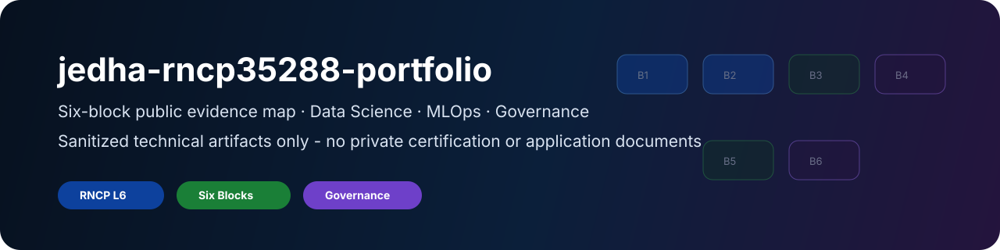

# jedha-rncp35288-portfolio

<div align="center">



<br/>

**Public, sanitized technical evidence portfolio for the Jedha Data Science & AI certification track**

RNCP35288 (Level 6, six blocks) + RNCP38777 AI Architect (Level 7, four blocks) / Data Infrastructure / EDA / ML / NLP / MLOps / Governance / AI Architecture


</div>

---

## Executive summary

This repository is a public sanitized evidence portfolio for two Jedha certification tracks: the RNCP35288 Data Science track (Level 6, six blocks) and the RNCP38777 AI Architect track (Level 7, four blocks; renewed as RNCP41993).

It is designed to organize technical evidence without publishing private school documents, exam materials, grades, certificates with personal identifiers, CPF documents, contracts, invoices or application material.

The portfolio maps technical artifacts to ten competency blocks:

```text
RNCP35288 : data infrastructure -> EDA/statistics -> machine learning -> NLP/deep learning -> MLOps deployment -> project governance
RNCP38777 : data & AI governance -> AI data architecture -> data pipelines for AI -> AI solutions deployment
```

---

## Validation evidence

Generated validation artifacts are available in:

- [docs/local_run_report.md](docs/local_run_report.md)
- [docs/screenshots.md](docs/screenshots.md)
- [docs/VALIDATION.md](docs/VALIDATION.md)

Current public validation checks the core evidence files. Future hardening will also verify absence of private file extensions and forbidden private folders.

---

## Public-safety boundary

This repository must never contain:

- private Jedha course content;
- exam subjects or answers;
- grades;
- private certificates with identifiers;
- administrative PDFs;
- CPF files;
- contracts or invoices;
- CVs or cover letters;
- employer-specific applications;
- real banking, insurance, health, client or employer data;
- secrets, tokens or credentials.

Allowed:

- personal technical code;
- sanitized screenshots;
- synthetic or open datasets;
- architecture diagrams;
- model cards;
- data cards;
- runbooks;
- project governance documents;
- evidence index.

---

## Six-block evidence map — Data Science (RNCP35288)

| Block | Public evidence folder | Technical signal |
|---|---|---|
| Bloc 1 - Data infrastructure | `bloc_1_data_infrastructure/` | ingestion, SQL, schema, data quality, architecture |
| Bloc 2 - EDA / statistics | `bloc_2_eda_statistics/` | analysis, distributions, anomalies, hypothesis testing |
| Bloc 3 - Machine learning | `bloc_3_machine_learning/` | supervised/unsupervised ML, evaluation, explainability |
| Bloc 4 - NLP / deep learning | `bloc_4_nlp_deep_learning/` | text processing, document classification, GenAI foundations |
| Bloc 5 - Industrialization / MLOps | `bloc_5_mlops_deployment/` | API, Docker, MLflow, tests, monitoring |
| Bloc 6 - Project governance | `bloc_6_project_governance/` | project charter, risk register, model/data governance |

## Four-block evidence map — AI Architect (RNCP38777)

| Block | Public evidence folder | Technical signal |
|---|---|---|
| AIA Bloc 1 - Data & AI governance | `aia_bloc_1_data_ai_governance/` | asset and risk mapping, RACI, data contracts, RBAC/ABAC, GDPR and EU AI Act |
| AIA Bloc 2 - AI data architecture | `aia_bloc_2_ai_data_architecture/` | OLTP/OLAP/NoSQL design, sizing, Infrastructure as Code, resilience, FinOps |
| AIA Bloc 3 - Data pipelines for AI | `aia_bloc_3_data_pipelines_for_ai/` | batch/streaming flows, orchestration, data quality, privacy by design, observability |
| AIA Bloc 4 - AI solutions deployment | `aia_bloc_4_ai_solutions_deployment/` | CI/CD/CT, model registry, inference API, drift monitoring, retraining, model card |

---

## Relationship with the broader portfolio

This repository should reference, not duplicate, the technical repos:

| External repo | Related block |
|---|---|
| `banking-dataops-monitoring` | Bloc 1, Bloc 6 |
| `fraud-mlops-control-tower` | Bloc 3, Bloc 5, Bloc 6 |
| `database-migration-quality-lab` | Bloc 1, Bloc 6 |
| `secure-wealth-rag-assistant` | Bloc 4, Bloc 6 |
| `sovralys-infra-lab` | Bloc 1, Bloc 5 |
| `pty-flights-pricing` | Bloc 1, operational automation evidence |

---

## Repository structure

```text
jedha-rncp35288-portfolio/
|-- README.md
|-- PORTFOLIO.md
|-- LICENSE
|-- assets/
|-- docs/
|-- bloc_1_data_infrastructure/
|-- bloc_2_eda_statistics/
|-- bloc_3_machine_learning/
|-- bloc_4_nlp_deep_learning/
|-- bloc_5_mlops_deployment/
|-- bloc_6_project_governance/
|-- aia_bloc_1_data_ai_governance/
|-- aia_bloc_2_ai_data_architecture/
|-- aia_bloc_3_data_pipelines_for_ai/
`-- aia_bloc_4_ai_solutions_deployment/
```

---

## How to use this repo

1. Keep private school/admin documents outside GitHub.
2. Add only sanitized technical evidence.
3. Link to dedicated project repos when evidence belongs there.
4. Update `docs/evidence_index.md` after every added artifact.
5. Run public-safety review before every push.

---

## Non-goals

This repository is not:

- a dump of school files;
- a private certificate folder;
- a place for applications;
- a place for grades;
- a copy of Jedha course content;
- a production data/ML system.

---

## Portfolio signal

This repo proves structure, traceability and documentation discipline across the complete Data / MLOps certification track, while keeping sensitive material private.

---

## Portfolio layer

This repository is part of the KinSushi public technical portfolio.

| Layer | Evidence |
|---|---|
| Certification evidence | public sanitized ten-block evidence map: RNCP35288 (six blocks) and RNCP38777 (four blocks) |

Detailed cross-repository context: [docs/PORTFOLIO_LAYER.md](docs/PORTFOLIO_LAYER.md)

---

*Copyright © 2026 · Auteur — KinSushi · Enzo · Sovralys LLC*
