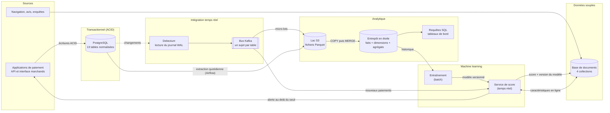
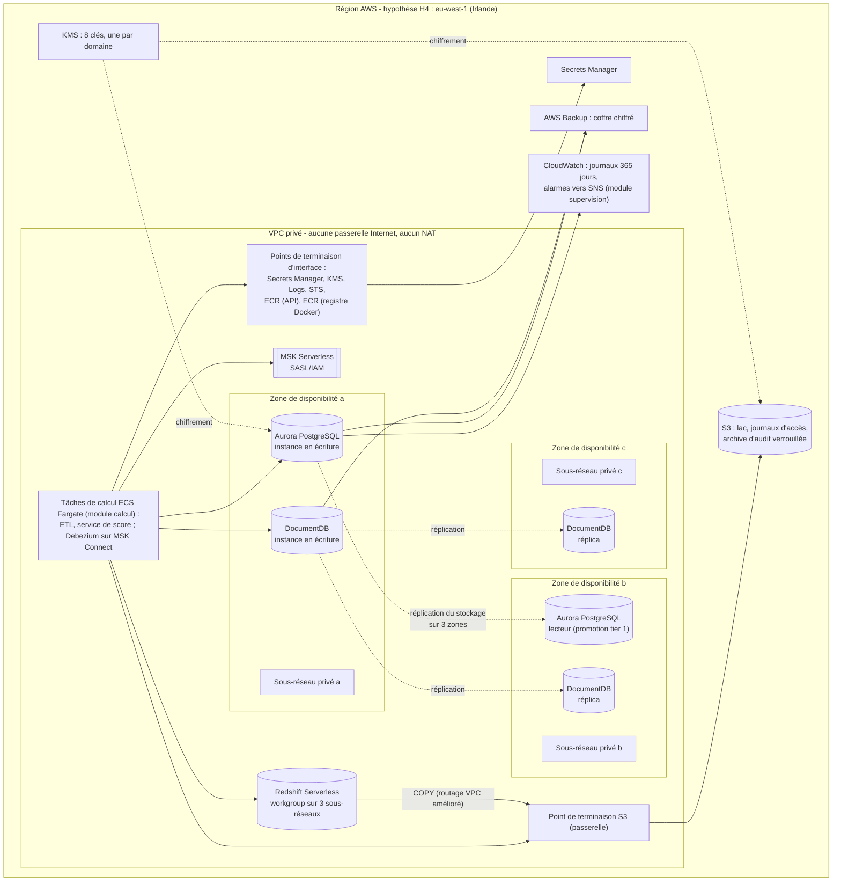

# 01 - Architecture globale : logique, physique, arbitrages

> Répond aux livrables 1 (diagramme d'architecture global) de l'énoncé et aux indicateurs 2.1, 2.2, 2.3, 2.4, 3.1, 3.2 et 3.3.
> Les valeurs précédées de « H » sont des hypothèses déclarées (registre : document 09).

## 1. Principes directeurs

1. **Chaque besoin a son moteur.** Les écritures financières exigent l'ACID (PostgreSQL) ; l'analytique exige un stockage en colonnes (entrepôt) ; les données souples exigent des documents (MongoDB) ; le lien entre ces mondes est un **flux de changements** (CDC), pas des copies manuelles.
2. **Une seule source de vérité par donnée.** Le client et le paiement vivent dans l'OLTP ; tout le reste en est dérivé et reconstructible.
3. **Idempotence partout.** Un message rejoué, un lot relancé, un `terraform apply` répété produisent le même état (tests : `test_cdc.py`, `test_generer_ddl.py`).
4. **Privé par défaut.** Aucun composant de données n'a d'adresse publique ni de route vers Internet.
5. **Le code décrit l'architecture.** Les schémas SQL et JavaScript sont générés depuis un modèle unique ; l'infrastructure est déclarée en Terraform ; ce document en explique les choix.

## 2. Architecture logique

**Description textuelle du diagramme.** Les applications écrivent dans PostgreSQL. Debezium lit le journal de transactions de PostgreSQL et publie chaque changement dans Kafka. Les changements sont déposés en fichiers Parquet dans le lac S3 (en micro-lots) et complétés par une extraction quotidienne ; l'entrepôt charge le lac. Les analystes interrogent l'entrepôt. Le modèle de fraude est entraîné sur l'entrepôt, puis le service de score note chaque nouveau paiement reçu de Kafka, en s'appuyant sur les caractéristiques en ligne de la base de documents, et y écrit son score. Au-delà du seuil, une alerte revient vers l'application.

Le tableau suivant nomme chaque composant logique, son rôle et sa réalisation dans le dépôt.

| Composant | Rôle | Réalisation |
|---|---|---|
| Base transactionnelle | Vérité des paiements, intégrité ACID | `modele_oltp.py` → `oltp_schema_postgresql.sql` ; Aurora PostgreSQL (Terraform) ; SQLite en démonstration autonome |
| Capture des changements | Publier chaque changement sans interroger les tables | `debezium_connecteur.json` ; déclencheurs SQLite + `journal_changements` en démonstration |
| Bus de messages | Découpler producteurs et consommateurs, conserver l'ordre par clé | MSK Serverless (Terraform) ; Redpanda en local (`docker-compose.yml`) |
| Lac de données | Mémoire longue, bon marché, rejouable | module `lac_s3` |
| Entrepôt | Analytique en colonnes | `olap_schema.sql` ; Redshift Serverless ; DuckDB en démonstration |
| Base de documents | Données souples, caractéristiques en ligne | `nosql/schemas/*.json` ; DocumentDB ou MongoDB ; mongomock en démonstration |
| Modèle de fraude | Détection par apprentissage | `fraude.py` |
| Orchestration | Séquencer le batch quotidien, relancer en cas d'échec | Airflow : DAG `stripe/dags/stripe_quotidien.py` (document 05 § 2), testé sans Airflow et chargé par Airflow 2.10.5 ; jamais exécuté par un ordonnanceur |

## 3. Architecture physique (production)

**Description textuelle du diagramme.** Dans une région de l'Union européenne, un réseau privé s'étend sur trois zones de disponibilité. Aurora place son instance en écriture dans la zone a et un lecteur dans la zone b ; DocumentDB répartit ses instances sur les trois zones. MSK Serverless et Redshift Serverless s'attachent aux sous-réseaux privés. Les tâches de calcul parlent aux bases, au bus et à l'entrepôt par le réseau interne, à S3 par un point de terminaison de type passerelle et aux services AWS (secrets, clés, journaux, jetons temporaires, registre d'images ECR) par des points de terminaison d'interface. Les tâches de calcul sont des conteneurs sans serveur (ECS sur Fargate) placés dans les sous-réseaux privés : le service de score ajuste son nombre de tâches au CPU entre un minimum et un maximum, l'ETL est lancé chaque jour par l'orchestrateur. Les sauvegardes vont dans un coffre AWS Backup ; les journaux, conservés douze mois, sont chiffrés par une clé KMS dédiée ; des alarmes CloudWatch préviennent l'astreinte par une rubrique SNS chiffrée.

Correspondance avec le code (`stripe/terraform/modules/`) :

| Élément du schéma | Module | Remarques |
|---|---|---|
| VPC, sous-réseaux, routes, groupes de sécurité, points de terminaison, journaux de flux | `reseau` | trois zones minimum (Redshift Serverless l'exige) |
| Aurora et ses lecteurs | `aurora_postgresql` | `promotion_tier` = rang d'instance ; une instance par zone |
| DocumentDB | `documentdb` | idem |
| MSK Serverless | `msk_serverless` | authentification IAM uniquement |
| Redshift Serverless | `redshift_serverless` | routage VPC amélioré, plafond de consommation |
| Buckets | `lac_s3` (3 buckets) fondé sur `bucket_s3` | lac, journaux d'accès, archive d'audit |
| Clés | `kms` | huit clés, rotation annuelle activée |
| Secrets | `secrets` | sel de pseudonymisation, compte Debezium |
| Droits | `iam` | six rôles (dont `score`), aucun joker |
| Sauvegardes | `sauvegarde` | AWS Backup |
| Tâches de calcul (ETL, service de score) | `calcul` | ECS sur Fargate ; autoscaling du score par suivi du CPU entre deux bornes (hypothèse H16) ; images désignées par leur empreinte ; déploiement progressif avec retour arrière automatique |
| Alarmes et notification | `supervision` | rubrique SNS chiffrée (clé `alertes`) ; alarmes : retard de l'emplacement de réplication, consommation de l'entrepôt, score sans tâche ; événements de basculement et de défaillance d'Aurora |

## 4. Topologies de calcul et de stockage

| Charge | Topologie de calcul | Stockage | Pourquoi cette distribution |
|---|---|---|---|
| Écritures de paiement | 1 instance en écriture, lecteurs en lecture seule | stockage Aurora partagé, répliqué sur 3 zones | les écritures sont sérialisées par un seul écrivain (cohérence) ; la lecture passe à l'échelle par les lecteurs |
| Capture des changements | 1 tâche de connecteur par base | décalage (offsets) conservé dans Kafka | un seul lecteur du WAL par emplacement de réplication, ordre garanti |
| Bus de messages | géré par le service (serverless) | rétention Kafka | pas de courtiers à dimensionner |
| Analytique | capacité élastique en RPU, bornée par `capacite_max_rpu` | stockage Redshift managé + lac S3 | séparation calcul / stockage : la charge d'analyse n'agit jamais sur l'OLTP |
| Documents | 1 écrivain + réplicas | stockage DocumentDB répliqué | lectures des caractéristiques en ligne réparties |
| Modèle de fraude | processeurs (CPU) ; aucun GPU | modèle en mémoire, données sur l'entrepôt | modèle d'arbres sur 6 variables : entraînement mesuré à 0,5 s sur 38 400 lignes ; un GPU n'apporterait rien (document 09) |
| Archive d'audit | stockage objet | S3 avec verrouillage (WORM) | preuve d'audit non modifiable |

## 5. Flux de données et temps réel

Le chemin chaud (paiement → score) ne traverse que l'OLTP, Kafka, le service de score et la base de documents. L'entrepôt est sur le chemin **tiède** (quelques minutes, hypothèse H9) et le lac sur le chemin **froid**. Le détail est au document 05.

## 6. Évolutivité (indicateur 2.4)

| Composant | Mécanisme | Sens | Déclencheur | Limite à connaître | État |
|---|---|---|---|---|---|
| Aurora | ajout de lecteurs ; changement de classe d'instance | horizontal (lectures) puis vertical (écritures) | CPU, connexions, retard de réplication | un seul écrivain ; au-delà, partitionner (document 02 § 7) | variable `nb_instances`, `classe_instance` |
| Paiements (table) | partitionnement par mois | - | volume de l'index chaud > mémoire | la clé primaire doit contenir la date ; clé d'idempotence à extraire (vérifié sur PostgreSQL 16) | décrit, non appliqué |
| MSK Serverless | capacité gérée par le service | horizontal automatique | débit | quotas du service | géré |
| Entrepôt | `capacite_base_rpu` → `capacite_max_rpu` | horizontal automatique | file d'attente de requêtes | plafond de coût `plafond_rpu_heures_mensuel` | variables Terraform |
| Lac S3 | stockage non borné, cycle de vie | - | - | coût de stockage | module `lac_s3` |
| DocumentDB | réplicas supplémentaires | horizontal (lectures) | CPU lecture | un seul écrivain | variable `nb_instances` |
| Notation de fraude | plusieurs tâches consommatrices d'un même groupe | horizontal | CPU moyen du service (codé) ; retard de consommation (lag) : recommandé, non codé | nombre de partitions du sujet | module `calcul` : `score_taches_min` à `score_taches_max` |

La linéarité du volume a été mesurée : stockage OLTP par paiement (index compris) et volume de journal de transactions sont des constantes par ligne (document 09), donc la croissance des volumes est prévisible.

## 7. Note d'arbitrage : coûts, performance, souveraineté, modèle de service

### 7.1 Choix par composant (indicateurs 3.1 et 3.3)

| Composant | Choix | Modèle de service | Alternatives étudiées | Raison du choix | Prix à payer |
|---|---|---|---|---|---|
| OLTP | Aurora PostgreSQL provisionné | PaaS | PostgreSQL sur serveurs virtuels (IaaS) ; RDS PostgreSQL ; Aurora Serverless v2 | stockage répliqué sur 3 zones, basculement géré, lecteurs, décodage logique pour Debezium | capacité payée même si inutilisée ; Serverless v2 serait plus souple pour une charge très variable |
| Bus | MSK Serverless | serverless | MSK provisionné ; Kinesis ; Kafka auto-hébergé (IaaS) | aucun courtier à patcher ni dimensionner ; API Kafka standard (portabilité vers Redpanda en local) | moins de réglages fins ; quotas du service |
| Entrepôt | Redshift Serverless | serverless | Redshift provisionné ; Snowflake (SaaS) ; requêtes directes sur le lac | facturation à l'usage, plafond de coût, intégration IAM/KMS/VPC | performance à valider par banc d'essai à l'échelle cible |
| Documents | DocumentDB | PaaS | MongoDB Atlas (SaaS) ; DynamoDB | compatibilité d'API MongoDB, dans le même VPC | sous-ensemble de MongoDB : `$jsonSchema` à confirmer (document 04) |
| Capture | Debezium (MSK Connect) | PaaS + logiciel libre | AWS DMS | lecture du WAL, format d'événement ouvert, sujets par table | un composant de plus à exploiter |
| Calcul applicatif | conteneurs sans serveur (Fargate) | serverless | EKS (IaaS/PaaS) ; Lambda | pas de nœuds à patcher, mémoire/CPU déclarés par tâche | module Terraform `calcul` (non déployé) |
| Modèle | scikit-learn dans le service de score | - | SageMaker | simplicité, latence en mémoire | pas de registre de modèles managé (recommandé : un registre) |

### 7.2 Coût et performance (indicateur 3.1)

- **Séparer OLTP et OLAP est le premier arbitrage coût/performance.** Une requête analytique sur la base transactionnelle prendrait des E/S, du CPU et du cache aux écritures de paiement, et un instantané long retarderait le nettoyage (vacuum). Les mesures le montrent côté OLTP : sur PostgreSQL 16 avec 48 000 paiements, la requête « 10 derniers paiements d'un client » lit 15 pages avec l'index composé `(id_client, cree_le)` et 756 pages sans (balayage séquentiel), soit environ 50 fois plus de lectures et 4,3 ms contre 0,12 ms (mesure unique, ordre de grandeur). Le balayage séquentiel croît avec le nombre de lignes alors que la recherche par index croît beaucoup plus lentement : l'écart augmente avec le volume (raisonnement, non mesuré à plus grande échelle).
- **Serverless contre provisionné** : le serverless supprime la sur-capacité des charges irrégulières (entrepôt, bus) ; le provisionné reste préférable pour une charge stable et soutenue (OLTP). Le critère de bascule est l'utilisation moyenne : à l'usage constant, la capacité réservée est en général moins chère que la capacité à la demande (à chiffrer avec la grille tarifaire de la région au moment de la décision, voir document 09 § 5.2).
- **Rétentions bornées** : événements 90 jours (index TTL), lac par classes de stockage, versions anciennes purgées. Elles réduisent le coût et l'exposition RGPD.

### 7.3 Souveraineté des données (indicateur 3.2)

| Exigence | Mesure |
|---|---|
| Données personnelles de l'Union européenne traitées dans l'Union | région UE unique (H4) ; aucune réplication inter-régions déclarée (choix assumé, document 10) |
| Maîtrise des clés | clés KMS gérées par le client, une par domaine, rotation annuelle ; la suppression d'une clé rend les données illisibles |
| Minimisation | e-mail haché, colonnes exclues du flux (`column.exclude.list`), TTL de 90 jours, aucun numéro de carte |
| Transferts hors UE | aucun transfert prévu ; tout recours à un sous-traitant hors UE exigerait un encadrement (RGPD, chapitre V) |
| Accès | IAM au moindre privilège, MFA pour les humains |

**Risque résiduel à signaler** : héberger en région UE chez un fournisseur dont la maison mère est soumise à un droit étranger n'élimine pas le risque d'une demande d'accès extraterritoriale. Atténuation : chiffrement avec clés du client, journalisation des usages de clés, et évaluation juridique par le DPO. Le plan de conformité complet est au document 06.

*Copyright © 2026 · voir le fichier LICENSE du dépôt*
