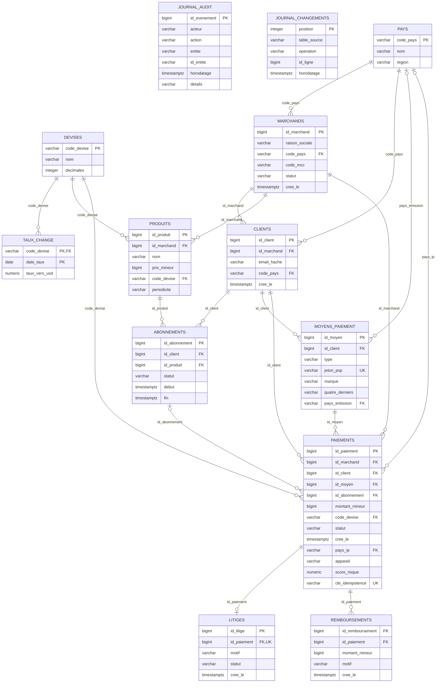
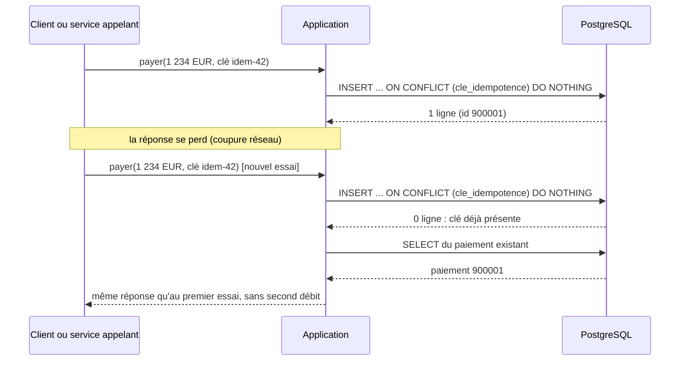
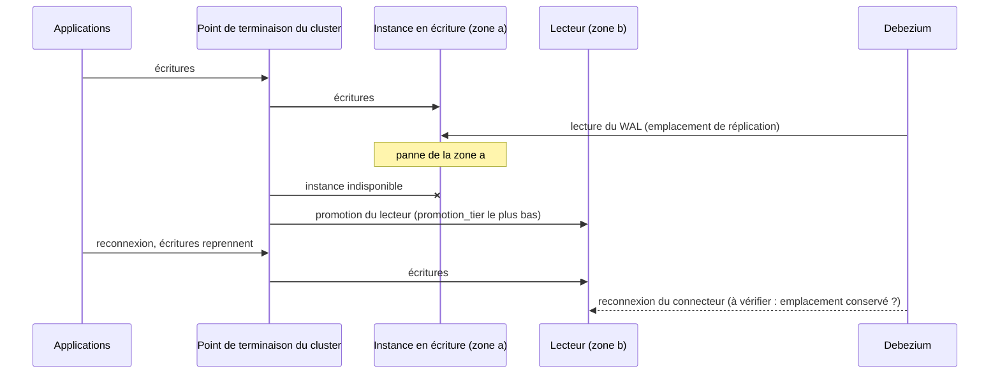

# 02 — Modèle transactionnel (OLTP) : ERD, ACID, réplication, bascule, partitionnement

> Répond au livrable 2 de l'énoncé (ERD OLTP) et aux indicateurs 6.1 et 6.2 pour la couche transactionnelle.
> Source de vérité du modèle : `stripe/stripe_demo/modele_oltp.py` (SQLAlchemy). Le DDL PostgreSQL est **généré** : `stripe/sql/oltp_schema_postgresql.sql`.

## 1. Diagramme entité-relation



**Description textuelle du diagramme.** Treize tables. Les référentiels (`pays`, `devises`, `taux_change`) sont rattachés aux entités métier. Un **marchand** possède des **clients** et des **produits**. Un client possède des **moyens de paiement** et des **abonnements**. Un **paiement** relie un marchand, un client, un moyen de paiement, éventuellement un abonnement, une devise et un pays d'IP. Un paiement a au plus un **litige** et un nombre quelconque de **remboursements**. Deux tables sont techniques : `journal_audit` (preuve d'audit) et `journal_changements` (journal d'« outbox » de la démonstration).

Chiffres vérifiables : 13 tables, 74 colonnes, 18 clés étrangères, 7 contraintes `CHECK`, 3 contraintes d'unicité hors clés primaires (`jeton_psp`, `cle_idempotence`, `litiges.id_paiement`).

## 2. Choix de modélisation

| Choix | Raison | Garantie vérifiée par |
|---|---|---|
| Troisième forme normale : une table par entité, référentiels séparés | aucune donnée répétée, donc aucune incohérence à réconcilier | relecture du modèle |
| Montants en **unités mineures entières** (`montant_mineur BIGINT`) et devise séparée | pas d'arrondi flottant sur de l'argent | `ck_paiement_montant` (> 0) |
| **Aucun numéro de carte** : jeton du prestataire (`jeton_psp`, unique) + 4 derniers chiffres | sortir la plateforme du périmètre le plus lourd du PCI-DSS | `test_aucune_colonne_ne_peut_porter_un_numero_de_carte` |
| E-mail **haché** (SHA-256 salé, 64 hexadécimaux) | pseudonymisation (RGPD) ; le sel est un secret (module `secrets`) | `test_courriel_pseudonymise` |
| `cle_idempotence` **unique** sur les paiements | un paiement rejoué après coupure n'est pas débité deux fois | `test_cle_d_idempotence_unique_empeche_le_double_debit` ; vérifié aussi sur PostgreSQL 16 |
| Domaines de valeurs en `CHECK` (statuts, appareil, type de moyen) | la base refuse l'incohérence même si l'application ou un import la produit | `test_check_refuse_les_valeurs_hors_domaine` |
| Un seul litige par paiement (`UNIQUE`) | règle métier portée par le schéma | `test_un_seul_litige_par_paiement` |
| Colonnes d'identité (`GENERATED BY DEFAULT AS IDENTITY`) dans le DDL PostgreSQL | l'`INSERT` suffit, sans droit séparé sur une séquence (moindre privilège) | DDL appliqué sur PostgreSQL 16 |

Le **score de risque** (`paiements.score_risque`) est dénormalisé à dessein : il est lisible sans jointure par le service de score, et la version du modèle est tracée dans la base de documents (`signaux_fraude`).

## 3. Propriétés ACID : ce qui les garantit

| Propriété | Mécanisme | Preuve |
|---|---|---|
| **Atomicité** | transaction : tout ou rien (`BEGIN … COMMIT`) | `test_rollback_atomique` : si la seconde insertion viole une contrainte, la première est annulée |
| **Cohérence** | clés étrangères, `CHECK`, `UNIQUE` évalués par le moteur | 11 cas de refus et 1 test d'atomicité dans `test_oltp_contraintes.py` ; mêmes refus constatés sur PostgreSQL 16 (`test_postgres_docker.py`) |
| **Isolation** | niveau par défaut de PostgreSQL, *read committed* ; l'unicité de la clé d'idempotence sert d'arbitre entre deux requêtes concurrentes | comportement documenté de PostgreSQL ; aucun test de concurrence n'a été écrit (limite assumée) |
| **Durabilité** | journal de transactions (WAL) écrit avant l'acquittement ; sur Aurora, écriture sur un quorum de copies réparties sur trois zones | documentation du service ; non testé ici |

**Motif d'écriture idempotente** (exécuté sur PostgreSQL 16 : la seconde tentative ne retourne aucune ligne, et une seule ligne subsiste) :

```sql
INSERT INTO paiements (id_paiement, id_marchand, id_client, id_moyen, montant_mineur,
                       code_devise, statut, cree_le, appareil, cle_idempotence)
VALUES (…)
ON CONFLICT (cle_idempotence) DO NOTHING
RETURNING id_paiement;   -- aucune ligne retournée = déjà traité : relire le paiement existant
```



**Description textuelle.** Le client rejoue sa demande avec la même clé d'idempotence. La base refuse silencieusement la seconde insertion ; l'application relit le paiement existant et renvoie la même réponse. Le débit n'a lieu qu'une fois.

## 4. Réplication et haute disponibilité (indicateur 6.2)

**Architecture (Aurora PostgreSQL, `modules/aurora_postgresql`)** : le stockage est partagé et répliqué sur trois zones de disponibilité ; l'instance en écriture et les lecteurs lisent le même volume. Il n'y a donc pas de copie de fichiers entre instances : la réplication se fait au niveau du stockage, et un lecteur peut être promu sans rejouer de journal.

| Élément | Réglage Terraform | Effet |
|---|---|---|
| Instances | `nb_instances` (2 en prod, 1 en dev), une par zone (`availability_zone`) | un candidat à la promotion existe dans une autre zone que l'écrivain |
| Ordre de promotion | `promotion_tier = rang de l'instance` | le premier lecteur est promu en premier |
| Suppression | `deletion_protection = true` en prod ; instantané final exigé | une erreur d'opérateur ne détruit pas le cluster |
| Sauvegardes | rétention 35 jours en prod, coffre AWS Backup en plus | restauration à un instant donné |
| TLS, IAM | `rds.force_ssl = 1`, authentification IAM | voir document 06 |



**Description textuelle.** Si la zone de l'écrivain tombe, le service promeut le lecteur d'une autre zone et le point de terminaison du cluster pointe vers lui ; les applications se reconnectent. Le connecteur Debezium doit se reconnecter à la nouvelle instance en écriture.

**Point non vérifié** : le comportement de l'emplacement de réplication logique de Debezium après une bascule Aurora n'a pas été testé (pas de compte AWS). La procédure du document 10 (§ 3, panne « bascule Aurora ») prévoit de le contrôler et de relancer le connecteur ; à tester en préproduction avant la mise en production.

**Lectures** : les lectures qui tolèrent un léger retard (tableaux de bord opérationnels, recherche d'historique) vont au point de terminaison des lecteurs ; une lecture qui doit voir une écriture qui vient d'avoir lieu reste sur l'écrivain.

## 5. Bascule et objectifs de reprise (hypothèse H5)

| Scénario | Objectif de reprise (RTO) | Perte de données admise (RPO) | Mécanisme | Statut |
|---|---|---|---|---|
| Panne d'une instance ou d'une zone | 15 minutes | quasi nulle (écriture par quorum sur trois zones) | promotion d'un lecteur | **hypothèse H5** ; durée réelle de bascule à mesurer en préproduction |
| Erreur humaine (suppression, mauvaise migration) | quelques heures | jusqu'au dernier point de restauration | restauration à un instant donné dans un **nouveau** cluster, puis bascule des applications | hypothèse H5 |
| Perte de la région | non couverte | — | pas de réplication inter-régions | risque résiduel assumé (document 10 § 5) |

## 6. Indexation : mesures sur PostgreSQL 16

Données : 48 000 paiements synthétiques (`stripe_demo.mesures`). Requête : les 10 derniers paiements d'un client.

| Cas | Plan | Pages lues | Temps d'exécution |
|---|---|---|---|
| Avec `ix_paiements_client_date (id_client, cree_le)` | parcours d'index à rebours, aucun tri | 15 | 0,122 ms |
| Index supprimé (annulé ensuite) | balayage séquentiel + tri partiel | 756 | 4,345 ms |
| Recherche par `cle_idempotence` | parcours d'index seul sur l'unicité | 4 | 0,047 ms |

Mesure unique sur un poste de travail : ordre de grandeur, pas une performance garantie.
Taille mesurée de la table `paiements` : 6 168 576 octets de données et 8 126 464 octets d'index pour 48 000 lignes, soit environ 298 octets par paiement, index compris. L'index pèse plus que les données : chaque index supplémentaire doit être justifié par une requête réelle.

## 7. Partitionnement

**Pourquoi partitionner** : borner la taille des index chauds, purger ou archiver par mois sans `DELETE` massif, faciliter les opérations de maintenance. Critère de déclenchement proposé : l'index du dernier mois ne tient plus dans la mémoire de l'instance (voir le calcul dans le document 09 : environ 4,8 Gio pour un million de paiements par jour, **sous hypothèse H1**).

**Pourquoi ce n'est pas appliqué aujourd'hui** : le partitionnement natif de PostgreSQL impose des contraintes qui cassent le modèle actuel. Elles ont été **vérifiées sur PostgreSQL 16** :

1. Une clé primaire ou une contrainte d'unicité d'une table partitionnée doit contenir la clé de partition. Résultat constaté : `ERROR: unique constraint on partitioned table must include all partitioning columns`.
2. La **clé d'idempotence ne peut donc plus être unique globalement** : il faut l'extraire dans une table non partitionnée `cles_idempotence (cle PRIMARY KEY, id_paiement, cree_le)` écrite dans la même transaction (comportement vérifié : un doublon est refusé).
3. Les tables `remboursements` et `litiges` ne peuvent plus référencer `paiements(id_paiement)` seul : `ERROR: there is no unique constraint matching given keys for referenced table`. Il faut ajouter `cree_le` à leurs clés étrangères.
4. L'élagage des partitions fonctionne : la requête d'un jour ne lit que la partition du mois concerné (plan constaté).

```sql
CREATE TABLE paiements_p (
    id_paiement BIGINT GENERATED BY DEFAULT AS IDENTITY NOT NULL,
    -- … mêmes colonnes que paiements …
    cree_le TIMESTAMPTZ NOT NULL,
    PRIMARY KEY (id_paiement, cree_le)
) PARTITION BY RANGE (cree_le);
CREATE TABLE paiements_p_2026_08 PARTITION OF paiements_p
    FOR VALUES FROM ('2026-08-01') TO ('2026-09-01');
CREATE TABLE paiements_p_defaut PARTITION OF paiements_p DEFAULT;  -- filet de sécurité
```

**Procédure de migration sans interruption (expand / contract)** : (1) créer la table partitionnée et `cles_idempotence` ; (2) écrire dans les deux tables (double écriture applicative) ; (3) recopier l'historique par tranches ; (4) basculer les lectures ; (5) retirer l'ancienne table après une période d'observation. Chaque étape est réversible jusqu'à la dernière. Le détail opérationnel est au document 10 § 6.

## 8. Rôles et droits dans la base (moindre privilège)

Définis dans le DDL généré et testés sur PostgreSQL 16 :

| Rôle (sans connexion) | Droits | Comptes de service qui en héritent |
|---|---|---|
| `role_application` | `SELECT`, `INSERT` sur les tables métier, `INSERT` sur `journal_audit` ; `UPDATE` limité à des colonnes (`paiements.statut`, `paiements.score_risque`, `statut` des marchands, litiges, abonnements ; `clients.email_hache` et `code_pays` pour l'effacement et la rectification) ; **aucun** `DELETE` | `svc_application` |
| `role_cdc` | `SELECT` sur les 8 tables capturées ; droit de réplication | `svc_debezium` |
| `role_extraction` | `SELECT` sur les 8 tables métier et les référentiels | `svc_extraction` (rôle IAM `etl`) |
| `role_audit` | `SELECT` sur `journal_audit` | — |

Constats vérifiés : `UPDATE paiements SET montant_mineur = …` et `DELETE FROM paiements` sont refusés au compte applicatif (`permission denied`) ; `UPDATE`, `DELETE` et `TRUNCATE` sur `journal_audit` sont refusés par déclencheur pour tout le monde (le propriétaire pourrait supprimer le déclencheur : la copie dans l'archive S3 verrouillée comble ce point, document 06).

## 9. Démonstration autonome et production : les écarts

| Sujet | Démonstration (SQLite) | Production (PostgreSQL / Aurora) |
|---|---|---|
| Moteur | SQLite, clés étrangères activées par `PRAGMA` | PostgreSQL 16 ; contraintes toujours actives |
| Capture des changements | déclencheurs → `journal_changements` | Debezium lit le WAL ; la table d'« outbox » reste vide |
| Identifiants | entiers imposés par le générateur | colonnes d'identité |
| Types | `DATETIME`, `NUMERIC` souples | `TIMESTAMPTZ`, `NUMERIC(p, s)` stricts |
| Droits | aucun | rôles et comptes de service |

## 10. Vérifications effectuées

```text
pytest tests/test_oltp_contraintes.py   -> 17 tests, contraintes OLTP (SQLite)
STRIPE_TESTS_DOCKER=1 pytest tests/test_postgres_docker.py -> 5 tests sur PostgreSQL 16 (conteneur jetable)
python -m stripe_demo.generer_ddl --verifier   -> le DDL versionné est à jour
```

*Copyright © 2026 · voir le fichier LICENSE du dépôt*
