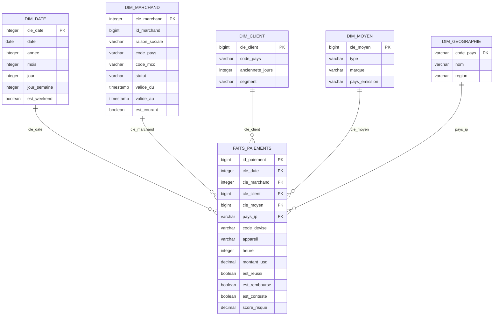
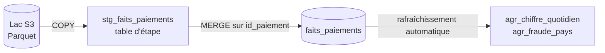

# 03 - Entrepôt analytique (OLAP) : schéma en étoile, agrégats, optimisation

> Répond au livrable 3 de l'énoncé (schéma OLAP : étoile ou flocon, agrégations, optimisation).
> Spécification unique : `TABLES_OLAP` dans `stripe/stripe_demo/generer_ddl.py` → `stripe/sql/olap_schema.sql` (Redshift) ; version DuckDB de la démonstration : `stripe/stripe_demo/olap.py`.

## 1. Schéma en étoile

**Description textuelle du diagramme.** Au centre, la table de faits `faits_paiements`, d'**une ligne par paiement**. Autour, cinq dimensions : date, marchand, client, moyen de paiement et géographie. Chaque fait porte les clés étrangères vers les dimensions, des mesures numériques (`montant_usd`, `score_risque`) et des indicateurs booléens (`est_reussi`, `est_rembourse`, `est_conteste`).

**Grain** : un paiement. Tout ce qui s'agrège (somme, moyenne, comptage) le fait à partir de ce grain, ce qui évite les doubles comptages.

| Table | Contenu | Particularités |
|---|---|---|
| `dim_date` | un jour du calendrier : année, mois, jour, jour de semaine, week-end | clé entière `AAAAMMJJ` ; alimentée par les jours présents dans les paiements, **y compris ceux qui arrivent par la CDC** |
| `dim_marchand` | marchand, pays, catégorie d'activité (MCC), statut | dimension **historisée de type 2** : `valide_du`, `valide_au`, `est_courant` |
| `dim_client` | pays, ancienneté, segment (occasionnel, régulier, fidèle) | pas d'e-mail ni de donnée directement identifiante |
| `dim_moyen` | type (carte, SEPA, portefeuille), marque, pays d'émission | jamais de numéro de carte |
| `dim_geographie` | pays, nom, région | référentiel |
| `faits_paiements` | mesures et indicateurs | `montant_usd` converti au taux du jour du paiement |

## 2. Mesures : additives ou non

| Mesure | Nature | Agrégation correcte |
|---|---|---|
| `montant_usd` | additive | somme (filtrée sur `est_reussi` pour le chiffre d'affaires) |
| `est_reussi`, `est_rembourse`, `est_conteste` | indicateurs 0/1, additifs | somme = nombre ; moyenne = taux |
| `score_risque` | **non additive** | moyenne, quantile ; jamais de somme |
| `heure` | attribut du fait (dimension dégénérée) | regroupement par tranche |

Le **taux de change** est figé au moment du chargement (taux du jour du paiement) : les faits ne bougent plus quand le taux change le lendemain, ce qui rend les rapports reproductibles.

## 3. Historisation (type 2) : état réel

La table `dim_marchand` possède les colonnes de type 2. **Dans la démonstration, aucun changement de marchand n'est traité** : toutes les lignes sont chargées comme courantes (`est_courant = vrai`, `valide_au` vide), ce que vérifie `test_dimensions_coherentes`. En production, le traitement attendu quand un marchand change de statut (événement CDC sur `marchands`) est :

1. fermer la version courante (`valide_au = horodatage de l'événement`, `est_courant = faux`) ;
2. insérer la nouvelle version (`valide_du = horodatage`, `est_courant = vrai`) ;
3. rattacher les **nouveaux** faits à la nouvelle clé de substitution, les anciens gardant l'ancienne.

C'est une limite connue de la démonstration, non une fonctionnalité réalisée.

## 4. Agrégats pré-calculés

Les tableaux de bord lisent quelques milliers de lignes d'agrégats au lieu de balayer tous les faits.

| Agrégat | Grain | Colonnes |
|---|---|---|
| `agr_chiffre_quotidien` | (jour, marchand) | nombre de paiements, chiffre d'affaires USD (réussis), taux de remboursement |
| `agr_fraude_pays` | pays de l'adresse IP | nombre de paiements, taux de litige |

En production ce sont des **vues matérialisées** à rafraîchissement automatique (`CREATE MATERIALIZED VIEW … AUTO REFRESH YES`) ; en démonstration, des tables reconstruites après chaque chargement. Le SQL de production évite `FILTER (WHERE …)` au profit de `SUM(CASE WHEN … THEN … END)`, équivalent plus portable.

**Cohérence démontrée par les tests** (`tests/test_olap.py`) :

- aucun paiement perdu ni créé entre l'OLTP et l'entrepôt ;
- chaque montant en USD = montant en unités mineures ÷ 100 × taux du jour (25 paiements recalculés un à un) ;
- somme des agrégats = somme des faits ; chaque couple (jour, marchand) égal à son recalcul ;
- le DDL portable livré, chargé des mêmes données dans DuckDB, redonne les mêmes agrégats (à l'arrondi près des montants en `DECIMAL(18,4)`) ;
- aucune clé orpheline vers `dim_date`, `dim_marchand`, `dim_client`, `dim_moyen`.

**Défaut trouvé et corrigé pendant la rédaction des tests** : un paiement reçu par la CDC un jour absent de `dim_date` avait une clé de date orpheline et disparaissait de tous les agrégats (jointure interne). Dans la démonstration d'origine, cela retirait les paiements du dernier jour de flux des totaux mensuels. Correction : `inserer_faits` ajoute d'abord les jours manquants à `dim_date` (`stripe/stripe_demo/olap.py`). Le test `test_les_agregats_suivent_la_cdc` protège ce point.

## 5. Étoile ou flocon ?

| Critère | Étoile (retenue) | Flocon |
|---|---|---|
| Jointures par requête | une par dimension | plusieurs niveaux |
| Lisibilité pour l'analyste | simple | plus complexe |
| Redondance | modérée (pays répété dans les dimensions) | aucune |
| Mise à jour | simple pour des dimensions petites | utile si une dimension est très volumineuse ou change souvent |

Choix : **étoile**. Les dimensions sont petites devant les faits, et la redondance (code pays, catégorie) est sans conséquence sur le volume. `dim_geographie` reste séparée car elle sert à la fois de dimension du pays d'IP du paiement et de référentiel : c'est le seul « début de flocon » du modèle. Un vrai flocon se justifierait pour une dimension produit hiérarchique (catégorie → famille → produit), absente de ce périmètre.

## 6. Optimisation (Redshift)

| Technique | Mise en œuvre dans `olap_schema.sql` | Effet attendu |
|---|---|---|
| Distribution par clé | `faits_paiements` et `dim_client` : `DISTKEY (cle_client)` | la jointure faits ↔ clients se fait localement, sans redistribution de données |
| Distribution « ALL » | petites dimensions (`dim_date`, `dim_geographie`, `dim_marchand`) | copiées sur chaque nœud : jointures sans transfert |
| Distribution automatique | `dim_moyen` : `DISTSTYLE AUTO` | choix laissé au service, la clé `cle_client` étant déjà prise par la dimension client |
| Clé de tri | `SORTKEY (cle_date)` sur les faits | les requêtes bornées par période n'ouvrent que les blocs concernés |
| Compression | automatique (comportement par défaut) | moins d'octets lus |
| Agrégats | vues matérialisées | requêtes de tableau de bord instantanées |
| Garde-fous | durée maximale de requête, plafond mensuel de RPU, routage VPC amélioré | pas de requête folle, coût borné, trafic COPY/UNLOAD hors Internet |

Ces choix sont **raisonnés, non mesurés** : le DDL Redshift n'a pas été exécuté (pas de compte AWS). Le premier réglage à valider sur données réelles est la clé de distribution, en observant le plan d'exécution des sept requêtes du document 08.

## 7. Chargement

**Description textuelle.** Les fichiers du lac sont copiés dans une table d'étape, puis fusionnés dans la table de faits sur la clé `id_paiement` ; les agrégats se rafraîchissent d'eux-mêmes. Rejouer un lot remplace les mêmes lignes : aucun doublon (équivalent de `INSERT OR REPLACE` de la démonstration).

La procédure `MERGE` est fournie, en commentaire, dans `olap_schema.sql` (`_merge_faits()` la génère pour toutes les colonnes).

## 8. Mesures

| Mesure | Valeur | Source |
|---|---|---|
| Faits chargés | 48 000 au chargement batch, 49 000 après les 5 micro-lots CDC | `donnees/resultats_demo.json` |
| Fichier DuckDB de la démonstration | 4 730 880 octets | `donnees/mesures_demo.json` |
| Même table de faits en Parquet | 897 258 octets, soit 18,3 octets par fait | idem |
| Chargement batch de 48 000 faits | 0,2 s (une exécution locale) | journal de la démonstration |

La taille DuckDB n'est pas comparable à celle de PostgreSQL (moteurs et colonnes différents) ; le Parquet sert de base à la prévision du lac (document 09).

## 9. Écarts entre la démonstration et la production

- Les montants sont des `DOUBLE` dans DuckDB et des `DECIMAL(18,4)` dans le DDL Redshift (exactitude des sommes).
- L'ancienneté des clients est calculée par rapport à une date fixe (30 septembre 2026) dans la démonstration ; en production, par rapport à la date de chargement.
- Le DDL Redshift utilise des clés primaires et étrangères **informatives** : Redshift ne les vérifie pas. L'unicité repose sur le `MERGE`.

*Copyright © 2026 · Auteur : KinSushi · Enzo · Sovralys LLC*
