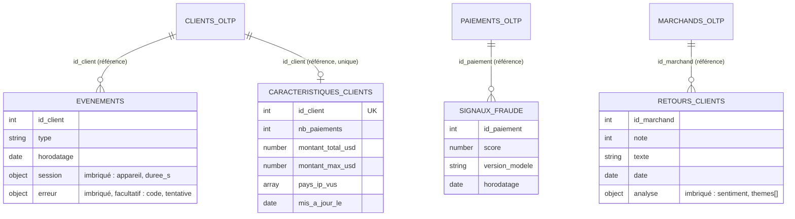

# 04 - Modèle NoSQL (documents) : embedding, referencing, index, validation

> Répond au livrable 4 de l'énoncé (modèle NoSQL : embedding / referencing, index).
> Sources : `stripe/stripe_demo/nosql.py` (comportement), `stripe/nosql/schemas/*.json` (validateurs), `stripe/nosql/creer_collections.js` (généré), `stripe/nosql/requetes_mongo.js`.

## 1. Quatre collections



**Description textuelle du diagramme.** Chaque collection fait référence à une entité de l'OLTP par son identifiant (`id_client`, `id_paiement`, `id_marchand`) : l'OLTP reste la source de vérité. Les événements et les retours clients contiennent des sous-documents imbriqués (`session`, `erreur`, `analyse`). Les caractéristiques en ligne ont un document unique par client.

| Collection | Rôle | Écrivain | Lecteur |
|---|---|---|---|
| `evenements` | parcours de navigation et de paiement, un document par événement | applications | analyse des abandons, erreurs de paiement |
| `retours_clients` | avis et réponses aux enquêtes, avec analyse (sentiment, thèmes) | collecte d'avis | équipes marchands, produit |
| `caracteristiques_clients` | magasin de caractéristiques « en ligne » du score de fraude | service de score | service de score |
| `signaux_fraude` | score de chaque paiement et version du modèle qui l'a produit | service de score | support, audit, suivi du modèle |

## 2. Imbriquer ou référencer ?

Règle appliquée : **imbriquer** ce qui est lu avec son parent, en quantité bornée et de même cycle de vie ; **référencer** ce qui vit seul, croît sans borne ou appartient à une autre source de vérité.

| Relation | Décision | Raison | Contre-partie | Quand reconsidérer |
|---|---|---|---|---|
| `session` dans `evenements` | **imbriqué** | toujours lue avec l'événement, 1 pour 1 | document un peu plus gros | jamais : cardinalité fixe |
| `erreur` dans `evenements` | **imbriqué, facultatif** | n'existe que pour les erreurs ; schéma souple | champ absent pour 3 types d'événements sur 4 | si l'erreur acquiert un cycle de vie propre |
| `analyse` (sentiment, thèmes) dans `retours_clients` | **imbriqué** | produite et lue avec l'avis ; thèmes bornés (1 à 5, imposé par le validateur) | mise à jour de l'analyse = réécriture du document | si l'analyse est recalculée souvent par un autre service |
| `caracteristiques_clients` → client | **référencé** (`id_client`, unique) | le client appartient à l'OLTP ; ces compteurs sont écrits à chaque paiement par un autre service | une recherche de plus pour avoir le client complet | jamais : l'OLTP reste la vérité |
| `signaux_fraude` → paiement | **référencé** (`id_paiement`) | le paiement est dans l'OLTP ; plusieurs scores possibles par paiement (nouvelle version du modèle) | pas de jointure native : l'application fait le rapprochement | si un seul score par paiement devenait la règle |
| `pays_ip_vus` (tableau) dans les caractéristiques | **imbriqué** | ensemble borné par le nombre de pays (codes ISO) | tableau qui peut grossir | borner la taille si on y stocke autre chose que des codes pays |

## 3. Exemples de documents (produits par les générateurs de la démonstration)

Événement d'erreur de paiement :

```json
{
  "id_client": 594, "type": "erreur_paiement", "horodatage": "2026-09-20T01:48:00",
  "session": {"appareil": "mobile", "duree_s": 558},
  "erreur": {"code": "card_declined", "tentative": 3}
}
```

Retour client (le texte est un texte de démonstration) :

```json
{
  "id_marchand": 29, "note": 5, "texte": "avis de démonstration", "date": "2026-09-28T00:00:00",
  "analyse": {"sentiment": "positif", "themes": ["litige", "integration"]}
}
```

Caractéristiques d'un client après deux paiements (25,5 USD en France puis 80 USD aux États-Unis) :

```json
{
  "id_client": 42, "nb_paiements": 2, "montant_total_usd": 105.5,
  "pays_ip_vus": ["FR", "US"], "montant_max_usd": 80.0,
  "mis_a_jour_le": "2026-10-11T02:24:05"
}
```

## 4. Index

| Collection | Index | Sert à | Origine |
|---|---|---|---|
| `evenements` | `{id_client: 1, horodatage: -1}` | historique récent d'un client : égalité sur `id_client`, puis tri décroissant déjà ordonné (règle égalité-tri-intervalle) | démonstration |
| `evenements` | `{horodatage: 1}` avec `expireAfterSeconds: 7776000` | **suppression automatique après 90 jours** (minimisation RGPD) | démonstration |
| `caracteristiques_clients` | `{id_client: 1}` **unique** | un seul document par client ; `upsert` atomique sans doublon | démonstration |
| `signaux_fraude` | `{score: -1}` | lister les paiements les plus suspects | démonstration |
| `signaux_fraude` | `{id_paiement: 1}` | retrouver le score d'un paiement | ajout pour la production |
| `retours_clients` | `{id_marchand: 1, date: -1}` | avis récents d'un marchand | ajout pour la production |

7 776 000 s = 90 × 24 × 3 600 s. Les trois pipelines d'agrégation de la démonstration (document 08) balaient les collections : acceptable sur 90 jours de rétention et un volume de démonstration, à exécuter sur un réplica ou sur l'entrepôt en production. Un index partiel (par exemple sur `type = "erreur_paiement"`) serait la première optimisation si l'un d'eux devenait fréquent ; **non mesuré** (la démonstration utilise `mongomock`, qui ne produit pas de plans d'exécution).

## 5. Validation des documents

Les schémas `$jsonSchema` imposent : champs obligatoires, types (`date`, entiers, nombres), bornes (`note` de 1 à 5, `score` de 0 à 1), énumérations (types d'événements, sentiments, thèmes), motif des codes pays (`^[A-Z]{2}$`), et la présence du sous-document `erreur` quand le type vaut `erreur_paiement`. Les champs supplémentaires restent permis (`additionalProperties: true`) : c'est ce qui donne la **souplesse** du schéma tout en protégeant le noyau.

- Installation : `mongosh … nosql/creer_collections.js` crée chaque collection avec `validationLevel: "strict"` et `validationAction: "error"` (document invalide refusé), ou met à jour le validateur d'une collection existante (`collMod`). Le script est généré à partir des fichiers JSON : impossible qu'ils divergent (test).
- Côté application : `stripe_demo/validation_mongo.py` applique les **mêmes** schémas en Python (`erreurs(collection, document)`). Il sert de filet de sécurité si le service cible ne prend pas en charge les validateurs.
- **Point à confirmer** : Amazon DocumentDB est compatible avec l'API MongoDB mais n'en implémente qu'un sous-ensemble. La prise en charge de `$jsonSchema` (et de certains opérateurs d'agrégation) doit être confirmée dans la documentation du service avant le déploiement ; non vérifié ici. En local, MongoDB 7 est utilisé (`docker-compose.yml`).

## 6. Cohérence, atomicité, idempotence

- **Atomicité par document** : `findOneAndUpdate` avec `$inc`, `$addToSet`, `$max` et `upsert` est atomique pour un document ; deux paiements simultanés du même client ne perdent aucune mise à jour (testé : `test_mise_a_jour_des_caracteristiques_cumule_sans_perte`). Aucune transaction multi-documents n'est nécessaire.
- **Cohérence avec l'OLTP** : à terme (cohérence éventuelle). L'OLTP fait foi ; une caractéristique en retard n'affecte qu'une décision de score, jamais un solde.
- **Limite connue : `$inc` n'est pas idempotent.** Si un message Kafka est livré deux fois (livraison « au moins une fois »), `nb_paiements` est compté deux fois. La démonstration traite chaque paiement une seule fois, donc la limite n'apparaît pas. Parade prévue, **non implémentée** : mémoriser l'identifiant du dernier paiement traité par client et ne mettre à jour que si le nouvel identifiant est supérieur (`{id_client: X, dernier_id_paiement: {$lt: id}}`) ; l'ordre par clé de partition Kafka garantit qu'un client est traité dans l'ordre.
- **Lecture** : lectures des caractéristiques sur les réplicas ; l'écriture se fait sur l'écrivain.

## 7. Dimensionnement et évolution

- **Volume** : les événements dominent. Leur rétention de 90 jours borne le volume : N événements par jour × 90, quel que soit l'âge de la plateforme. Ordre de grandeur à établir avec l'hypothèse de trafic (document 09) ; aucune taille de document n'a été mesurée (limite).
- **Montée en charge** : ajouter des réplicas pour les lectures (variable `nb_instances` du module `documentdb`). Le partitionnement horizontal (sharding) n'est pas retenu à ce stade ; si nécessaire, `id_client` (valeur hachée) serait la clé naturelle, car presque toutes les requêtes opérationnelles filtrent sur le client.
- **Évolution du schéma** : les ajouts de champs ne cassent rien (`additionalProperties: true`) ; ajouter un champ `version_schema` aux nouveaux documents avant tout changement incompatible, puis resserrer le validateur avec `collMod` une fois les anciens documents migrés.

## 8. Vérifications

```text
pytest tests/test_nosql.py tests/test_schemas_mongo.py tests/test_requetes_mongo_js.py
```

- index, unicité, TTL de 90 jours ;
- trois pipelines sur de petits jeux écrits à la main dont la réponse est connue ;
- documents de la démonstration valides, 16 documents volontairement faux refusés ;
- scripts `.js` exécutés avec Node.js contre un simulateur : les pipelines envoyés sont ceux de `nosql.py`, au caractère près.

Non vérifié : exécution sur un vrai serveur MongoDB ou DocumentDB.

*Copyright © 2026 · voir le fichier LICENSE du dépôt*
