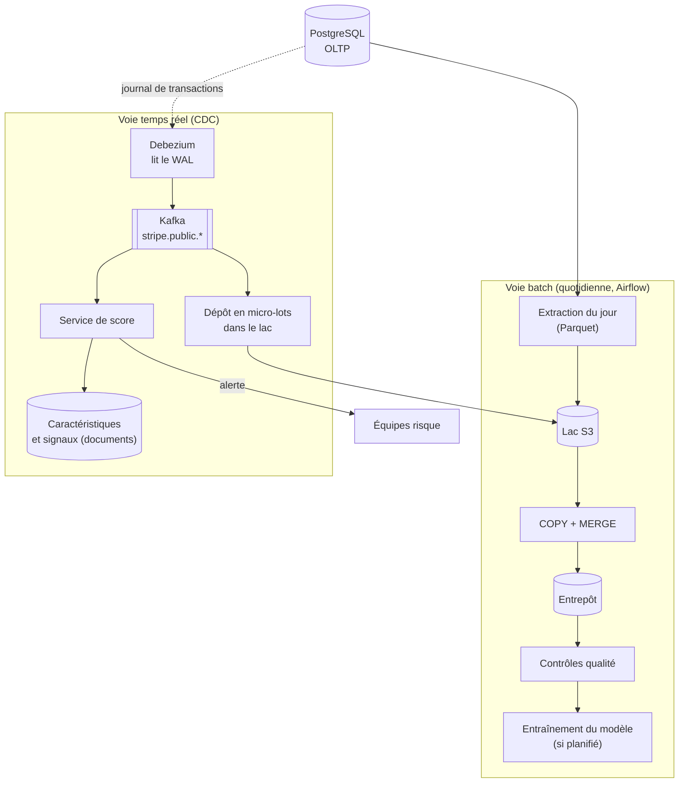
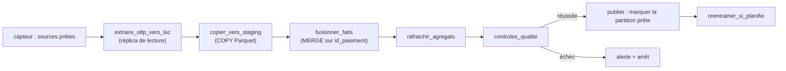
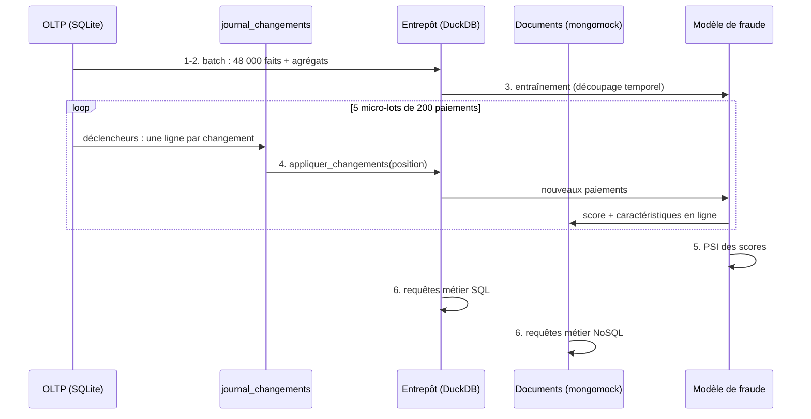

# 05 - Pipelines : batch, temps réel (CDC), cohérence et conflits

> Répond au livrable 5 de l'énoncé (architecture du pipeline) et au « plan du ou des pipelines » demandé par la plateforme.
> Code : `stripe/stripe_demo/pipeline.py` (démonstration autonome), `stripe/docker-compose.yml` et `stripe/deploiement/debezium_connecteur.json` (production locale).

## 1. Deux voies complémentaires



**Description textuelle du diagramme.** La voie batch extrait chaque jour les données de l'OLTP vers le lac, les charge dans l'entrepôt, vérifie leur cohérence et, selon le calendrier, réentraîne le modèle. La voie temps réel lit le journal de transactions avec Debezium, publie les changements dans Kafka, les dépose en micro-lots dans le lac et alimente le service de score, qui écrit dans la base de documents et lève des alertes. Le lac est le point de rencontre des deux voies.

Pourquoi deux voies : le temps réel donne la fraîcheur (alertes de fraude en secondes), le batch donne l'**exactitude** (une réconciliation complète du jour, qui corrige tout écart que la voie rapide aurait laissé). Si le flux manque un message, la reprise batch du lendemain rétablit la vérité.

## 2. Voie batch : DAG Airflow quotidien

Le DAG est **codé** dans `stripe/dags/stripe_quotidien.py` : les huit tâches ci-dessous, dans cet ordre. Chaque tâche est une fonction Python ordinaire, paramétrée par la date logique `ds`, qui peut être rejouée sans effet de bord ; Airflow n'est importé que pour assembler le graphe. Sur un poste, les tâches visent la démonstration (OLTP SQLite, entrepôt DuckDB, lac dans un dossier) et réutilisent ses fonctions (`olap.charger_batch`, `olap.construire_agregats`, `fraude.entrainer`) ; en production, les mêmes étapes visent Aurora, S3 et Redshift, et tournent dans la définition de tâche `etl` du module Terraform `calcul`.



**Description textuelle.** Le DAG enchaîne huit tâches : un capteur attend que les sources soient prêtes, puis l'extraction, la copie vers la table d'étape, la fusion dans les faits, le rafraîchissement des agrégats et les contrôles de qualité. Si les contrôles réussissent, la partition du jour est publiée (septième tâche) puis le modèle est éventuellement réentraîné (huitième tâche) ; sinon une alerte est levée et le DAG s'arrête.

| Tâche | Rôle | Idempotence | Reprise |
|---|---|---|---|
| `attendre_sources` | capteur : attend qu'au moins un paiement du jour soit présent dans l'OLTP (vérification toutes les 10 minutes, abandon après 6 heures : **hypothèses**) | lecture seule | automatique (mode `reschedule` : le capteur libère sa place entre deux vérifications) |
| `extraire_oltp_vers_lac` | écrit les paiements du jour en Parquet sous `s3://lac/paiements/ds=AAAA-MM-JJ/`, en lisant un **lecteur** Aurora | le fichier du jour est réécrit au même chemin | relancer la tâche |
| `copier_vers_staging` | `COPY` dans `stg_faits_paiements` (sur un poste : `stg_paiements`, recréée depuis le fichier Parquet du jour) | la table d'étape est vidée avant chaque chargement | relancer |
| `fusionner_faits` | `MERGE` sur `id_paiement` (voir `olap_schema.sql`) ; sur un poste, rechargement complet et transactionnel de l'étoile (`olap.charger_batch`) | rejouer remplace les mêmes lignes : aucun doublon (test `test_pas_de_doublon_de_cle_apres_plusieurs_rejeux` pour la logique équivalente) | relancer |
| `rafraichir_agregats` | vues matérialisées | recalcul déterministe | relancer |
| `controles_qualite` | mêmes invariants que `tests/test_olap.py` : faits du jour = paiements extraits dans la table d'étape, agrégats = faits, aucune clé orpheline ; un écart lève une exception : la tâche échoue et les suivantes ne partent pas | lecture seule | - |
| `publier_partition` | pose le marqueur `_PRET` dans `ds=AAAA-MM-JJ/` : les lecteurs du lac ne prennent que les partitions publiées | le marqueur est réécrit au même chemin | relancer |
| `reentrainer_si_planifie` | le jour prévu (le lundi : **hypothèse**), entraînement sur l'entrepôt, version du modèle incrémentée | en production, produit un nouveau modèle versionné, n'écrase pas l'ancien ; sur un poste, rend les mesures du modèle (pas de registre de modèles dans ce dépôt, document 07) | relancer |

Politique de nouvelle tentative, codée dans le DAG : 3 nouvelles tentatives à intervalle croissant (5 minutes, doublé à chaque fois), puis alerte par le rappel d'échec `signaler_echec` (une ligne ERROR « ALERTE » ; en production, la rubrique SNS du module Terraform `supervision`). Valeurs **hypothétiques**, à régler selon l'expérience d'exploitation.

Ce qui est vérifié, et comment :

- **sans Airflow** (`tests/test_dag_stripe_quotidien.py`) : analyse du fichier (Airflow n'est importé qu'à l'intérieur de `construire_dag` ou sous garde ; les huit tâches sont celles de ce tableau, dans le même ordre) ; la chaîne complète exécutée sur une mini-démonstration, puis rejouée sans doublon ; refus d'une date mal formée, d'une source absente, d'un fait perdu, d'agrégats périmés, d'une clé orpheline ; graphe des tâches construit avec un faux Airflow minimal (dépendances, paramètres, tentatives, rappel d'échec) ;
- **par Airflow 2.10.5** (environnement séparé, 19/10/2026) : le fichier est chargé sans erreur d'import, le graphe compte huit tâches enchaînées, chacune avec 3 tentatives à intervalle croissant et le rappel d'échec. DuckDB, absent de cet environnement, y était remplacé par un module vide : Airflow a construit le graphe, il n'a exécuté aucune tâche ;
- **non fait** : une exécution par l'ordonnanceur d'Airflow (`airflow dags test`), qui exige une base Airflow et DuckDB dans le même environnement.

## 3. Voie temps réel : capture des changements (CDC)

**Mécanisme.** PostgreSQL écrit chaque modification dans son journal de transactions (WAL). Avec `wal_level = logical`, ce journal peut être décodé ligne par ligne. Debezium se connecte par un **emplacement de réplication** (`debezium_stripe`) et la **publication** `stripe_cdc` (plugin `pgoutput`), puis publie chaque changement dans Kafka : un sujet par table, nommé `<topic.prefix>.<schéma>.<table>`, soit `stripe.public.paiements`, `stripe.public.litiges`, etc.

**Vérifié sur PostgreSQL 16** (conteneur jetable, `test_postgres_docker.py`) : après application du DDL livré, une insertion puis une mise à jour de paiement sont décodées par le journal. Extrait réel (décodeur `test_decoding`) :

```text
table public.paiements: INSERT: id_paiement[bigint]:50 id_marchand[bigint]:1 … statut[character varying]:'reussi' …
table public.paiements: UPDATE: id_paiement[bigint]:50 id_marchand[bigint]:1 … statut[character varying]:'rembourse' …
```

Avec le plugin `pgoutput` et la publication `stripe_cdc`, le même scénario (une insertion et une mise à jour de paiement, deux transactions) a produit 7 messages binaires dans l'emplacement de réplication (vérification manuelle ; leur contenu n'a pas été décodé, la décomposition attendue étant : début de transaction, description de la table, insertion, fin, puis début, mise à jour, fin). C'est ce protocole que lit Debezium.

**Forme attendue d'un message** (d'après la configuration du connecteur ; **Debezium n'a pas été exécuté ici**, aucun message réel n'a été capturé) :

```json
{
  "id_paiement": 50, "id_marchand": 1, "montant_mineur": 2500, "code_devise": "EUR",
  "statut": "rembourse", "cree_le": "2026-10-11T02:10:00.000000Z",
  "__op": "u", "__source_ts_ms": 1760148600000, "__deleted": "false"
}
```

Choix de configuration (`debezium_connecteur.json`) et raisons :

| Paramètre | Valeur | Raison |
|---|---|---|
| `plugin.name` | `pgoutput` | décodeur natif de PostgreSQL, aucun module à installer |
| `publication.autocreate.mode` | `disabled` | la publication est créée par le DDL ; Debezium n'a pas besoin d'être propriétaire des tables (moindre privilège) |
| `table.include.list` | 8 tables métier | identique aux tables de la publication (test de cohérence) ; le journal d'audit ne quitte jamais la base |
| `column.exclude.list` | `public.clients.email_hache` | minimisation : l'empreinte d'e-mail n'a pas à voyager |
| `snapshot.mode` | `initial` | état complet au premier démarrage, puis flux |
| `topic.creation.default.replication.factor` et `.partitions` | `-1` | le connecteur crée lui-même ses sujets avec les valeurs par défaut du courtier, que la création automatique soit activée ou non (un seul nœud en local, géré par le service sur MSK) |
| `decimal.handling.mode` | `string` | pas de perte de précision sur les décimaux |
| `heartbeat.interval.ms` | 10 000 | fait avancer la position du connecteur même sans activité sur les tables suivies, ce qui évite que l'emplacement de réplication retienne du WAL inutilement |
| `database.password` | `${secrets:/run/secrets:postgres_cdc_password}` | le mot de passe n'est jamais écrit dans la configuration |
| Transformation | `ExtractNewRecordState` | message à plat (état après modification + `__op`, `__source_ts_ms`) |

La clé du message Kafka est la clé primaire de la ligne : tous les changements d'un même paiement vont dans la même partition, donc **dans l'ordre**.

## 4. Cohérence, livraison et conflits

### 4.1 Garantie de livraison

Kafka garantit une livraison « au moins une fois » : après une panne, un consommateur relit des messages déjà traités. Chaque consommateur doit donc être **idempotent**.

| Consommateur | Idempotent ? | Comment | Preuve |
|---|---|---|---|
| Entrepôt (faits) | **oui** | `INSERT OR REPLACE` (démonstration) / `MERGE` (production) sur `id_paiement` | `tests/test_cdc.py` : rejeu depuis la même position, reprise à la dernière position, 3 rejeux, mise à jour de statut |
| Dépôt dans le lac | oui (prévu) | nom de fichier déterministe (sujet, partition, plage d'offsets) : un lot rejoué écrase le même fichier | conception, non codé |
| Caractéristiques en ligne | **non** | `$inc` double-compte si un message est rejoué | limite connue, parade décrite (document 04 § 6), non implémentée |
| `signaux_fraude` | partiel | un rejeu insère un second document de même `id_paiement` ; un index unique `(id_paiement, version_modele)` le prévient | recommandation, non implémenté |

### 4.2 Ordre

- **Par clé** : garanti (même partition). Les états successifs d'un paiement sont appliqués dans l'ordre ; l'état final de l'entrepôt est celui du dernier événement.
- **Entre tables** : non garanti. Un litige peut arriver avant la dernière mise à jour du paiement correspondant. L'entrepôt n'impose aucune clé étrangère vérifiée, donc chaque table converge indépendamment : **cohérence éventuelle**. Les contrôles quotidiens détectent un écart persistant.

### 4.3 Conflits d'écriture

- Dans l'OLTP, une seule instance écrit : pas de conflit multi-maître. Deux acteurs peuvent modifier le statut d'un même paiement (remboursement et litige) ; la base applique le dernier validé et le journal conserve les deux changements. Règle métier proposée, non implémentée : interdire par déclencheur les retours en arrière de statut.
- Le droit de modification est restreint aux colonnes de statut (document 02 § 8) : un conflit ne peut pas porter sur un montant.
- Entre voie rapide et voie batch, **la voie batch fait foi** : le `MERGE` du lendemain réécrit les faits du jour à partir de l'OLTP.

### 4.4 Évolution de schéma

Un ajout de colonne (nullable) se propage sans coordination ; un renommage ou une suppression casse les consommateurs. La règle « évolution compatible d'abord » du contrat d'interface (document 11) s'applique : ajouter, migrer les consommateurs, puis retirer.

## 5. La démonstration autonome

`python -m stripe_demo.pipeline` exécute six étapes, avec SQLite et DuckDB à la place des services AWS :



**Description textuelle.** Le batch charge l'entrepôt, le modèle est entraîné, puis cinq micro-lots de 200 nouveaux paiements traversent la CDC : l'entrepôt les intègre, le modèle les note, le résultat est écrit dans la base de documents. Enfin la dérive est mesurée et les requêtes métier sont exécutées.

Équivalences : `journal_changements` + position ≙ WAL + offset Kafka ; `INSERT OR REPLACE` ≙ `MERGE` ; DuckDB ≙ Redshift ; mongomock ≙ MongoDB. Résultat constaté sur la dernière exécution : 1 000 paiements notés, 40 alertes, latence médiane de 9,1 ms par paiement sur la dernière exécution (de 4,5 à 9,1 ms sur six exécutions) (fonctionnement en mémoire, une seule machine : ordre de grandeur de la logique, non de la production), PSI 0,01 (stable).

## 6. « Production locale » avec Docker Compose

```text
python deploiement/generer_secrets.py        # 4 mots de passe aléatoires dans secrets/ (ignoré par Git)
docker compose up --build                    # postgres, mongodb, redpanda, connect, enregistrement, amorçage, démonstration
docker compose exec redpanda rpk topic consume stripe.public.paiements -n 5
```

| Étape | Service | Ce qui se passe |
|---|---|---|
| 1 | `postgres` | démarre avec `wal_level=logical` ; exécute le DDL généré puis crée `svc_application` et `svc_debezium` |
| 2 | `mongodb` | crée les 4 collections avec validateurs et index |
| 3 | `redpanda` | courtier compatible Kafka à un nœud |
| 4 | `connect` | Debezium Connect, secrets résolus depuis `/run/secrets` |
| 5 | `enregistrer_connecteur` | enregistre (ou met à jour, `PUT` idempotent) le connecteur |
| 6 | `amorcage` | charge les référentiels (compte propriétaire) |
| 7 | `demonstration` | insère 20 lots de 50 paiements, puis conteste un paiement par lot (événements `INSERT` et `UPDATE`) |

**Ce qui a été vérifié et ce qui ne l'a pas été** : le fichier est validé par `docker compose config` ; l'image du service de démonstration a été construite ; **les services `postgres`, `amorcage` et `demonstration` ont réellement tourné** (secrets en fichiers, conteneurs durcis, 150 paiements insérés avec le compte applicatif) ; la démonstration autonome a été exécutée dans le conteneur contraint à 1 Gio. Les images `mongo`, `redpanda`, `debezium/connect` et `curl` n'ont **pas** été téléchargées : ces services, le connecteur et la consommation des sujets n'ont pas été exécutés. Ce qui manque pour une chaîne complète en local : un consommateur Kafka qui applique les changements à un entrepôt (la logique existe dans `olap.appliquer_changements`, mais n'est pas raccordée à Kafka).

## 7. Traitement des erreurs

| Situation | Parade |
|---|---|
| Message impossible à traiter (« poison ») | le consommateur écarte le message dans un sujet d'erreurs (file de lettres mortes) avec la cause, poursuit, et alerte ; ne jamais bloquer toute la partition |
| Connecteur arrêté | l'emplacement de réplication retient le WAL : surveiller son retard et alerter avant que le disque ne se remplisse (document 10) |
| Entrepôt indisponible | les messages restent dans Kafka (rétention) ; reprise à la dernière position validée |
| Écart détecté par les contrôles qualité | la tâche échoue, la partition n'est pas publiée, alerte |

## 8. Vérifications

```text
pytest tests/test_cdc.py tests/test_olap.py tests/test_deploiement.py
pytest tests/test_dag_stripe_quotidien.py tests/test_supervision.py
STRIPE_TESTS_DOCKER=1 pytest tests/test_postgres_docker.py
```

*Copyright © 2026 · voir le fichier LICENSE du dépôt*
