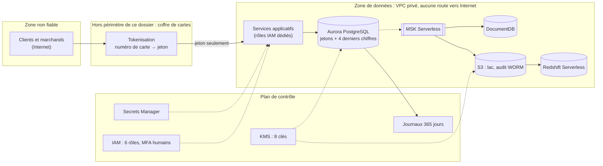

# 06 — Sécurité et conformité : PCI-DSS v4.0.1, RGPD, CCPA

> Répond au livrable 6 de l'énoncé (plan de sécurité et de conformité) et aux indicateurs 3.2, 7.1, 7.2 et 7.3.
> Ce document décrit des mesures **techniques** et leur preuve dans le dépôt. Il ne remplace ni l'évaluation d'un évaluateur qualifié PCI (QSA), ni l'avis du délégué à la protection des données (DPO). Les numéros de sous-exigences PCI-DSS cités sont à vérifier dans le référentiel officiel par l'évaluateur.

## 1. Périmètre et zones de confiance



**Description textuelle du diagramme.** Les clients atteignent un coffre de cartes qui n'est pas dans le périmètre de ce dossier et qui remet à la plateforme un **jeton** à la place du numéro de carte. La plateforme de données vit dans un réseau privé sans route vers Internet. Un plan de contrôle (clés, secrets, identités, journaux) s'applique à tous ses composants.

**Hypothèse structurante (H10)** : le numéro de carte (PAN) est traité uniquement dans un environnement séparé, validé par ailleurs ; la plateforme de données ne reçoit que des jetons. Elle réduit ainsi la portée PCI-DSS de ses bases mais pas à zéro (elle relève encore des exigences de réseau, d'accès, de journalisation et de configuration qui protègent les systèmes connectés).

## 2. PCI-DSS v4.0.1 : les douze exigences

| Exigence (intitulé résumé) | Mesure dans l'architecture | Preuve | Statut |
|---|---|---|---|
| 1. Contrôles de sécurité réseau | VPC privé sans passerelle Internet ni NAT ; groupes de sécurité par rôle, entrées limitées au groupe applicatif ; points de terminaison privés ; journaux de flux | module `reseau` ; test `test_aucune_ressource_publique` | réalisé (code) |
| 2. Configurations sécurisées | paramètres de durcissement : `rds.force_ssl`, `tls` DocumentDB, `require_ssl` Redshift, conteneurs sans privilèges (`cap_drop: ALL`, `no-new-privileges`, système de fichiers en lecture seule), images épinglées | modules Terraform ; `docker-compose.yml` ; `test_deploiement.py` | réalisé (code), non déployé |
| 3. Protection des données de compte stockées | **aucun PAN, cryptogramme ni date d'expiration** ; jeton + 4 derniers chiffres ; chiffrement au repos KMS de tous les stockages | `test_aucune_colonne_ne_peut_porter_un_numero_de_carte` ; `storage_encrypted = true` | réalisé pour le périmètre ; coffre de cartes hors périmètre |
| 4. Chiffrement des transmissions | TLS imposé : PostgreSQL, DocumentDB, Redshift, MSK (service), S3 (politique de refus du non-chiffré) | paramètres et politique de bucket | réalisé (code), non déployé |
| 5. Protection contre les logiciels malveillants | images minimales, utilisateur sans privilège, pas de poste d'administration dans le VPC | `Dockerfile` | partiel : analyse des images à ajouter à l'intégration continue |
| 6. Développement et maintenance sécurisés | analyse statique de l'IaC (checkov), tests automatisés, revue par branche, dépendances épinglées par plage | § 9 ; `checkov.txt` | réalisé (outils) ; analyse des dépendances à ajouter |
| 7. Accès restreint selon le besoin d'en connaître | rôles IAM par fonction, aucun joker, clés KMS par domaine ; rôles de base de données ; colonnes modifiables restreintes | § 6 ; `test_droits_iam_sans_joker` | réalisé (code) |
| 8. Identification et authentification | MFA pour les humains (condition `aws:MultiFactorAuthPresent`) ; authentification IAM aux bases ; aucun secret en dur (8.6.2) ; mots de passe de service gérés et renouvelables (8.6.3) | § 6 et 7 | réalisé (code) ; fonction de rotation à fournir |
| 9. Accès physique | délégué au fournisseur de cloud (responsabilité partagée) | — | hors périmètre |
| 10. Journalisation et surveillance | journal d'audit en ajout seul, `pgaudit`, journaux de flux, journaux des bases en CloudWatch 365 jours (10.5.1), archive d'audit verrouillée | § 8 | réalisé (code) |
| 11. Tests réguliers | analyse de configuration (checkov), tests automatisés ; analyses de vulnérabilités et tests d'intrusion à planifier | § 9 | partiel : à compléter par des essais d'intrusion |
| 12. Politiques et organisation | procédure d'incident (§ 10), matrice de responsabilités (document 11) | documents 10 et 11 | décrit |

## 3. RGPD

| Principe ou article | Application | Où |
|---|---|---|
| Art. 5 : minimisation, limitation de la conservation, intégrité et confidentialité | e-mail haché ; colonne exclue du flux CDC ; événements supprimés au bout de 90 jours (index TTL) ; chiffrement partout | `modele_oltp.py`, `debezium_connecteur.json`, `nosql.py` |
| Art. 6 : licéité | hypothèse H11 : exécution du contrat de paiement pour les données transactionnelles ; intérêt légitime pour la prévention de la fraude, à documenter par le DPO | — |
| Art. 25 : protection dès la conception | pseudonymisation par défaut, aucune donnée de carte, droits minimaux | modèle de données |
| Art. 28 : sous-traitants | le fournisseur de cloud est sous-traitant : accord de traitement à signer | juridique |
| Art. 30 : registre des traitements | la liste des traitements (paiement, analytique, fraude, personnalisation) se tient à partir du § 1 et des tableaux de ce dossier | à tenir par le DPO |
| Art. 32 : sécurité du traitement | chiffrement, pseudonymisation, cloisonnement, journalisation, sauvegardes testées | ce document |
| Art. 33 et 34 : violation de données | notification à l'autorité dans les 72 heures lorsque requis ; procédure au § 10 | § 10 |
| Art. 35 : analyse d'impact | **probablement nécessaire** : le score de fraude est un profilage à grande échelle ; le DPO en confirme le besoin et la conduit avant la mise en production | à faire |
| Art. 22 : décision individuelle automatisée | une alerte de fraude déclenche une **revue humaine** avant tout refus définitif ; le score et la version du modèle sont tracés pour pouvoir expliquer la décision | document 07 |
| Art. 44 à 49 : transferts hors Union | aucun transfert prévu ; région UE | document 01 § 7.3 |

**Une empreinte d'e-mail salée est une donnée pseudonymisée, pas anonyme** : elle reste une donnée personnelle (la réidentification reste possible par qui détient le sel et une liste d'adresses). C'est pourquoi le sel est un secret géré (module `secrets`) et lu par un seul rôle.

### Exercice des droits

| Droit | Procédure technique | Remarque |
|---|---|---|
| Accès, portabilité | extraction par `id_client` dans l'OLTP et dans les collections `evenements`, `caracteristiques_clients` | les identifiants sont des clés de recherche, jamais l'e-mail en clair |
| Rectification | `UPDATE` sur `clients` (colonnes `code_pays`, `email_hache` autorisées au compte applicatif) | propagé par la CDC |
| Effacement | **anonymisation** du client (remplacement de l'empreinte et des attributs), suppression des documents NoSQL de ce `id_client`, conservation des écritures de paiement liées | conservation comptable : exception prévue par l'article 17, paragraphe 3 ; à valider par le DPO |
| Opposition au profilage | exclusion du client du score ou revue humaine systématique | à spécifier avec le métier |

**Effacement dans le lac** : les fichiers Parquet sont immuables ; l'effacement exige de les réécrire sans les lignes concernées lors d'une compaction planifiée (ou un chiffrement par client dont on détruit la clé). Non réalisé ici ; c'est un chantier à inscrire au plan d'exploitation.

## 4. CCPA / CPRA (Californie)

Les droits des résidents californiens recoupent ceux du RGPD ; les mêmes mécanismes techniques s'appliquent.

| Droit | Mécanisme |
|---|---|
| Savoir quelles données sont collectées et à quelles fins | registre des traitements ; extraction par identifiant |
| Supprimer | procédure d'effacement ci-dessus |
| Corriger | procédure de rectification |
| Refuser la vente ou le partage de données personnelles | la plateforme ne vend ni ne partage de données dans ce périmètre (hypothèse H12) ; un indicateur de refus serait à ajouter au modèle si cela changeait |
| Limiter l'usage des informations sensibles | pas de catégorie sensible stockée en clair dans ce modèle |
| Ne subir aucune discrimination pour l'exercice d'un droit | règle de gestion hors du périmètre technique |

Les seuils d'application de la loi, les délais de réponse et les motifs de refus sont à confirmer par le juridique ; ils ne sont pas repris ici.

## 5. Chiffrement

| Donnée | Au repos | En transit |
|---|---|---|
| Aurora | KMS, clé `oltp` (stockage, instantanés, Performance Insights) | `rds.force_ssl = 1` |
| DocumentDB | KMS, clé `documents` | `tls = enabled` |
| Redshift | KMS, clé `analytique` | `require_ssl = true`, routage VPC amélioré |
| Lac et archive d'audit | SSE-KMS, clés `lac` et `journaux`, clé de bucket | refus de toute requête sans TLS (`aws:SecureTransport`) |
| Journaux d'accès S3 | SSE-S3 (limite du service de journalisation) | idem |
| MSK Serverless | clés gérées par le service (le service n'offre pas de clé du client) | TLS imposé par le service |
| Secrets | KMS, clé `secrets` | API AWS en TLS |
| Sauvegardes | clé `sauvegarde` (coffre AWS Backup) | — |
| Alertes de supervision (SNS) | clé `alertes`, utilisable par CloudWatch et par les événements RDS pour publier | API AWS en TLS |
| Journaux des tâches ECS | clé `journaux` (groupes CloudWatch, sessions ECS Exec) | — |
| Courriel client | haché SHA-256 salé (niveau applicatif) | — |

**Gestion des clés** : une clé par domaine, rotation annuelle activée, délai de 30 jours avant suppression effective (7 en développement), politique de clé déléguant à IAM. Désactiver une clé rend le domaine illisible : c'est aussi un levier de confinement en cas d'incident.

## 6. Identités, rôles et droits (IAM / RBAC)

### 6.1 Rôles du cloud (module `iam`)

| Rôle | Qui l'endosse | Ce qu'il peut faire | Ce qu'il ne peut pas faire |
|---|---|---|---|
| `etl` | tâches ECS de l'ETL (module `calcul`) du compte | lire/écrire le lac ; lire le sel de pseudonymisation ; se connecter à Aurora avec le compte `svc_extraction` ; obtenir des identifiants Redshift temporaires ; lire les sujets `stripe.*` | écrire dans Kafka, toucher à l'archive d'audit, lire d'autres secrets |
| `cdc` | connecteur Debezium (MSK Connect) | écrire les sujets `stripe.*` et ses sujets internes ; lire le secret de réplication | lire le lac, se connecter aux bases autrement que par ce secret |
| `redshift_s3` | Redshift | lire le lac (`COPY`) et déchiffrer avec la clé du lac | écrire dans S3 |
| `application` | service de paiement | se connecter à Aurora avec le seul compte `svc_application` | tout le reste |
| `score` | service de score de fraude (tâches ECS, module `calcul`) | lire les sujets `stripe.*` dans ses propres groupes de consommateurs `score-*` | écrire dans Kafka, lire le lac, les secrets ou les bases par IAM |
| `analyste` | personnes désignées, avec MFA | demander des identifiants temporaires au workgroup | accéder à l'OLTP, aux secrets, au lac |

Aucune politique ne contient d'action « * » ni de ressource « * » (test `test_droits_iam_sans_joker`). La seule exception du dépôt est la délégation à IAM de la politique d'une clé KMS (`kms:*` accordé au compte racine), recommandée par AWS et justifiée par écrit dans le module.

Le module `calcul` crée en plus un rôle d'**exécution** ECS, distinct des rôles de tâche (`etl`, `score`) : tirer les images des seuls dépôts ECR du projet, écrire les journaux des tâches. Sa seule ressource « * » est `ecr:GetAuthorizationToken`, une action qui n'en admet aucune autre (test `test_le_role_d_execution_n_a_aucun_joker_superflu`).

### 6.2 Rôles de base de données (DDL généré, testé sur PostgreSQL 16)

Voir document 02 § 8 : `role_application` (jamais de `DELETE`, montants non modifiables), `role_extraction` (lecture seule, extraction batch), `role_cdc` (lecture et réplication), `role_audit` (lecture du journal d'audit). Les comptes nominatifs (`svc_application`, `svc_extraction`) se créent par `CREATE ROLE … LOGIN; GRANT rds_iam, <rôle> TO …` ; seuls `svc_application` et `svc_debezium` sont créés par le script de la démonstration locale. Côté entrepôt : `role_analyste` et `role_data_science` en lecture seule (`olap_schema.sql`, non exécuté sur Redshift).

### 6.3 Séparation des tâches

| Action | Dev | Data | Ops | Sécurité |
|---|---|---|---|---|
| Modifier le modèle de données (migration) | propose | valide l'impact analytique | applique | revoit les droits |
| Appliquer `terraform apply` en production | — | — | exécute après revue | revoit le plan |
| Lire les journaux d'audit | — | — | — | oui (`role_audit`) |
| Désactiver une clé KMS | — | — | sur demande | décide |
| Consulter des données de paiement | via l'application uniquement | entrepôt (pseudonymisé) | non | non |

## 7. Gestion des secrets (indicateur 7.3)

| Secret | Où il vit | Qui le lit | Rotation | Dans le dépôt ? |
|---|---|---|---|---|
| Mot de passe administrateur Aurora | Secrets Manager, créé par Aurora (`manage_master_user_password`) | administrateur | gérée par le service | non |
| Mot de passe administrateur DocumentDB | idem | administrateur | gérée par le service | non |
| Mot de passe administrateur Redshift | idem (`manage_admin_password`) | administrateur | gérée par le service | non |
| Compte de réplication Debezium | Secrets Manager (module `secrets`) | rôle `cdc` | **obligatoire en production** : l'ARN d'une fonction de rotation est une variable sans valeur par défaut dans `environnements/prod` | non |
| Sel de pseudonymisation | Secrets Manager | rôle `etl` | aucune, volontairement (changer le sel invaliderait toutes les empreintes) | non |
| Mots de passe de la démonstration locale | fichiers `secrets/*.txt` générés aléatoirement, montés dans `/run/secrets` | conteneurs concernés | à la régénération | non (dossier ignoré par Git) |

Preuves : `test_aucun_secret_en_clair` (aucune clé d'accès, clé privée ni mot de passe littéral dans le code Terraform), `test_aucun_mot_de_passe_dans_le_compose`, `test_generation_des_secrets_ne_remplace_jamais_un_secret_existant`. Les valeurs aléatoires du module `secrets` figurent, chiffrées et marquées sensibles, dans l'**état** Terraform : l'état doit être stocké dans un bucket chiffré, versionné et à accès restreint (`terraform/README.md`). Limite à connaître : tant qu'une valeur secrète est dans l'état, quiconque lit l'état la lit.

## 8. Audit et journalisation

| Source | Contenu | Conservation | Protection |
|---|---|---|---|
| Table `journal_audit` | actions sensibles de l'application | base, puis export vers l'archive | déclencheur refusant `UPDATE`, `DELETE`, `TRUNCATE` ; vérifié sur PostgreSQL 16 |
| `pgaudit` (Aurora) | définitions de schéma et gestion des rôles | CloudWatch 365 jours | clé `journaux` |
| Journaux PostgreSQL, DocumentDB (audit, profilage) | connexions, requêtes lentes, événements d'audit | CloudWatch 365 jours | clé `journaux` |
| Journaux de flux du VPC | trafic accepté et refusé | CloudWatch 365 jours | clé `journaux` |
| Journaux d'accès S3 | accès au lac | bucket dédié, bascule en archivage | SSE-S3, versionnement |
| Archive d'audit | export de `journal_audit` | verrouillage d'objets 365 jours (mode gouvernance) | WORM |
| CloudTrail | appels d'API AWS | **hors dépôt** : à activer au niveau de l'organisation | — |

Le déclencheur d'ajout seul est contournable par le propriétaire de la table : la copie dans l'archive verrouillée en est le complément. Le mode « gouvernance » permet à un rôle autorisé de lever le verrou ; le mode « conformité », irréversible, serait à retenir après validation de l'évaluateur.

## 9. Conformité automatisée

La conformité est vérifiée par du code, à chaque modification, plutôt que par une relecture ponctuelle.

| Contrôle | Outil | Ce qu'il empêche |
|---|---|---|
| Analyse statique de l'IaC | `checkov -d stripe/terraform` | stockage non chiffré, accès public, droits trop larges, journalisation absente |
| Garanties critiques en tests | `tests/test_terraform.py` (214 cas) | régression silencieuse : base non chiffrée, ressource publique, joker IAM, secret littéral, journaux < 365 jours, `dev` et `prod` qui divergent |
| Schéma sans donnée de carte | `test_oltp_contraintes.py` | ajout d'une colonne de type PAN |
| DDL à jour | `generer_ddl.py --verifier` | script de déploiement qui s'écarte du modèle |
| Style et erreurs | `ruff` | — |

### Résultat de l'analyse checkov (fichier complet : `livrables/aia2/checkov.txt`)

```text
checkov 3.3.28 — terraform scan results:
Passed checks: 536, Failed checks: 0, Skipped checks: 18
```

Analyse faite le 10/10/2026 et rejouée le 17/10/2026 sur le Terraform du dossier : même total, mêmes contrôles et mêmes ressources ; seuls les numéros de ligne cités pour `environnements/prod/main.tf` avancent d'une ligne, ce fichier ayant reçu une ligne depuis la première analyse (461 / 0 / 18 les deux fois). Rejouée le 19/10/2026 (checkov 3.3.28, hors ligne) après l'ajout des modules `calcul` et `supervision` : 536 / 0 / 18, soit 75 contrôles réussis de plus, tous sur les ressources ajoutées (tâches ECS, rôles et politiques IAM, journaux, rubrique SNS, alarmes, clé KMS `alertes`, points de terminaison ECR) ; le même outil rend toujours 461 / 0 / 18 sur le Terraform d'avant l'ajout. Aucun échec. Les 18 contrôles ignorés correspondent à 8 règles distinctes ; chacune est justifiée par écrit dans le code, à l'endroit de la ressource concernée :

| Règle | Ressources | Justification |
|---|---|---|
| CKV_AWS_109, CKV_AWS_111, CKV_AWS_356 | politique de clé KMS | forme de politique recommandée par AWS : seul le compte racine reçoit `kms:*` pour déléguer à IAM ; `*` désigne la clé elle-même |
| CKV_AWS_139 | cluster Aurora | la protection contre la suppression est un paramètre : vraie par défaut et en production (le bloc `check` de `environnements/prod` affiche un avertissement au `terraform plan` si elle y est levée, sans bloquer ni `plan` ni `apply`), levée seulement en `dev` |
| CKV2_AWS_8 | cluster Aurora | le plan AWS Backup existe (module `sauvegarde`) ; le contrôle ne suit pas les références entre modules |
| CKV2_AWS_57 | secret du sel | ne doit pas tourner (invalidation des empreintes) |
| CKV2_AWS_5 | cinq groupes de sécurité | attachés dans d'autres modules ou par les équipes plateforme |
| CKV_AWS_144 | trois buckets | pas de réplication inter-régions : choix de souveraineté et de périmètre, à réévaluer (document 10 § 5) |

**Écarts relevés par la première analyse et suite donnée** : la première analyse comptait 15 échecs (résultat intermédiaire, non conservé tel quel). Deux ont été **corrigés dans le code** : les zones de disponibilité sont désormais nommées explicitement (CKV_AWS_394) ; une sauvegarde centralisée AWS Backup a été ajoutée (module `sauvegarde`), car son absence était un vrai manque. Ce dernier ajout ne suffit pas à satisfaire CKV2_AWS_8, qui ne suit pas les références entre modules : la règle reste donc ignorée, avec la justification ci-dessus. Les autres échecs relevaient de faux positifs ou de choix assumés, traités par une justification écrite après examen ; aucun ne concernait un chiffrement manquant, un accès public ou un droit IAM trop large.

**Limites** : l'analyse est statique et porte sur le texte HCL, non sur un `plan` ; `terraform validate`, `terraform plan` et `terraform fmt -check` n'ont **pas** été exécutés (binaire Terraform non installé, aucun compte AWS). C'est la première chose à faire avant tout déploiement.

## 10. Réponse à incident et violation de données

1. **Détecter** : alarmes de supervision (document 10), alertes d'accès inhabituel, signalement.
2. **Qualifier** : données concernées (personnelles ? de paiement ?), périmètre, date de début. Ouvrir le journal d'incident.
3. **Contenir** : révoquer le rôle ou la session suspecte ; faire pivoter le secret concerné ; si nécessaire, désactiver la clé KMS du domaine.
4. **Notifier** : DPO immédiatement ; autorité de contrôle dans les 72 heures si la violation présente un risque pour les personnes (RGPD, art. 33) ; personnes concernées si le risque est élevé (art. 34) ; partenaires de paiement selon les contrats.
5. **Rétablir** : restauration depuis un point sain (document 10), correction de la cause.
6. **Apprendre** : revue sans recherche de coupable, ajout d'un test ou d'une règle automatisée pour que la cause ne puisse pas revenir.

## 11. Risques résiduels

| Risque | Niveau | Traitement proposé | Responsable (A) |
|---|---|---|---|
| Accès extraterritorial au cloud | à qualifier par le juridique | clés du client, journalisation des usages de clés, évaluation du DPO | Sécurité / DPO (ligne « Conformité ») |
| Secret lisible dans l'état Terraform | moyen | état chiffré à accès restreint ; évaluer les ressources éphémères | Ops (ligne « Terraform ») |
| Déclencheur d'audit contournable par le propriétaire | moyen | archive verrouillée, séparation des comptes propriétaires | Sécurité / DPO (ligne « IAM, KMS ») |
| `$inc` non idempotent sur les caractéristiques | faible (qualité du score) | parade décrite au document 04 | Data (ligne « schémas NoSQL ») |
| Effacement dans le lac non réalisé | moyen (RGPD) | compaction planifiée ou chiffrement par client | Data (ligne « Lac ») |
| Biais du modèle de fraude (variable « pays différent ») | à évaluer | document 07 § 6 | Data (ligne « Modèle de fraude ») ; Sécurité / DPO consulté |
| Dépendance à un fournisseur unique | moyen | usage d'API ouvertes (Kafka, PostgreSQL, MongoDB), IaC | Ops (ligne « Terraform ») |

La colonne « Responsable » reprend le seul responsable de résultat (A) de la ligne correspondante de la matrice du document 11 § 3 ; elle désigne une équipe, pas une personne.

*Copyright © 2026 · voir le fichier LICENSE du dépôt*
