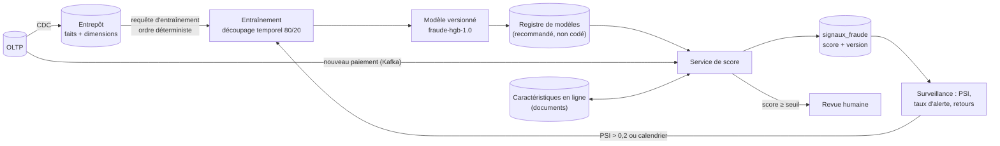

# 07 - Intégration du machine learning : fraude et personnalisation

> Répond au livrable 7 de l'énoncé (caractéristiques, déploiement, surveillance).
> Code : `stripe/stripe_demo/fraude.py` ; mesures : `livrables/aia2/donnees/mesures_demo.json` et `resultats_demo.json`.
> Données synthétiques : la fraude y est **simulée** (`stripe_demo/oltp.py`) ; les performances ci-dessous valident la chaîne, pas la capacité à détecter une vraie fraude.

## 1. Deux cas d'usage

| Cas | Statut | Décision pilotée |
|---|---|---|
| **Détection de fraude** sur chaque paiement | **réalisé** en démonstration (entraînement, notation en flux, surveillance) | alerter, déclencher une revue humaine |
| **Personnalisation** (offres, parcours) | conçu, **non réalisé** (§ 7) | ordre et choix des offres présentées |

## 2. Chaîne de bout en bout



**Description textuelle.** Les paiements capturés alimentent l'entrepôt, sur lequel le modèle est entraîné avec un découpage dans le temps. Le modèle versionné est servi par un service de score qui note chaque nouveau paiement, enrichit au besoin avec les caractéristiques en ligne et écrit le score et la version du modèle. Au-dessus du seuil, une revue humaine est déclenchée. La surveillance mesure la dérive des scores ; si elle dépasse le seuil, un réentraînement est lancé.

## 3. Caractéristiques

### 3.1 Variables du modèle 1.0 (`fraude.VARIABLES`)

| Variable | Définition | Source hors ligne | Source en ligne | Point d'attention |
|---|---|---|---|---|
| `montant_usd` | montant converti au taux du jour | `faits_paiements` | calculé à la volée | cohérence : même conversion à l'entraînement et en service |
| `heure` | heure du paiement (0 à 23) | `faits_paiements.heure` | idem | fuseau horaire à fixer (UTC) |
| `pays_different` | 1 si le pays de l'IP diffère du pays du client | `pays_ip` ≠ `dim_client.code_pays` | idem | **proxy possible d'une caractéristique protégée** (§ 6) |
| `nuit` | 1 si l'heure < 6 | dérivée de `heure` | idem | - |
| `anciennete_jours` | ancienneté du client | `dim_client` | lue dans la dimension | calculée par rapport à une date fixe dans la démonstration |
| `mobile` | 1 si l'appareil est un mobile | `faits_paiements.appareil` | idem | - |

Aucune variable n'est un identifiant direct : ni e-mail, ni numéro, ni nom.

### 3.2 Magasin de caractéristiques en ligne : état réel

La collection `caracteristiques_clients` accumule, pour chaque client, `nb_paiements`, `montant_total_usd`, `montant_max_usd` et `pays_ip_vus`, mis à jour de façon atomique à chaque paiement (793 clients avec un document après les 1 000 paiements du flux). **Le modèle 1.0 ne les utilise pas encore** : la fonction `noter` reçoit ces caractéristiques mais ne lit que les champs du paiement. C'est un point de départ pour une version 2 (historique du client : montant inhabituel pour lui, pays jamais vu). Cette évolution suppose de reconstituer ces caractéristiques **à l'identique** à l'entraînement (reconstruction à partir de l'historique de l'entrepôt, sans fuite d'information postérieure au paiement), faute de quoi le service verrait des valeurs que l'entraînement n'a jamais vues (décalage entre entraînement et service). Voir aussi la limite d'idempotence au document 04 § 6.

## 4. Entraînement

| Choix | Valeur | Raison |
|---|---|---|
| Algorithme | `HistGradientBoostingClassifier` (arbres de gradient) | bon sur données tabulaires, rapide, gère les non-linéarités |
| Paramètres | 200 itérations, taux d'apprentissage 0,05, poids de classes équilibrés, graine 42 | classes très déséquilibrées (2,5 % de fraude) |
| Découpage | **temporel** : 80 % des lignes (par date) pour apprendre, les dates suivantes pour évaluer | comme en production : on apprend sur le passé et on prédit le futur ; un tirage aléatoire fuirait de l'information |
| Reproductibilité | graine fixe **et ordre des lignes fixé** (`ORDER BY d.date, f.id_paiement`) | sans l'ordre fixe, l'arrêt précoce interne voyait des lignes dans un ordre variable et les mesures changeaient d'une exécution à l'autre (défaut corrigé) |

**Résultats mesurés** (48 000 faits : 38 400 pour apprendre, 9 600 pour évaluer ; `resultats_demo.json`) :

| Mesure | Valeur | Lecture |
|---|---|---|
| Taux de fraude (étiquette simulée) | 2,51 % | classe rare |
| Prévalence dans la période de test | 2,28 % | niveau de base de la PR-AUC |
| ROC-AUC (test) | 0,872 | le modèle classe bien une fraude au-dessus d'un paiement normal |
| PR-AUC (test) | 0,16 | environ 7 fois la prévalence ; modeste en valeur absolue |
| Durée d'entraînement | 0,5 s | CPU suffisant (document 09) |

La PR-AUC est la mesure qui compte pour une classe rare. Sa valeur modeste vient de la simulation : la fraude y est tirée au hasard avec une probabilité qui dépend de trois signaux (pays différent, nuit, montant élevé), donc une grande part des cas est **indécelable par construction**. Ces valeurs ne préjugent pas de celles d'une vraie base.

**Reproductibilité vérifiée** : deux exécutions complètes consécutives donnent des mesures identiques (hors latences) ; la reconstitution de l'état d'entraînement par `stripe_demo.mesures` redonne exactement ROC-AUC 0,872 et PR-AUC 0,16.

## 5. Déploiement et service

### 5.1 Service de score

| Aspect | Conception | État |
|---|---|---|
| Entrée | message de paiement capturé (Kafka) | démonstration : lecture des faits nouveaux après chaque micro-lot CDC |
| Traitement | mise à jour atomique des caractéristiques, calcul des variables, `predict_proba` | `pipeline.py` |
| Sortie | document `signaux_fraude` avec `score` et `version_modele` ; alerte si `score ≥ 0,8` | idem |
| Latence | médiane mesurée de 4,5 à 9,1 ms par paiement selon l'exécution (processus unique en mémoire, **construction d'un tableau pandas par paiement** : une notation par lots serait plus rapide) | mesuré ; objectif de production : **hypothèse H8** |
| Calcul | CPU, conteneur sans serveur ; pas de GPU | document 09 |
| Passage à l'échelle | plusieurs tâches dans un même groupe de consommateurs, limitées par le nombre de partitions du sujet | recommandation |

### 5.2 Cycle de vie du modèle

1. **Entraîner** sur l'entrepôt ; mesurer ; comparer à la version en service sur la même période de test.
2. **Versionner** : le nom (`fraude-hgb-1.0`) est écrit dans chaque score ; l'artefact est rangé dans le lac (chiffré, accès restreint) sous un chemin versionné. Un registre de modèles managé est recommandé (non codé).
3. **Déployer** en « ombre » (le nouveau modèle note sans décider), comparer les alertes, puis basculer progressivement.
4. **Revenir en arrière** : l'ancienne version reste disponible ; la version est dans chaque score, donc l'impact d'un modèle défaillant est délimitable et rejouable.

### 5.3 Qualité des alertes sur le flux (seuil 0,8)

Sur les 1 000 paiements du flux (étiquette simulée = paiement contesté) : 40 alertes, 22 fraudes, **10 fraudes détectées** : précision 25 %, rappel 45,5 %. Le seuil est un arbitrage économique (coût d'une revue humaine contre perte évitée) : il se choisit sur la courbe précision-rappel avec les coûts réels, non calculée ici.

## 6. Surveillance, dérive et gouvernance

### 6.1 Ce qui est mesuré en démonstration

L'**indice de stabilité de population (PSI)** compare la distribution des scores en production à celle de l'entraînement, par déciles. Seuils usuels : < 0,1 stable ; 0,1 à 0,2 à surveiller ; > 0,2 dérive, réentraînement. Valeur mesurée : **0,01** (stable). Le calcul est validé par six tests (`test_psi.py`) dont un calcul à la main sur deux classes (0,4159).

### 6.2 Plan de surveillance en production

| Indicateur | Fréquence | Seuil d'alerte (hypothèse H8) | Action |
|---|---|---|---|
| PSI des scores | quotidienne | > 0,2 | réentraînement |
| PSI par variable (dérive des données) | quotidienne | > 0,2 | enquête sur la source |
| Taux d'alertes | continue | écart marqué par rapport à la moyenne mobile | vérifier le seuil, la dérive, une attaque |
| Performance réelle (précision/rappel sur contestations arrivées) | hebdomadaire | baisse de la PR-AUC | réentraînement ; **les étiquettes arrivent avec retard** (contestations différées), donc la performance se mesure sur des cohortes anciennes |
| Latence, erreurs du service | continue | p99 > objectif | mise à l'échelle, analyse |
| Version du modèle servie | continue | version inattendue | arrêt du déploiement |

### 6.3 Équité et décisions automatisées

- La variable `pays_different` peut pénaliser des personnes qui voyagent ou résident à l'étranger : elle peut servir de **proxy** d'une origine. À mesurer : taux d'alertes par pays (l'agrégat `agr_fraude_pays` le permet) et par segment ; à contenir par une revue humaine avant refus définitif.
- RGPD, article 22 : aucune décision uniquement automatisée à effet significatif sans possibilité d'intervention humaine ; le score, son seuil et la version du modèle sont tracés pour expliquer une décision. L'analyse d'impact (article 35) est un préalable (document 06).
- Données d'entraînement minimales : aucune donnée identifiante n'entre dans les variables.

## 7. Personnalisation (conception, non réalisée)

| Élément | Proposition |
|---|---|
| Objectif | présenter à un client les offres ou les parcours les plus pertinents pour lui |
| Données | segments (`dim_client.segment`), historique d'achats, produits et abonnements (OLTP → entrepôt) ; événements de navigation (documents) |
| Modèle | classement de produits (recommandation) ou score d'appétence ; à choisir selon la donnée disponible |
| Service | même architecture que la fraude : caractéristiques en ligne, service de score, trace de la version |
| Contraintes | base légale et consentement (RGPD) ; droit de refus du profilage (RGPD) et de la vente ou du partage (CCPA) ; pas de variable sensible ; test A/B avec groupe témoin |
| Base vectorielle | **non retenue** : aucune recherche sémantique dans le périmètre. Si des représentations (embeddings) devenaient nécessaires, une extension vectorielle de PostgreSQL ou un service dédié seraient à étudier (document 09 § 4) |

## 8. Vérifications

```text
pytest tests/test_psi.py            # 6 tests : identité, calcul manuel, stabilité, dérive, monotonie
python -m stripe_demo.mesures demo  # mesures du modèle, alertes du flux, durée d'entraînement
```

## 9. Limites

- Données simulées : métriques non transposables.
- Le modèle n'utilise pas encore les caractéristiques en ligne.
- Pas de registre de modèles, pas de déploiement en ombre, pas de courbe précision-rappel avec coûts réels, pas de mesure d'équité réelle.
- Latence mesurée en processus unique avec des bases en mémoire.

*Copyright © 2026 · voir le fichier LICENSE du dépôt*
