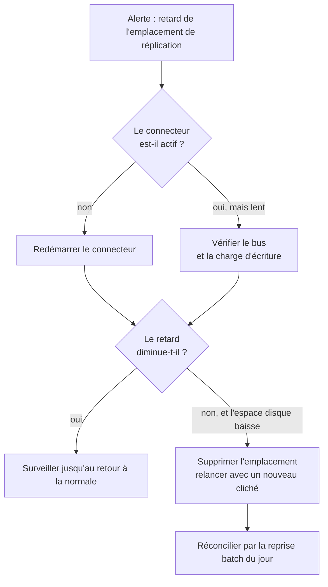
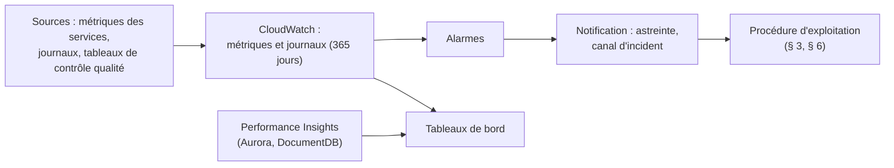

# 10 - Continuité d'activité, supervision et maintenance

> Répond aux indicateurs 6.1, 6.2, 6.3, 8.3 et 9.3.
> Les objectifs de reprise (RTO, RPO) sont des **hypothèses** (H5). Ce document est une conception d'exploitation : seuls les éléments marqués « vérifié » ont été exécutés. Rien n'a été déployé sur AWS.

## 1. Objectifs de continuité (hypothèse H5)

| Périmètre | Panne considérée | RTO visé | RPO visé |
|---|---|---|---|
| OLTP | perte d'une instance ou d'une zone | 15 minutes | quasi nul (écriture par quorum sur trois zones) |
| OLTP | erreur humaine, corruption logique | quelques heures | jusqu'au dernier point de restauration |
| Bus, capture des changements | arrêt d'un composant | quelques minutes à quelques heures | aucun message perdu tant que la rétention couvre la panne |
| Entrepôt | indisponibilité | quelques heures | reconstruction possible depuis le lac et l'OLTP |
| Base de documents | perte d'une instance | quelques minutes | quasi nul |
| Région entière | sinistre régional | **non couvert** (risque assumé, § 5) | - |

L'entrepôt et les agrégats sont **reconstructibles** : l'OLTP et le lac sont les sources. La criticité décroît donc de l'OLTP (irremplaçable) vers l'entrepôt (rejouable).

## 2. Mécanismes de continuité intégrés à l'architecture

| Mécanisme | Mise en œuvre |
|---|---|
| Redondance par zone | trois sous-réseaux privés ; une instance Aurora par zone ; instances DocumentDB réparties ; stockage répliqué sur trois zones |
| Basculement automatique | promotion d'un lecteur selon `promotion_tier` (Aurora et DocumentDB) |
| Retry sans danger | clé d'idempotence unique sur les paiements ; `MERGE` et `INSERT OR REPLACE` idempotents (tests) |
| Sauvegardes | sauvegardes automatiques (35 jours en prod) + coffre AWS Backup chiffré à part |
| Protection contre l'erreur | protection contre la suppression des bases, instantané final, `check` de garde-fous en prod, versionnement S3, délai de 30 jours avant suppression d'une clé |
| Reconstruction | tout l'environnement est du code (Terraform) ; les schémas sont générés |
| Découplage | le bus conserve les messages pendant l'indisponibilité d'un consommateur |

## 3. Pannes : effet et parade (indicateur 6.3)

| N° | Panne | Détection | Effet | Parade | Statut |
|---|---|---|---|---|---|
| 1 | Perte de l'instance Aurora en écriture (ou de sa zone) | alarme d'indisponibilité ; événements du service | écritures interrompues pendant la bascule | promotion automatique d'un lecteur d'une autre zone ; les applications se reconnectent et **rejouent avec la même clé d'idempotence** (pas de double débit) | événements de basculement et de défaillance reliés à l'alerte (module `supervision`) ; bascule non exercée |
| 2 | Perte d'un lecteur Aurora | alarme sur le nombre d'instances | capacité de lecture réduite | les lectures reviennent vers les autres instances ; recréer le lecteur (Terraform) | conception |
| 3 | Retard de réplication des lecteurs | métrique de retard de réplication | lectures obsolètes | router les lectures critiques vers l'écrivain ; investiguer la charge | conception |
| 4 | **Connecteur Debezium arrêté** | retard du connecteur ; retard de l'emplacement (requête ci-dessous) | la CDC prend du retard ; **l'emplacement de réplication retient le WAL, qui s'accumule sur le disque du cluster** | alerter tôt, redémarrer le connecteur ; si le retard devient dangereux, supprimer l'emplacement, relancer avec un nouveau cliché et laisser la reprise batch combler l'écart | alarme codée (module `supervision`, seuil H17) ; requête exécutable (`python -m stripe_demo.supervision`), testée sur PostgreSQL 16 |
| 5 | **Bascule Aurora et emplacement de réplication** | connecteur en erreur après un basculement | la CDC s'arrête tant que le connecteur n'a pas retrouvé son emplacement | contrôler l'existence de l'emplacement sur la nouvelle instance en écriture ; sinon le recréer, relancer le connecteur avec un cliché, réconcilier par le batch | **non vérifié : à tester en préproduction** |
| 6 | Bus indisponible | erreurs de publication du connecteur | CDC suspendue, WAL retenu | reprise automatique du connecteur ; surveiller comme au n° 4 | conception |
| 7 | Service de score arrêté | retard de consommation du groupe | paiements non notés, alertes retardées | plusieurs tâches dans le groupe de consommateurs, redémarrage automatique ; mode dégradé par règles simples (pays différent, montant élevé), non implémenté | service ECS et autoscaling codés (module `calcul`) ; alarme « aucune tâche en marche » codée |
| 8 | Message impossible à traiter | taux d'erreur du consommateur | partition bloquée si non traité | envoi dans un sujet d'erreurs avec la cause, poursuite, alerte | conception |
| 9 | Entrepôt indisponible ou saturé | échec des tâches de chargement, durée des requêtes | tableaux de bord figés ; les données continuent d'arriver dans le lac | durée maximale de requête, plafond de capacité ; reprise du `MERGE` (idempotent) | conception |
| 10 | Plafond de consommation de l'entrepôt atteint | métrique d'usage | selon l'action configurée : alerte (`emit-metric`) ou arrêt du calcul (`deactivate`) | décider avec la finance ; relever le plafond ou optimiser | alarme codée : un jour qui consomme plus d'un trentième du plafond mensuel |
| 11 | Instance DocumentDB en écriture perdue | alarme de disponibilité | caractéristiques en ligne indisponibles pendant la bascule | promotion d'un réplica ; le score utilise des valeurs par défaut le temps de la bascule | conception |
| 12 | S3 indisponible | échecs du chargement | chargement de l'entrepôt retardé | nouvelle tentative ; les messages restent dans le bus | conception |
| 13 | Suppression ou corruption logique de données OLTP | signalement, contrôles qualité | perte de lignes | restauration à un instant donné dans un **nouveau** cluster, extraction des lignes, réintégration ; ou restauration depuis le coffre de sauvegarde | conception ; exercice à planifier |
| 14 | Suppression d'objets S3 | alerte d'événement | fichiers manquants | restauration de la version précédente (versionnement) ; l'archive d'audit est verrouillée | conception |
| 15 | **Clé KMS désactivée ou planifiée pour suppression** | alarme sur l'événement d'API (CloudTrail, hors dépôt) | le domaine devient illisible | annuler la suppression pendant le délai de 30 jours ; réactiver la clé | conception ; CloudTrail à activer |
| 16 | Échec de rotation d'un secret | échec de la fonction de rotation | secret périmé | procédure manuelle de rotation ; correction de la fonction | conception |
| 17 | Compromission d'un rôle ou d'un secret | alerte d'accès inhabituel | accès illégitime | révoquer la session, pivoter le secret, désactiver la clé si nécessaire (document 06 § 10) | conception |
| 18 | Dérive du modèle de fraude | PSI > 0,2 | scores moins fiables | réentraînement ; retour à la version précédente (la version figure dans chaque score) | PSI mesuré en démonstration |
| 19 | Changement de schéma incompatible | connecteur ou consommateur en erreur | CDC cassée | procédure « ajouter puis retirer » (§ 6.5) ; retour arrière du déploiement | conception |
| 20 | Écart de données entre OLTP et entrepôt | contrôles qualité quotidiens | chiffres faux | la tâche échoue, la partition n'est pas publiée ; reprise batch | contrôles testés (`test_olap.py`) |
| 21 | Dépassement de mémoire d'un conteneur | arrêt du conteneur par le noyau | redémarrage | limites explicites avec marge (mesure : 52 % de la limite, document 09) ; redémarrage par l'orchestrateur | mesuré |
| 22 | `terraform apply` destructeur | revue du plan | destruction de ressources | protection contre la suppression, `check` en prod, revue obligatoire du plan ; restauration depuis les sauvegardes | partiellement codé |
| 23 | Perte de la région | indisponibilité générale | arrêt total | **non couvert** : voir § 5 | risque assumé |

Requête de surveillance du retard de l'emplacement de réplication (validée sur PostgreSQL 16) :

```sql
SELECT slot_name, active,
       pg_wal_lsn_diff(pg_current_wal_lsn(), confirmed_flush_lsn) AS retard_octets
FROM pg_replication_slots;
```

Elle est exécutable telle quelle : `python -m stripe_demo.supervision --seuil-octets 134217728` affiche le retard de chaque emplacement et rend le code 1 si un emplacement n'a plus de lecteur ou dépasse le seuil (hypothèse H17 : une heure de journal à la pointe en S2). Elle est testée sans base (`tests/test_supervision.py`) et sur PostgreSQL 16 avec un emplacement laissé sans lecteur (`tests/test_postgres_docker.py`). En production, la même mesure vient de la métrique `OldestReplicationSlotLag`, surveillée par l'alarme `retard-emplacement-replication` du module Terraform `supervision`.



**Description textuelle.** Si le retard de l'emplacement de réplication augmente, on vérifie d'abord que le connecteur tourne et on le relance. Si le retard diminue, on surveille. S'il ne diminue pas et que l'espace disque du cluster baisse, on sacrifie la continuité de la CDC pour sauver la base : suppression de l'emplacement, nouveau cliché, puis réconciliation par le batch quotidien.

## 4. Supervision (indicateur 8.3)

### 4.1 Chaîne d'alerte



**Description textuelle.** Les métriques des services, les journaux et les tableaux de contrôle qualité alimentent CloudWatch. Les alarmes déclenchent une notification vers l'astreinte, qui applique la procédure d'exploitation correspondante. Les mêmes données, avec Performance Insights, alimentent les tableaux de bord.

CloudWatch Logs, Performance Insights et les journaux de flux sont déclarés dans le code Terraform, ainsi que, depuis le 19/10/2026, la **notification** (rubrique SNS chiffrée, abonnés par courriel) et **quatre alertes** (module `supervision`) : retard de l'emplacement de réplication, basculement ou défaillance d'Aurora, consommation de l'entrepôt, service de score sans tâche. Les **tableaux de bord** et les alertes fondées sur des métriques applicatives (fraîcheur, qualité, PSI) restent à coder (limite assumée). Les noms des métriques AWS sont à confirmer au premier `terraform plan`.

### 4.2 Indicateurs de performance et seuils (seuils : hypothèse H8)

| Couche | Indicateur | Pourquoi | Seuil d'alerte proposé |
|---|---|---|---|
| Paiement (OLTP) | latence p95 et taux d'erreur des écritures | santé du service rendu | p95 au-delà de l'objectif ; erreurs > seuil |
| Aurora | utilisation CPU, mémoire disponible, connexions, retard de réplication | saturation | CPU soutenu élevé ; connexions proches du maximum ; mémoire basse |
| Aurora | requêtes lentes (journal à partir de 1 000 ms), verrous | régression de performance | hausse du nombre de requêtes lentes |
| CDC | retard du connecteur en millisecondes (`MilliSecondsBehindSource`), retard de l'emplacement en octets | fraîcheur, risque de disque plein | retard croissant sur 10 minutes ; octets retenus en hausse |
| Bus | retard de consommation par groupe, erreurs de production | consommateurs à la traîne | retard croissant |
| Entrepôt | RPU-heures consommées vs plafond, durée et file d'attente des requêtes | coût et performance | 80 % du plafond mensuel atteint avant le 20 du mois ; requêtes proches de la durée maximale |
| Fraîcheur des données | âge de la dernière ligne chargée (`now() - max(cree_le)` côté entrepôt) | respect de H9 | > fraîcheur visée |
| Qualité des données | écart entre le nombre de paiements OLTP et de faits, orphelins de dimension | exactitude | tout écart non nul persistant |
| Documents | latence des lectures, CPU, taille du TTL | santé des caractéristiques | seuils par défaut du service |
| ML | PSI des scores, taux d'alertes, précision sur contestations arrivées | qualité du modèle | PSI > 0,2 ; variation marquée du taux d'alertes |
| Sécurité | échecs d'authentification, usage des clés, modification de droits | détection d'abus | toute désactivation de clé ; pics d'échecs |
| Coût | consommation par environnement (étiquettes) | maîtrise financière | dépassement du budget |

Requête de fraîcheur validée sur PostgreSQL 16 : `SELECT now() - max(cree_le) FROM paiements;` (la même idée s'applique à l'entrepôt).

### 4.3 Qualité des données : contrôles quotidiens

Les invariants de `tests/test_olap.py` sont les contrôles de la tâche `controles_qualite` du DAG (document 05) : aucun paiement perdu ou créé, agrégats égaux aux faits, aucune clé orpheline vers les dimensions. Un écart bloque la publication de la partition et déclenche une alerte.

## 5. Risques résiduels de continuité

| Risque | Justification | Atténuation possible (non faite) |
|---|---|---|
| Perte de la région | pas de réplication inter-régions, sauvegardes dans la même région : choix de souveraineté et de simplicité, à réévaluer si le RTO régional devient une exigence | copie inter-régions (dans l'Union) des sauvegardes et du lac ; second environnement en veille |
| Bascule jamais exercée | la durée réelle de bascule et le comportement de l'emplacement de réplication ne sont pas mesurés | exercice en préproduction avant la mise en production |
| Supervision partielle | quatre alertes codées ; ni tableau de bord, ni alerte sur les métriques applicatives (fraîcheur, qualité, PSI) | publier ces métriques depuis le DAG et le service de score, puis leurs alarmes et un tableau de bord |
| Fonction de rotation des secrets à fournir | variable obligatoire en prod, fonction hors dépôt | écrire ou adopter une fonction de rotation |
| Alertes de fraude sans mode dégradé | si le service de score s'arrête, pas de règle de secours | règles simples exécutées dans l'application |

## 6. Maintenance et mises à jour sans interruption majeure (indicateur 9.3)

### 6.1 Conteneurs applicatifs (correctifs de l'image)

1. Reconstruire l'image avec la base mise à jour (le `Dockerfile` épingle la version de Python) ; analyser l'image ; lancer les tests.
2. Déployer une nouvelle révision de la tâche en **déploiement progressif** : de nouvelles tâches démarrent, passent leur contrôle de santé, puis seulement ensuite les anciennes s'arrêtent (jamais moins de la capacité nominale en service). Codé dans le module `calcul` : `deployment_minimum_healthy_percent = 100`, `deployment_maximum_percent = 200`.
3. Pour les consommateurs Kafka : l'arrêt d'une ancienne tâche déclenche un rééquilibrage du groupe, sans perte (les positions sont validées) ; les rejeux éventuels sont inoffensifs grâce à l'idempotence.
4. En cas d'anomalie : revenir à la révision précédente (la révision précédente reste disponible). Un déploiement dont les tâches ne démarrent pas revient seul en arrière (disjoncteur de déploiement avec retour arrière, module `calcul`).

### 6.2 Connecteur Debezium

Arrêt du connecteur → les positions sont conservées dans Kafka → remplacement de l'image/version → redémarrage : la CDC reprend où elle s'était arrêtée. L'interruption se traduit par un retard temporaire, pas par une perte. Tester d'abord la nouvelle version en préproduction.

### 6.3 Mise à jour mineure du moteur de base de données

Les mises à jour mineures (correctifs) sont appliquées pendant la fenêtre de maintenance hebdomadaire déclarée (`sun:03:00-sun:04:00` UTC pour Aurora) ; `auto_minor_version_upgrade` est activé sur les instances Aurora. Une mise à jour mineure redémarre des instances : l'interruption se limite à la durée d'une bascule, que les applications absorbent en réessayant avec la même clé d'idempotence. La durée réelle est **à mesurer en préproduction**. Ordre prudent : appliquer d'abord à `dev`, puis à `prod`.

### 6.4 Montée de version majeure (par exemple PostgreSQL 16 → version suivante)

Principe : ne jamais mettre à jour sur place ce qu'on ne peut pas annuler.

1. Créer un environnement « vert » à côté de l'environnement actuel (cluster restauré ou déploiement bleu/vert géré par le service), à la nouvelle version.
2. Le maintenir synchronisé (réplication logique).
3. Valider : tests de non-régression, comparaison de plans de requêtes, contrôles qualité.
4. Basculer : suspendre brièvement les écritures, laisser la réplication rattraper, rediriger les applications.
5. **Recréer l'emplacement de réplication et relancer le connecteur** (avec un cliché) sur le nouveau cluster ; réconcilier par le batch.
6. Garder l'ancien environnement pendant la période d'observation, puis le supprimer.

La coupure se réduit à l'étape 4. Non rejoué ici ; à répéter en préproduction.

### 6.5 Évolution du schéma de données (expand / contract)

| Étape | Action | Compatibilité |
|---|---|---|
| 1 | **Ajouter** la colonne ou la table (nullable, sans changer l'existant) | l'ancien code continue de fonctionner |
| 2 | Déployer le code qui écrit les deux formes | les deux versions coexistent |
| 3 | Remplir l'historique par tranches | - |
| 4 | Basculer les lectures | réversible |
| 5 | **Retirer** l'ancienne colonne après observation | seul point irréversible |

Précaution propre à PostgreSQL : sur une table volumineuse, créer un index avec `CREATE INDEX CONCURRENTLY` (il évite de bloquer les écritures). Le DDL généré utilise `CREATE INDEX IF NOT EXISTS`, adapté à l'initialisation d'une base vide ; en production sur une table remplie, utiliser la forme concurrente. Les schémas sont **versionnés dans Git** et générés depuis le modèle ; un test échoue si les scripts versionnés s'en écartent.

### 6.6 Infrastructure (Terraform)

1. Modifier le code dans une branche ; ouvrir une revue.
2. Exécuter `terraform fmt -check`, `terraform validate`, `checkov`, puis `terraform plan` : le plan est joint à la revue.
3. Après approbation, `terraform apply` en `dev`, puis en `prod` avec le même plan.
4. Les modules sont versionnés dans Git (références par étiquette) ; un retour arrière revient à l'étiquette précédente. Prudence : revenir en arrière sur une ressource avec état (base) ne restitue pas les données.

### 6.7 Services gérés (MSK Serverless, Redshift Serverless)

Leur correctif est assuré par le fournisseur. Le travail d'exploitation se limite à lire les avis de maintenance, à vérifier les fenêtres déclarées et à contrôler les alertes après la maintenance.

### 6.8 Modèle de fraude

Déploiement en ombre : la nouvelle version note sans décider ; on compare ses alertes à celles de la version en service ; on bascule progressivement ; l'ancienne version reste disponible pour un retour arrière immédiat.

### 6.9 Dépendances logicielles

Les dépendances Python sont déclarées par plages (`requirements.txt`). Mise à jour mensuelle recommandée : mettre à jour, lancer les tests (`pytest`, 930 cas, dont 6 qui exigent Docker), `ruff`, `checkov`, puis reconstruire l'image.

## 7. Exercices de reprise recommandés (fréquences : hypothèses)

| Exercice | Objectif | Fréquence proposée |
|---|---|---|
| Restauration à un instant donné dans un nouveau cluster | prouver le RPO et mesurer le RTO d'une erreur humaine | trimestrielle |
| Bascule forcée d'Aurora (en préproduction) | mesurer la durée de bascule, observer la CDC | avant la mise en production, puis semestrielle |
| Arrêt du connecteur 30 minutes | vérifier alertes, accumulation du WAL, reprise | semestrielle |
| Perte d'un secret / rotation forcée | vérifier la procédure | semestrielle |
| Reconstruction de `dev` depuis le code | prouver la reproductibilité de l'IaC | à chaque version majeure |

*Copyright © 2026 · Auteur : KinSushi · Enzo · Sovralys LLC*
