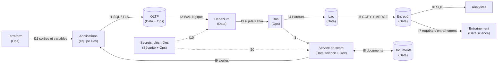
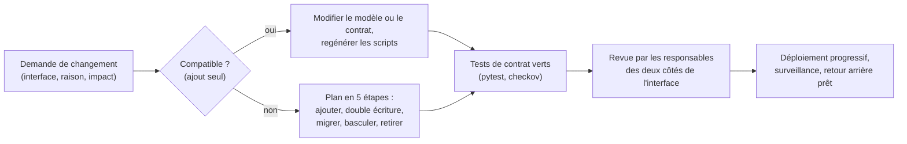

# 11 — Interfaces entre composants et responsabilités (Data, Dev, Ops)

> Répond à l'indicateur 9.1 (contrats d'interface et responsabilités formalisés) et complète l'indicateur 9.2 (documentation exploitable).
> Un contrat d'interface dit : qui produit, qui consomme, par quel canal, sous quelle forme, avec quelles garanties, et comment il évolue. Quand un test du dépôt applique le contrat, il est cité.

## 1. Carte des interfaces



**Description textuelle du diagramme.** Les applications (équipe de développement) écrivent dans la base transactionnelle (I1). Debezium lit son journal (I2) et publie dans le bus (I3). Le bus alimente le lac (I4) et le service de score ; le lac charge l'entrepôt (I5), lu par les analystes (I6) et par l'entraînement (I7). Le service de score échange avec la base de documents (I8) et renvoie des alertes aux applications (I9). La sécurité fournit secrets, clés et rôles (I10) ; Terraform publie les adresses et les identifiants dont les équipes ont besoin (I11).

## 2. Contrats d'interface

| N° | De → vers | Canal | Contrat (forme et garanties) | Évolution | Contrôle automatique |
|---|---|---|---|---|---|
| **I1** | Applications → OLTP | SQL sur TLS ; authentification IAM ; compte `svc_application` | schéma des 13 tables (`oltp_schema_postgresql.sql`), généré du modèle ; **écriture idempotente** par `cle_idempotence` ; l'application ne peut ni supprimer ni modifier un montant | compatible d'abord (ajout nullable) ; migration en 5 étapes (document 10 § 6.5) | `test_generer_ddl.py` (script à jour), `test_oltp_contraintes.py`, `test_postgres_docker.py` (droits) |
| **I2** | OLTP → Debezium | réplication logique `pgoutput`, publication `stripe_cdc`, compte `svc_debezium` | 8 tables publiées ; colonne `clients.email_hache` exclue ; connexion par secret | toute nouvelle table à capturer s'ajoute **à la fois** à la publication et au connecteur | `test_tables_capturees_identiques_a_la_publication`, `test_donnees_personnelles_exclues_du_flux` |
| **I3** | Debezium → bus | sujets `stripe.public.<table>` | clé = clé primaire de la ligne (ordre garanti par clé) ; valeur = JSON à plat : colonnes de la ligne + `__op` (`c`, `u`, `d`, `r`), `__source_ts_ms`, `__deleted` ; livraison **au moins une fois** | colonnes ajoutées = compatibles ; renommage ou suppression = changement incompatible, à planifier | `test_les_sujets_kafka_suivent_la_convention_documentee` (préfixe) ; **forme des messages non vérifiée** (Debezium non exécuté) |
| **I4** | bus → lac | fichiers Parquet `paiements/ds=AAAA-MM-JJ/…` | nom de fichier déterministe (rejouable) ; colonnes = celles des faits | ajout de colonnes en fin de schéma | conception, non codé |
| **I5** | lac → entrepôt | `COPY` dans `stg_faits_paiements` puis `MERGE` sur `id_paiement` ; rôle IAM `redshift_s3` | table d'étape de même structure que `faits_paiements` ; `MERGE` idempotent | `olap_schema.sql` est généré de `TABLES_OLAP` | `test_la_specification_olap_est_celle_de_la_demonstration`, `test_cdc.py` |
| **I6** | entrepôt → analystes | SQL ; rôle `role_analyste` (lecture) | **définitions uniques des indicateurs** (tableau ci-dessous) ; l'étoile est le contrat | une définition ne change qu'avec une version datée | `test_olap.py` (agrégats = faits), `test_toutes_les_requetes_du_fichier_sql_s_executent` |
| **I7** | entrepôt → entraînement | requête `fraude.REQUETE_ENTRAINEMENT` | colonnes et **ordre déterministe** (`ORDER BY d.date, f.id_paiement`) ; découpage temporel | changement de variables = nouvelle version de modèle | reproductibilité des mesures (document 07) |
| **I8** | service de score ↔ documents | MongoDB / DocumentDB ; TLS | quatre collections avec **validateurs JSON Schema** ; opérations atomiques `$inc`, `$addToSet`, `$max` | champs ajoutés = compatibles (`additionalProperties: true`) ; resserrer après migration | `test_schemas_mongo.py`, `test_nosql.py`, `test_requetes_mongo_js.py` |
| **I9** | service de score → applications | alerte (canal à choisir : sujet Kafka ou appel de service) | message `{id_paiement, score, version_modele, seuil, horodatage}` (proposé) ; la version du modèle figure toujours | champs ajoutés = compatibles | **non implémenté** |
| **I10** | secrets et clés → consommateurs | Secrets Manager ; clés KMS | nom `<préfixe>/cdc/postgresql` (JSON `{username, password}`), `<préfixe>/pseudonymisation/sel` (chaîne) ; lecture réservée à un rôle par secret ; rotation | un changement de nom exige de mettre à jour la politique du rôle | `test_aucun_secret_en_clair`, `test_droits_iam_sans_joker` |
| **I11** | Terraform → équipes | sorties et variables des environnements | sorties : points de terminaison, ARN des rôles, noms de buckets, ARN des secrets, **jamais de secret** ; variables : documentées et validées | modules versionnés dans Git | `test_terraform.py` (appels de modules cohérents, sorties existantes) |

### Définitions uniques des indicateurs (contrat I6)

| Indicateur | Définition |
|---|---|
| Chiffre d'affaires | somme de `montant_usd` des faits où `est_reussi` ; converti au taux du jour du paiement |
| Taux de remboursement | moyenne de `est_rembourse` sur l'ensemble des faits du périmètre |
| Taux de litige | moyenne de `est_conteste` sur l'ensemble des faits du périmètre |
| Paiement réussi | `paiements.statut = 'reussi'` (un paiement remboursé ou contesté cesse de l'être) |
| Client fidèle / régulier / occasionnel | 30 paiements ou plus / 10 à 29 / moins de 10 |

### Contrat proposé pour une API de score (non implémenté)

Aucune API HTTP n'existe dans le périmètre (les interfaces sont des protocoles de données). Si le service de score était appelé en direct par l'application de paiement, le contrat minimal serait :

```json
{
  "requete": {"id_paiement": 12345, "id_client": 42, "montant_usd": 25.5,
              "heure": 14, "pays_ip": "FR", "appareil": "mobile"},
  "reponse": {"id_paiement": 12345, "score": 0.07, "version_modele": "fraude-hgb-1.0",
              "seuil": 0.8, "alerte": false},
  "garanties": ["idempotente par id_paiement", "réponse dans l'objectif de latence H8",
                "en cas d'indisponibilité : repli par règles simples côté appelant"]
}
```

## 3. Responsabilités : qui fait quoi

R = réalise ; **A** = répond du résultat (un seul par ligne) ; C = consulté ; I = informé.

| Activité | Data | Dev | Ops | Sécurité / DPO |
|---|---|---|---|---|
| Modèle de données OLTP et migrations | C | **A**, R | R (exécution) | C |
| Génération des DDL, schémas NoSQL | **A**, R | C | I | I |
| Connecteur Debezium, publication, sujets | **A**, R | C | R (exploitation) | C |
| Bus (capacité, droits d'accès) | C | C | **A**, R | C |
| Lac : organisation, compaction, cycle de vie | **A**, R | I | C | C |
| Entrepôt : modèle, performance, définitions des indicateurs | **A**, R | I | C | I |
| Contrôles de qualité des données | **A**, R | C | C | I |
| Modèle de fraude : entraînement, évaluation | **A**, R | C | I | C (équité, article 22) |
| Service de score : déploiement, surveillance | R | R | **A** (exploitation) | I |
| IAM, KMS, politique de clés | I | I | R | **A**, R |
| Secrets et leur rotation | I | C | R | **A** |
| Sauvegardes et exercices de reprise | C | C | **A**, R | I |
| Supervision et astreinte | C | C | **A**, R | I |
| Correctifs des conteneurs et des moteurs | I | R (image) | **A**, R | C |
| Terraform : modules, revues, déploiements | I | C | **A**, R | C (revue du plan) |
| Conformité : PCI-DSS, registre RGPD, analyse d'impact | C | C | C | **A**, R |
| Gestion d'incident et notification | C | C | R | **A** |
| FinOps : budgets, étiquettes, revue mensuelle | C | C | **A**, R | I |

Règle : un livrable n'a **qu'un** responsable de résultat. Les lignes « Dev A, Ops R » signifient que l'équipe de développement tranche *quoi* et l'exploitation exécute *comment*.

## 4. Processus de changement d'une interface



**Description textuelle.** Toute demande de changement indique l'interface touchée. Un changement purement additif suit la voie courte ; un changement incompatible suit le plan en cinq étapes. Dans les deux cas, les tests de contrat doivent passer et les responsables des deux côtés de l'interface relisent avant le déploiement.

## 5. Documentation exploitable et accessible (lien avec l'indicateur 9.2)

| Besoin | Où |
|---|---|
| Démarrer (installer, lancer la démonstration, les tests, le déploiement local) | `stripe/README.md` |
| Déployer l'infrastructure | `stripe/terraform/README.md` |
| Comprendre l'architecture et ses choix | documents 01 à 07 |
| Exploiter | document 10 |
| Retrouver la preuve d'une affirmation | les documents citent le test ou la commande qui la vérifie ; les mesures sont dans `livrables/aia2/donnees/` |

Accessibilité : chaque diagramme est suivi d'une **description textuelle** ; les tableaux ont des en-têtes explicites ; aucune information n'est portée par la seule couleur ; les termes techniques sont définis au premier emploi ou dans le glossaire de `stripe/README.md`.

*Copyright © 2026 · voir le fichier LICENSE du dépôt*
