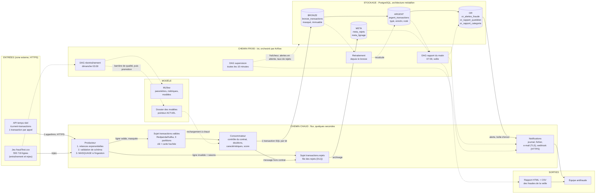

# 01 - Architecture de l'infrastructure, justifiée

*Bloc 3 AIA : détection automatique de fraude. Code : `fraude/`. Ce document répond aux
indicateurs 1.1, 1.2 et 1.3 du référentiel.*

## 1. Le besoin et ses deux fraîcheurs

L'énoncé fixe deux besoins dont l'exigence de fraîcheur n'est pas la même. C'est cette différence
qui commande l'architecture.

| Besoin métier | Fraîcheur exigée | Conséquence |
|---|---|---|
| « Être notifié dès qu'une fraude est détectée » | quelques secondes | chemin **chaud**, en **flux** |
| « Voir chaque matin les paiements et fraudes de la veille » | une fois par jour, 07:00 | chemin **froid**, en **lot** |

L'énoncé précise aussi que « la partie la plus importante est le pipeline de données, pas
l'algorithme » : le modèle (gradient boosting par histogrammes, voir `02_pipeline_et_qualite.md`)
est volontairement simple et remplaçable sans toucher au reste.

## 2. Diagramme d'architecture

Trait plein : flux continu. Trait pointillé : traitement par lot ou lecture différée.

Lecture rapide :

* **Entrées** : l'API (une transaction par appel) et le jeu `fraudTest.csv` (rejeu et
  entraînement).
* **Stockages intermédiaires** : le sujet Kafka (tampon durable), les trois couches de l'entrepôt,
  la file des rejets, le dossier des modèles.
* **Sorties** : l'alerte de fraude (quatre canaux), le rapport du matin (HTML et CSV), les
  tables de la couche or.

## 3. Justification des modes de traitement (indicateur 1.1)

> *« L'arbitrage entre batch, streaming ou ELT/ETL est-il argumenté en fonction de la fraîcheur
> de donnée requise ? »*

### 3.1 Alerte immédiate : flux

Un traitement par lot, même toutes les 15 minutes, ferait attendre l'équipe 7,5 minutes en
moyenne (moitié de l'intervalle) et jusqu'à 15 minutes dans le pire cas. Or une fraude à la
carte vient en **rafale**. Le rejeu du 21 décembre 2020, exécuté pour ce projet, le montre :
une même carte déclenche **quatre alertes en 2 h 15**, toutes avant 03:00 (le détail des
paiements, extrait du jeu, n'est pas reproduit ici). Une alerte dès le premier paiement permet
de bloquer la carte avant les trois suivants ; un rapport lu à 07:00 ne permet que de constater
les quatre. Le coût d'un flux, ici, est faible : un producteur et un consommateur légers.

Le consommateur lit des **micro-lots** (500 messages au plus, 1 s d'attente au plus) plutôt que
message par message : le modèle note le lot en un appel vectorisé, et la latence reste de l'ordre
de la seconde. Latence mesurée de la publication à l'envoi de la notification, sur les 10 alertes
du rejeu : **0,05 s au minimum, 0,30 s en moyenne, 0,54 s au maximum** (mode local, un poste). Sur la production locale (Kafka, PostgreSQL, 18 alertes) : 0,60 s au minimum, 1,95 s en moyenne, 4,26 s au maximum, toujours très en deçà de l'objectif de 60 s.

### 3.2 Rapport du matin : lot

Le métier lit le rapport le matin, pour la **veille entière**. Aucune exigence de fraîcheur à la
seconde ; en revanche on veut une journée *complète et consolidée*, reproductible et
rejouable. Un lot quotidien orchestré (Airflow, 07:00) est la réponse la moins coûteuse : il lit
la couche argent, calcule les agrégats en SQL, écrit la couche or et les fichiers. Il est
**idempotent** : relancé, il remplace le résultat précédent.

### 3.3 Entraînement, retraitement : lot

L'entraînement (hebdomadaire) et le retraitement de l'historique sont des calculs lourds sans
contrainte de latence : ils tournent par lot, hors du chemin chaud.

### 3.4 ETL ou ELT ?

Les deux, chacun là où il est justifié :

* **ETL à l'entrée, pour la confidentialité.** Le masquage doit se faire *avant* le chargement : si
  une donnée identifiante n'est jamais écrite, elle ne peut ni fuiter ni être à purger. La
  transformation « masquer » est donc faite par le producteur, en mémoire, avant publication.
* **ELT ensuite, pour la souplesse.** Les messages masqués sont chargés tels quels dans le
  **bronze** ; les transformations métier (normalisation, caractéristiques, score, agrégats) se
  font après chargement, dans l'entrepôt et sur le bronze. Quand une règle change, on **rejoue
  depuis le bronze** (`python -m detection_fraude.retraitement`) sans rappeler l'API, qui ne
  fournit pas d'historique.

## 4. Choix technologiques et dimensionnement (indicateur 1.2)

> *« Les outils de collecte (Kafka, API, CDC) sont-ils dimensionnés pour supporter le volume de
> données sources sans perte ? »*

### 4.1 Les volumes à absorber

| Source | Volume | Provenance |
|---|---|---|
| API temps réel | **5 appels par minute au plus**, une transaction par appel, soit au plus 7 200 par jour ; usage retenu : 1 appel par minute, **1 440 par jour** | documentation de l'API (`/openapi.json`) |
| Réponse de l'API | 587 octets (une transaction) ; 5,8 à 11 s par appel ; **1 réponse 502 sur 7 appels** observée le 11/10/2026 | mesures de ce projet |
| Jeu de données (rejeu) | 555 719 transactions sur 194 jours : **2 865 par jour en moyenne**, 1 460 au minimum, 6 530 au maximum ; **pic de 16 par minute et de 4 par seconde** | calcul sur `fraudTest.csv` |
| Message dans la file | **431 octets en moyenne** (467 au maximum) ; un rejet pèse environ 690 octets | mesure sur 6 384 messages |

### 4.2 Capacité mesurée

Le rejeu d'une journée complète (6 390 lignes lues, dont 6 volontairement corrompues) est traité
de bout en bout (validation, masquage, file, contrôle, enrichissement, score, trois couches de
stockage, notifications) en **4,4 à 6,3 secondes** selon l'exécution dans le mode local (un poste,
un processus producteur et un processus consommateur, file et entrepôt SQLite) : **entre 1 000 et
1 450 transactions par seconde**. Marges, calculées avec le débit le plus bas (1 000 par seconde) :

* par rapport au **pic du jeu** (4 transactions par seconde) : environ 250 fois ;
* par rapport au **plafond de l'API** (5 transactions par minute, soit 0,083 par seconde) :
  environ 12 000 fois.

La collecte n'est donc pas le facteur limitant. Ce qui l'est : la disponibilité de la source (voir
les relances) et l'envoi des notifications (voir la boîte d'envoi). Ces chiffres sont mesurés en
mode local ; ils ne préjugent pas des performances d'un cluster, mais l'écart de plusieurs ordres
de grandeur laisse une marge très large.

### 4.3 Pourquoi ces outils, et comment ils évitent la perte

| Brique | Choix | Raison | Garantie contre la perte |
|---|---|---|---|
| Collecte | Producteur Python, `requests` | une seule source HTTP à interroger ; le délai maximal et les relances se maîtrisent mieux qu'avec un connecteur générique | relances à attente exponentielle avec gigue (1 s, 2 s, 4 s, 8 s ; 5 tentatives), respect de `Retry-After`, cycle abandonné sans arrêt du processus |
| Bus | **Kafka** en production (ici **Redpanda**, même protocole) ; **SQLite** en local | découplage, tampon durable, rejeu ; Redpanda : un seul binaire, léger en local | producteur `acks=all` et idempotent ; `flush` avant de clore un lot ; rétention 7 jours (valeur par défaut de Redpanda) ; 3 partitions pour monter à 3 consommateurs |
| Consommation | Consommateur Python | logique métier en Python avec le modèle scikit-learn | position validée **après** le commit de la base : un message n'est jamais perdu, au pire relivré |
| Idempotence | clé primaire `trans_num` | une relivraison ne doit ni dupliquer ni renotifier | `INSERT ... ON CONFLICT DO NOTHING`, test dédié |
| Entrepôt | **PostgreSQL** (SQLite en local) | transactions ACID, SQL portable, volume modeste | une transaction par lot : bronze, argent, alertes et lignage ensemble ou pas du tout |
| Orchestration | **Airflow** 2.10 | exigence 3.1 ; relances, SLA, historique des exécutions | `retries`, `retry_delay`, SLA, callbacks d'alerte |
| Suivi des modèles | **MLflow** | paramètres, métriques, empreinte des données, versions | chaque entraînement est tracé et rejouable |

### 4.4 Scénarios de panne et résultat (tous couverts par un test)

| Panne | Ce qui se passe | Perte ? |
|---|---|---|
| L'API répond 502, 429 ou ne répond pas | relances à attente exponentielle, puis cycle abandonné et repris à l'appel suivant ; état de santé écrit | non : la transaction « courante » suivante arrive à l'appel d'après |
| Une ligne est corrompue | elle va en DLQ avec les raisons ; le lot continue | non : elle est conservée (masquée) et comptée |
| Le consommateur s'arrête | les messages s'accumulent dans le sujet (7 jours) ; rattrapage à plus de 1 000 tx/s à la reprise | non |
| La base est indisponible au milieu d'un lot | la transaction est annulée, la position de la file n'avance pas, le lot est rejoué | non |
| Le processus tombe entre le commit et la validation de la file | les messages sont relivrés ; les doublons sont ignorés | non, et pas de seconde notification |
| Un canal de notification est en panne | l'alerte reste `a_envoyer` ; seul le canal en échec est réessayé ; au bout de 5 tentatives : `echec`, alerte de supervision | non (détectée et signalée) |

### 4.5 Limites assumées

* Une seule instance de consommateur : la boîte d'envoi des alertes n'est pas protégée contre la
  concurrence entre plusieurs instances (`FOR UPDATE SKIP LOCKED` en backlog).
* Le courtier est unique dans la production locale (facteur de réplication 1) ; une production
  réelle en demande trois.
* Le débit de 1 000 tx/s est mesuré avec SQLite ; avec PostgreSQL, le coût réseau par lot est plus
  élevé, mais le plafond de l'API est 12 000 fois plus bas.

## 5. Schématisation des flux (indicateur 1.3)

Le diagramme de la section 2 est complété par le tableau de lecture suivant, qui nomme chaque
point d'entrée, de sortie et de stockage.

| Élément | Type | Contenu | Producteur → consommateur |
|---|---|---|---|
| API `/current-transactions` | **entrée** | 1 transaction brute (21 champs, données personnelles incluses) | source → producteur |
| `fraudTest.csv` | **entrée** | 555 719 lignes étiquetées | fichier → producteur (rejeu), entraînement |
| `transactions.valides` | stockage intermédiaire | message masqué (431 octets), clé = carte hachée | producteur → consommateur |
| `transactions.rejets` | stockage intermédiaire | ligne invalide masquée + liste des erreurs | producteur ou consommateur → archivage |
| `bronze_transactions` | stockage | messages valides tels que reçus, masqués, immuables | consommateur → retraitement, historique des cartes |
| `argent_transactions` | stockage | lignes normalisées, enrichies, notées | consommateur → rapport, supervision |
| `or_alertes_fraude` | stockage + sortie | alerte et état de sa notification | consommateur → notifications |
| `or_rapport_quotidien`, `or_rapport_categorie` | stockage + sortie | indicateurs du jour | DAG rapport → lecteurs métier |
| `meta_rejets`, `meta_lignage` | stockage | rejets archivés, une ligne par exécution d'étape | tous → audit |
| Rapport HTML et CSV | **sortie** | paiements, fraudes, taux, liste | DAG rapport → équipe |
| Alerte (journal, fichier, e-mail, webhook) | **sortie** | fraude détectée, données masquées | consommateur → équipe |
| Modèles + `ACTUEL` | stockage | pipeline scikit-learn, seuil, métadonnées, SHA-256 | DAG réentraînement → consommateur |
| MLflow | stockage | runs, paramètres, métriques | entraînement → équipe |

## 6. Hypothèses et points à confirmer

* Les horodatages de la source sont traités comme UTC ; « la veille » est un jour UTC. À
  confirmer avec le métier si ses journées suivent un fuseau américain.
* La devise des montants n'est pas précisée par la source ; les rapports n'en affichent aucune.
* Les chiffres de débit sont mesurés en mode local ; ils n'ont pas été vérifiés sur un cluster.

*Copyright © 2026 · Auteur : KinSushi · Enzo · Sovralys LLC*
