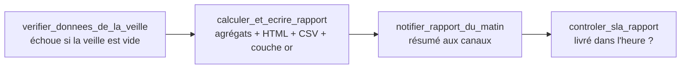

# 02 - Pipeline de données et qualité

*Bloc 3 AIA : détection automatique de fraude. Ce document répond aux indicateurs 2.1, 2.2, 2.3,
3.1, 3.2, 3.3, 4.1, 4.2, 4.3 et 7.1 du référentiel. Tous les chiffres viennent de mesures faites
sur ce projet (jeu `fraudTest.csv`, mode local et production locale Docker).*

## 1. Les trois couches (architecture médaillon) - indicateur 2.1

> *« Les transformations sont-elles organisées en modules réutilisables ou couches logiques
> (Médaillon) ? »*

| Couche | Table(s) | Contenu | Écrit par | Jamais modifié par |
|---|---|---|---|---|
| **Bronze** | `bronze_transactions` | message valide **tel que reçu**, déjà masqué, avec sa position dans la file | `consommateur.construire_ligne_bronze` | personne (immuable, sauf purge de conservation) |
| **Argent** | `argent_transactions` | ligne normalisée, enrichie (caractéristiques) et notée (score, décision, versions) | `consommateur.enrichir` + `noter_lignes` ; `retraitement` | le bronze ne dépend pas d'elle |
| **Or** | `or_alertes_fraude`, `or_rapport_quotidien`, `or_rapport_categorie` | alertes et état de leur notification ; indicateurs du jour | consommateur ; DAG rapport | - |
| **Méta** | `meta_rejets`, `meta_lignage` | rejets archivés ; une ligne par exécution d'étape | consommateur, rapport, retraitement | - |

Chaque transformation est une **fonction isolée et testée**, réutilisée par le flux, le lot et
l'entraînement. Le tableau ci-dessous donne le module de chaque étape.

| Transformation | Module · fonction | Réutilisée par |
|---|---|---|
| Décoder la réponse de l'API | `producteur.decoder_reponse` | producteur |
| Valider le schéma brut | `schema.valider_brut` | producteur, entraînement |
| Masquer | `masquage.masquer` | producteur, entraînement, rejeu |
| Valider le contrat de la file | `schema.valider_masque` | producteur, consommateur |
| Normaliser (argent) | `fonctionnalites.normaliser_commercant`, `derivees_temporelles` | consommateur, retraitement |
| Caractéristiques d'historique | `fonctionnalites.EtatCartes` (flux), `ajouter_historique_cartes` (lot) | consommateur, retraitement ; entraînement |
| Noter | `modele.ModeleFraude.noter` | consommateur, retraitement |
| Agréger (or) | `rapport.calculer_rapport` | DAG rapport, ligne de commande, retraitement |

Le principe qui évite les écarts entre l'entraînement et la production est simple : **le jeu
d'entraînement passe par le même code que le flux** (`jeu_donnees.preparer_jeu_entrainement`
appelle `valider_brut` puis `masquer`). Le modèle apprend donc sur ce qu'il verra, y compris sur
des données déjà masquées.

## 2. Feature engineering - indicateur 2.2

> *« Les transformations spécifiques (encodage, normalisation, agrégations) sont-elles
> configurées selon les besoins mathématiques du modèle ? »*

Deux modèles sont entraînés pour une raison : leurs mathématiques n'exigent pas les mêmes
prétraitements. Le meilleur sur la période de validation est retenu.

| Caractéristique | Régression logistique (modèle linéaire) | Gradient boosting par histogrammes (arbres) | Pourquoi |
|---|---|---|---|
| `montant` | `log1p` puis découpage en 12 tranches, indicatrices | brut | la fraude cible des montants *intermédiaires* : un modèle linéaire ne sait tracer qu'un effet monotone, d'où les tranches ; un arbre coupe où il veut |
| `population_ville`, `distance_km`, `nb_tx_24h`, `montant_relatif` | `log1p` puis standardisation | brut | longues traînes : un modèle linéaire y est sensible ; un arbre est invariant aux transformations monotones, la mise à l'échelle n'apporterait rien |
| `age` | imputation médiane, standardisation | brut (le modèle gère les manquants) | échelle |
| `heure`, `jour_semaine` | indicatrices (24 et 7 colonnes) | brut | la fraude se concentre sur quelques heures : effet non linéaire |
| `categorie` (14), `etat` (51) | indicatrices, catégories rares regroupées (moins de 20 occurrences) | encodage ordinal déclaré **catégoriel** (découpes sur sous-ensembles) | cardinalité faible ; valeur inconnue → ignorée / manquante |

**Agrégations** (calculées sur l'historique de la carte, jamais sur le futur ni sur la
transaction elle-même) :

* `nb_tx_24h` : nombre de transactions de la même carte dans les 24 h strictement précédentes ;
* `montant_relatif` : montant divisé par la moyenne des montants de la carte sur les 30 jours
  précédents (1 si la carte est inconnue, plafonné à 100).

Elles existent en **deux versions** (vectorisée pour le lot, incrémentale pour le flux) dont
l'égalité est vérifiée par un test (`tests/test_fonctionnalites.py`, jeu aléatoire avec égalités
d'horodatage, arrivées tardives et trous de plus de 30 jours). L'état du flux est reconstruit à la
demande depuis le bronze : un consommateur redémarré retrouve exactement le même état (test
`test_apres_redemarrage_l_etat_est_reconstruit_depuis_le_bronze`).

### Protocole d'entraînement et résultats mesurés

* **Découpage chronologique** 70 % / 15 % / 15 % (jamais aléatoire sur une série temporelle) :

| Tranche | Lignes | Fraudes | Taux | Période |
|---|---:|---:|---:|---|
| Entraînement | 389 003 | 1 776 | 0,457 % | 21/06/2020 → 20/11/2020 |
| Validation (seuil, choix du modèle) | 83 358 | 283 | 0,339 % | 20/11/2020 → 13/12/2020 |
| Test (mesure finale) | 83 358 | 86 | 0,103 % | 13/12/2020 → 31/12/2020 |

* **Précision fixée** : le seuil est celui qui, sur la validation, donne le meilleur rappel avec
  une précision d'au moins 0,90 (la précision est la contrainte métier : chaque alerte coûte du
  temps d'analyste).
* **Résultats** (gradient boosting, retenu) :

| Mesure | Validation | Test |
|---|---:|---:|
| PR-AUC (surface sous la courbe précision-rappel) | **0,8236** | **0,7899** |
| ROC-AUC | - | 0,9959 |
| Rappel à précision fixée à 0,90 (sur la courbe de la tranche) | - | 0,686 |
| Seuil de décision retenu | 0,4150 | |
| Au seuil retenu : précision / rappel | - | 0,707 / 0,814 (99 alertes, 70 vraies sur 86 fraudes) |

| Régression logistique (référence) | Validation | Test |
|---|---:|---:|
| PR-AUC | 0,5003 | 0,4085 |

Le gradient boosting est retenu : sa PR-AUC de validation est la plus élevée. Les deux
modèles sont **reproductibles à l'identique** d'une exécution à l'autre (un premier jet de la
régression logistique ne l'était pas : `KBinsDiscretizer` tirait au hasard 200 000 lignes pour
fixer ses bornes, ce que `subsample=None` supprime ; un test l'interdit désormais).

**Limite à connaître** : le taux de fraude du jeu s'effondre en fin de période (aucune fraude
après le 22/12/2020), si bien que la précision cible de 0,90, atteinte sur la validation, retombe à 0,707 sur le test au même
seuil. C'est un décalage de prévalence propre à ce jeu, pas un défaut du pipeline ; la barrière
de qualité (section 4.2) suit la PR-AUC, qui y est moins sensible.

* **Reproductibilité** : graine fixée (42), empreinte SHA-256 du jeu, versions de bibliothèques,
  hyperparamètres et métriques sont consignés dans MLflow **et** dans `metadonnees.json` à côté du
  modèle. Un test vérifie que deux entraînements successifs donnent le même seuil et la même
  PR-AUC.

## 3. Cycle de vie et retraitement de l'historique - indicateur 2.3

> *« Le pipeline permet-il de re-traiter des données historiques si les règles de transformation
> changent ? »*

Oui, **sans rappeler l'API** (qui ne fournit qu'une transaction « courante » et aucun historique) :
le bronze conserve les messages masqués et rejouables.

```bash
# Recalculer la couche argent et les alertes du 21 au 22 décembre 2020 avec le modèle en service,
# puis régénérer les rapports de ces jours
python -m detection_fraude.retraitement --depuis 2020-12-21 --jusqu 2020-12-22 --rapports

# Avec une version précise du modèle
python -m detection_fraude.retraitement --depuis 2020-12-21 --jusqu 2020-12-22 --modele 20261011T025310Z
```

Garanties (toutes testées dans `tests/test_retraitement.py`) :

* **idempotent** : relancer la commande donne le même résultat, sans doublon ;
* **les caractéristiques d'historique sont recalculées** dans l'ordre chronologique à partir du
  bronze, y compris pour la première transaction de la période (historique antérieur relu) ;
* **aucune notification d'événements anciens** : une fraude nouvellement détectée est enregistrée
  avec le statut `rejouee` et n'est jamais envoyée ; les alertes déjà envoyées sont conservées
  (piste d'audit) ;
* la commande **compte les décisions modifiées** (`decisions_modifiees`) et l'inscrit dans le
  lignage ;
* **la version des règles** (`VERSION_REGLES`, dans `detection_fraude/__init__.py`) et la version
  du modèle sont inscrites dans chaque ligne de la couche argent : après un changement de règle,
  `SELECT DISTINCT version_regles ...` dit exactement ce qui reste à recalculer.

Rétention (RGPD, limitation de conservation) : le bronze est purgé après 90 jours de **réception**
(`Entrepot.purger_bronze`) ; un rejeu d'historique n'est donc pas purgé le jour même.

## 4. Orchestration, dépendances et reproductibilité - indicateurs 3.1, 3.2, 3.3

### 4.1 Les DAG (indicateur 3.1 : orchestrateur, aucun lancement manuel)

| DAG | Planification | Rôle | Relances | SLA |
|---|---|---|---|---|
| `fraude_rapport_du_matin` | tous les jours à 07:00 (Europe/Paris) | rapport de la veille | 3, espacées de 5 min, attente croissante (plafond 30 min) | 60 min après 07:00 |
| `fraude_reentrainement_hebdo` | dimanche 03:00 | entraînement, barrière de qualité, promotion | 2, espacées de 10 min (plafond 1 h) | 3 h |
| `fraude_supervision` | toutes les 10 minutes | contrôles de santé du flux temps réel | 1, après 1 min | 5 min |

Les trois DAG sont **actifs dès leur création** (`DAGS_ARE_PAUSED_AT_CREATION=false`), portent
`catchup=False` et `max_active_runs=1`. La planification utilise explicitement
`CronDataIntervalTimetable` : le SLA d'Airflow se mesure à partir de la fin de l'intervalle de
données, c'est-à-dire 07:00 le jour même (avec la planification « déclencheur » par défaut des
versions récentes, il se mesurerait un jour plus tard). Un jour manqué se rattrape avec
`airflow dags backfill`, jamais à la main sur le fichier.

**Comportement constaté en production locale.** Le conteneur Airflow a lui-même déclenché, dès son
démarrage, le DAG du rapport pour l'intervalle manqué du 9 octobre 2026 ; la première tâche a
échoué faute de données (source muette détectée), est passée en `up_for_retry`, puis a été
relancée automatiquement après le chargement des données. Les tâches suivantes ne démarrent qu'au
succès de la précédente (voir 4.2).

### 4.2 Dépendances (indicateur 3.2)

Rapport du matin : chaque flèche signifie « attend le **succès** de la tâche précédente ».



Réentraînement : `verifier_jeu_de_donnees` → `entrainer_candidats` → `valider_barriere_qualite`
→ `promouvoir_modele` → `notifier_reentrainement`. Le test `test_dags.py` reconstruit le graphe
réel à partir des fichiers de DAG (doublure d'Airflow) et vérifie qu'il s'agit d'une **chaîne
sans tâche orpheline**, que `valider_barriere_qualite` précède `promouvoir_modele`, et que chaque
tâche appelle une fonction qui existe dans `taches_airflow.py`. Les fichiers de DAG sont en outre
analysés par le **vrai Airflow 2.10.5** (`airflow dags list`, aucune erreur d'import).

La barrière de qualité refuse un candidat dont la PR-AUC de test est sous 0,30 ou inférieure de
plus de 0,02 à celle du modèle en service ; le refus est un **échec définitif** (non relancé) qui
déclenche l'alerte, et l'ancien modèle reste en service. La promotion est une bascule atomique du
pointeur `ACTUEL` ; le consommateur détecte le changement et recharge sans redémarrer.

### 4.3 Environnements et reproductibilité (indicateur 3.3)

> *« Le pipeline peut-il être ré-exécuté de manière identique dans un environnement différent
> (test/prod) ? »*

| Aspect | `dev` (sans Docker) | `prod` (Docker) | Identique ? |
|---|---|---|---|
| Code | `detection_fraude/` | le même, copié dans les images | oui |
| Configuration | `config/base.yaml` + `dev.yaml` | `base.yaml` + `prod.yaml` | paramètres métier identiques (testé) |
| File | SQLite | Kafka (Redpanda) | même interface `FileMessages` |
| Entrepôt | SQLite | PostgreSQL | même SQL portable, seul le DSN change |
| Suivi des modèles | SQLite local | serveur MLflow | même code |
| Secrets | généré localement (sel), environnement | fichiers montés `/run/secrets` | même fonction `lire_secret` |
| Versions de bibliothèques | environnement virtuel de l'utilisateur | figées par les contraintes d'Airflow 2.10.5 et `docker/contraintes-ml.txt` | identiques entre les trois images |

Preuves : (1) la suite de tests passe sur **deux piles de bibliothèques** (pandas 3.0 + numpy 2.5 +
SQLAlchemy 2.1, et pandas 2.1.4 + numpy 1.26.4 + SQLAlchemy 1.4.54 comme dans l'image Airflow) ;
(2) le même rejeu du 21/12/2020 donne les **mêmes 10 alertes** en mode local (SQLite) et sur la
production locale (Kafka + PostgreSQL) ; (3) l'entraînement donne la même PR-AUC de test (0,7899)
sur le poste et dans les conteneurs.

## 5. Contrôles de qualité à chaque étape - indicateur 4.1

> *« Des tests automatiques vérifient-ils la conformité des types et des formats de données à
> chaque étape ? »*

| Étape | Contrôle | Où | Test |
|---|---|---|---|
| Réponse de l'API | double encodage JSON décodé ; structure `columns`/`data` ; autant de valeurs que de colonnes | `decoder_reponse` | `test_producteur::test_decodage_*` |
| Ligne brute | 20 champs obligatoires, types, formats, bornes (montant, coordonnées, date, `trans_num` = 32 hexadécimaux, `current_time` plausible…) ; `is_fraud` facultatif ∈ {0,1} | `schema.valider_brut` | `test_schema` (22 corruptions) |
| Message masqué (sortie du producteur) | champs exacts du contrat, **tout champ inattendu refusé** (donc tout champ sensible oublié) | `schema.valider_masque` | `test_schema`, `test_producteur` |
| Entrée du consommateur | même contrat, revérifié (on ne fait pas confiance au producteur) | `Consommateur.traiter_lot` | `test_message_hors_contrat_vers_la_dlq…` |
| Bronze | clé primaire, `NOT NULL`, types SQL | DDL de `entrepot.py` | `test_entrepot` |
| Caractéristiques | égalité lot/flux ; absence de `NaN` ; plafonds | `fonctionnalites.py` | `test_fonctionnalites` |
| Argent | toutes les caractéristiques du modèle présentes (sinon `ErreurModele`) ; score ∈ [0, 1] | `ModeleFraude.noter` | `test_entrainement` |
| Rapport | agrégats vérifiés à la main sur un jeu connu ; source muette refusée | `rapport.py` | `test_rapport` |
| Modèle | empreinte SHA-256 vérifiée avant le chargement du pickle ; barrière de qualité | `modele.py`, `entrainement.py` | `test_entrainement` |
| Jeu téléchargé | taille et SHA-256 vérifiés sur le flux **et** sur le fichier relu | `telechargement.py` | `test_divers` |

Chaque erreur de validation est une triplet `{champ, code, detail}` ; **toutes** les erreurs d'une
ligne sont remontées d'un coup, ce qui accélère le diagnostic. Le `detail` ne cite jamais la
valeur d'un champ sensible.

## 6. Gestion des anomalies : file des rejets (DLQ) - indicateur 4.2

> *« Des mécanismes d'isolation (Dead Letter Queues) sont-ils prévus pour ne pas bloquer le flux
> en cas de ligne corrompue ? »*

Une ligne invalide **ne bloque jamais** le flux : elle est publiée dans le sujet
`transactions.rejets`, le lot continue. Deux points de rejet existent : le producteur (schéma
brut, contrôle de sortie du masquage) et le consommateur (contrat de la file violé, charge
illisible). Un archiveur recopie ce sujet dans `meta_rejets` pour le requêter et le compter.

Exemple, aux valeurs fictives (une ligne dont le champ `gender` a été corrompu ; **aucune donnée identifiante**,
seuls les noms des champs masqués sont conservés) :

```json
{
  "version_schema": 1,
  "etape": "producteur",
  "raison": "schema_invalide",
  "erreurs": [{"champ": "gender", "code": "valeur_inconnue", "detail": ""}],
  "trans_num": "c7e1d0a94f3b42e8a65d1f0b9e2c7a14",
  "source": "api",
  "rejete_le": "2026-10-11T03:09:36+00:00",
  "charge_utile_masquee": {
    "champs_conserves": {"merchant": "fraud_Marchand 3", "category": "misc_net", "amt": 30.5,
                         "state": "NY", "city_pop": 8000000, "trans_num": "c7e1d0a9…",
                         "merch_lat": 40.8, "merch_long": -73.95, "is_fraud": 0,
                         "current_time": 1791682255368},
    "champs_masques": ["cc_num", "city", "dob", "first", "gender", "job", "last", "lat", "long",
                       "street", "zip"],
    "champs_inconnus": []
  }
}
```

Sept types de corruption sont injectables pour la démonstration (`--corruptions N`) : type invalide,
champ obligatoire absent, valeur hors liste, date impossible, coordonnée hors bornes, numéro de
carte invalide, montant négatif. Chacun finit en DLQ (`test_chaque_corruption_de_demonstration…`).
Dans le rejeu du 21/12/2020 : **6 390 lignes lues, 6 corrompues, 6 en DLQ, 6 384 traitées**.

## 7. Robustesse opérationnelle : relances automatiques - indicateur 4.3

> *« Des politiques de relance automatique (retries) sont-elles configurées pour gérer les pannes
> réseau éphémères ? »*

| Niveau | Politique | Configuration |
|---|---|---|
| Appel à l'API | 5 tentatives ; attente 1 s, 2 s, 4 s, 8 s (facteur 2, plafond 60 s) + gigue de 10 % ; `Retry-After` respecté ; relance sur 408, 425, 429, 500, 502, 503, 504, délai dépassé, erreur réseau, réponse illisible ; **pas** de relance sur 4xx définitif | `config/base.yaml`, section `source.relances` |
| Cycle de collecte | un cycle abandonné n'arrête pas le processus ; prochain essai à l'intervalle suivant ; compteur d'échecs consécutifs dans l'état de santé | `producteur.boucle_api` |
| Publication Kafka | `acks=all`, producteur idempotent, `flush` avant de clore un lot, erreur de livraison levée | `file_attente.FileKafka` |
| Écriture en base | transaction annulée, position de la file non validée, lot rejoué | `Consommateur.traiter_lot` |
| Notifications | 5 tentatives par alerte, canal par canal, puis statut `echec` et alerte de supervision | `notification.envoyer_alertes_en_attente` |
| Tâches Airflow | `retries`, `retry_delay`, attente exponentielle, `execution_timeout`, SLA, `on_failure_callback` | `dags/*.py` |

Les relances de l'API ne sont pas théoriques : l'API réelle a répondu **502 à 1 appel sur 7** et
ses réponses ont pris 5,8 à 11 s. La démonstration `--pannes 2` simule deux pannes réseau au
départ pour les montrer à coup sûr.

## 8. Lignage des données - indicateur 7.1

> *« Le lignage permet-il de retracer l'origine de chaque donnée transformée ? »*

### 8.1 Lignage par colonne (couche argent)

| Colonne | Origine (champ de l'API) | Transformation | Code |
|---|---|---|---|
| `trans_num` | `trans_num` | identité (clé primaire) | `masquer` |
| `horodatage_s`, `horodatage_utc`, `date_transaction` | `current_time` (ms) | division par 1000 ; formats UTC | `masquage.horodatage_depuis_ms`, `fonctionnalites.derivees_temporelles` |
| `carte_hash` | `cc_num` | HMAC-SHA256 à clé secrète, 32 premiers caractères hexadécimaux | `masquage.HacheurCarte` |
| `carte_fin` | `cc_num` | 4 derniers chiffres | `masquer` |
| `commercant` | `merchant` | bronze : identique ; argent : préfixe `fraud_` retiré | `fonctionnalites.normaliser_commercant` |
| `categorie`, `etat`, `population_ville` | `category`, `state`, `city_pop` | identité | `masquer` |
| `montant` | `amt` | flottant | `masquer` |
| `age` | `dob` et date de la transaction | années révolues | `masquage.calculer_age` |
| `distance_km` | `lat`, `long`, `merch_lat`, `merch_long` | distance de haversine | `masquage.distance_km` |
| `heure`, `jour_semaine` | `current_time` | composantes UTC | `fonctionnalites.derivees_temporelles` |
| `nb_tx_24h`, `montant_relatif` | historique de la carte dans le bronze | fenêtres 24 h et 30 j, strictement antérieures | `fonctionnalites.EtatCartes` |
| `score`, `est_fraude`, `seuil`, `version_modele` | caractéristiques ci-dessus | probabilité du modèle ; décision `score >= seuil` | `modele.ModeleFraude` |
| `etiquette_source` | `is_fraud` | identité ; **jamais utilisée pour décider**, seulement pour mesurer | `masquer` |
| `version_regles`, `lot_id`, `traite_le` | métadonnées d'exécution | - | `consommateur` |

Les champs `first`, `last`, `street`, `city`, `zip`, `job`, `gender`, `dob`, `lat`, `long` n'ont
**aucune colonne descendante** : leur lignage s'arrête au producteur (voir
`03_securite_conformite.md`).

### 8.2 Lignage par exécution et par ligne

* `meta_lignage` : une ligne par exécution d'étape (`consommateur`, `rapport_du_matin`,
  `retraitement`) avec l'entrée, la sortie, les nombres de lignes entrées / sorties / rejetées,
  l'horodatage de début et de fin, la version des règles et celle du modèle, des détails JSON
  (lot, doublons, fraudes, durée).
* Chaque ligne d'argent porte son `lot_id`, qui renvoie à la ligne de `meta_lignage` ; chaque ligne
  de bronze porte son sujet, sa **position dans la file** (`partition:décalage` en Kafka), son
  heure de publication et son heure de réception.
* Exemple de remontée : une alerte (`or_alertes_fraude.trans_num`) → la ligne d'argent
  (`version_modele`, `version_regles`, `lot_id`) → le lot (`meta_lignage`) → la ligne de bronze
  (message tel que reçu, position dans la file) → le sujet Kafka. Le rapport du jour porte sa
  version de règles, son heure de génération et les chemins de ses fichiers.

*Copyright © 2026 · Auteur : KinSushi · Enzo · Sovralys LLC*
