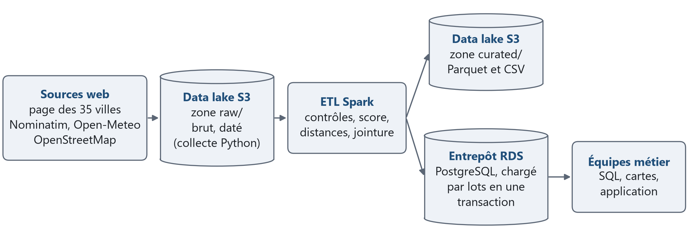
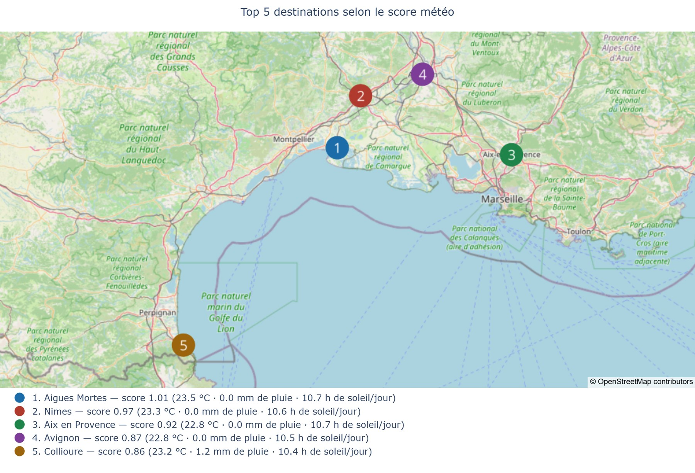
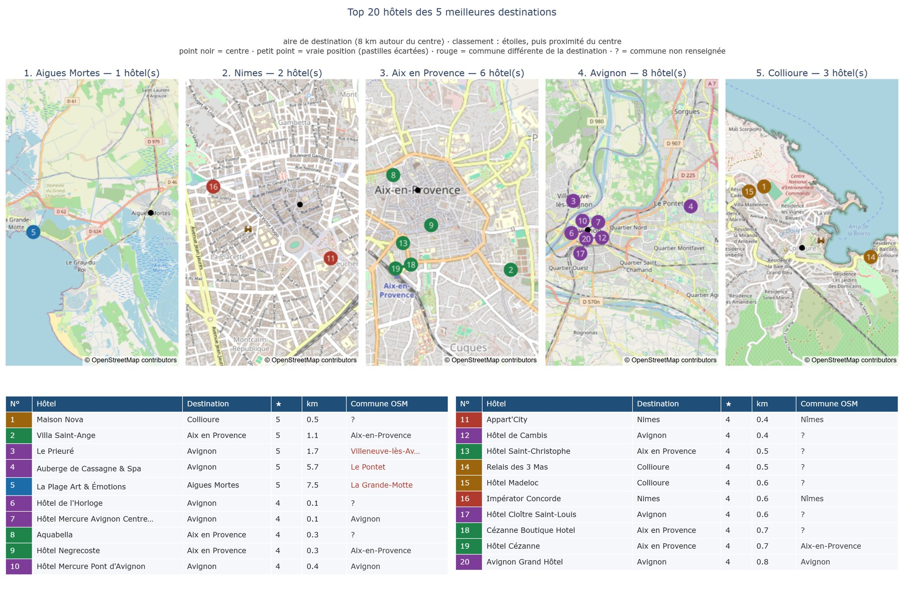

# Bloc 1 - Infrastructure de données : le pipeline Kayak

*Certification RNCP35288 (Concepteur Développeur en Science des Données), bloc 1 : construction et alimentation d'une infrastructure de gestion de données.*

Collecte web de 35 destinations françaises (météo à 7 jours, hôtels), stockage dans un **data lake** daté, **ETL Spark**, chargement dans un **entrepôt SQL**, puis deux cartes : les 5 meilleures destinations de la semaine et les 20 meilleurs hôtels de ces destinations.

| Pour aller vite | Où |
|---|---|
| Le notebook exécuté (résultats, contrôles, SQL, cartes) | [`kayak_v2/Kayak_Bloc1_CDSD.ipynb`](kayak_v2/Kayak_Bloc1_CDSD.ipynb) |
| Le README technique (installation, limites détaillées, conformité) | [`kayak_v2/README.md`](kayak_v2/README.md) |
| Le code | [`kayak_v2/kayak/`](kayak_v2/kayak/) ; tests dans [`kayak_v2/tests/`](kayak_v2/tests/) |
| Les données et comment les obtenir | [`OBTENIR_LES_DONNEES.md`](OBTENIR_LES_DONNEES.md) |

---

## 1. Problématique

Étude de cas : l'équipe marketing d'un site de voyage (Kayak, dans l'énoncé du projet) veut recommander où partir selon **la météo** et **les hôtels**. Il faut collecter les données de 35 villes françaises, les stocker dans un data lake, les nettoyer et les charger dans un entrepôt SQL par un processus ETL, puis cartographier les 5 meilleures destinations et les 20 meilleurs hôtels.

Ce que le projet doit montrer, au-delà des deux cartes : une architecture data lake + entrepôt adaptée au besoin, un traitement distribué (Spark), une collecte web **loyale et conforme au RGPD**, et un ETL robuste.

## 2. Données

Toutes les données viennent de **sources web publiques** ; aucune base privée n'est utilisée.

| Donnée | Source et outil | Collecte du 11/10/2026 | Source du chiffre |
|---|---|---|---|
| Liste des 35 destinations | page « 35 cities to visit in France », BeautifulSoup | 35 villes rapprochées : 33 identiques, 2 par alias | notebook, In[5] |
| Coordonnées | API Nominatim (OpenStreetMap) | 35 / 35 géocodées | In[6] |
| Météo à 7 jours | API Open-Meteo | 245 prévisions journalières, du 11 au 17/10/2026 | In[6] |
| Hôtels (prévu) | Booking.com, robot Scrapy | 35 villes sur 35 bloquées par un contrôle anti-robot (collecte du 10/10), **non contourné** | In[9] |
| Hôtels (retenu) | OpenStreetMap, API Overpass | 4 128 hôtels, dont 1 914 avec étoiles | In[11] |

Le data lake n'est pas inclus dans ce dépôt. [`OBTENIR_LES_DONNEES.md`](OBTENIR_LES_DONNEES.md) décrit les sources, leurs licences et la commande qui refait une collecte. Les sorties enregistrées du notebook montrent les résultats de la collecte du 11/10/2026.

Licences des données : © les contributeurs d'OpenStreetMap (ODbL) ; Open-Meteo (CC BY 4.0, API gratuite réservée à un usage non commercial).

## 3. Méthode

<p align="center"></p>

*Cible conçue : S3 et RDS sur AWS. **AWS n'est pas déployé** : tout a été exécuté en local (data lake dans un dossier, Spark sur un poste, entrepôt SQLite).*

1. **Collecte loyale.** Chaque `robots.txt` est archivé daté et interprété règle par règle ; le robot s'identifie (User-Agent) et garde un débit faible (une requête par seconde au plus pour Nominatim) ; chaque requête est journalisée (hôte, chemin, paramètres publics comme le nom de la ville ou les coordonnées de son centre, statut, taille, durée ; ni clé d'API ni corps de requête). Les moyens de contact des établissements que renvoie OpenStreetMap (courriel, téléphone) sont retirés de chaque réponse dès sa réception, avant l'archivage. La collecte du 11/10 compte **142 requêtes** ; Overpass a reçu 70 requêtes, dont 35 réponses « serveur occupé » (504), chacune suivie d'un nouvel essai (In[7]). Devant le contrôle anti-robot de Booking.com, le robot s'est arrêté et l'a consigné ; il n'a pas été relancé. Conséquence assumée : pas de note client, donc un classement des hôtels par étoiles.
2. **Data lake** par source et par date (`raw/<source>/date=AAAA-MM-JJ/`), puis zone `curated/` (Parquet et CSV enrichi) : l'ETL se rejoue sans recollecter.
3. **ETL Spark** (PySpark) : lecture, dépliage des prévisions (`explode`), agrégats par ville (`groupBy`), score météo, contrôles des hôtels, distance au centre (haversine), rattachement à la destination la plus proche (fenêtre), jointure. Chaque anomalie est **comptée avant d'être corrigée**.
4. **Entrepôt SQL** : 3 tables reliées par des clés (`villes`, `meteo_quotidienne`, `hotels`), des index et la vue `vue_hotels_destinations`, chargés **par lots en une seule transaction** (un échec n'efface rien). Le code passe par SQLAlchemy : SQLite en local, PostgreSQL (RDS) en cible, seule l'URL change. Huit requêtes d'exemple : [`kayak_v2/entrepot/requetes_exemple.sql`](kayak_v2/entrepot/requetes_exemple.sql).
5. **Score météo** : moyenne de scores centrés réduits (chaleur +, ensoleillement +, pluie -) sur la semaine. **Hôtels** : ceux d'une aire de 8 km autour du centre de la destination, classés par étoiles puis par proximité du centre.

## 4. Résultats

**Qualité de l'ETL** (collecte du 11/10, In[12] et In[15]) : 4 128 hôtels lus ; 131 doublons, collectés pour deux villes voisines dont les aires se recouvrent (78 pour Bayonne et Biarritz, 53 pour Colmar et Eguisheim), gardés une fois pour la plus proche ; 0 hôtel hors de France ; **3 997 hôtels chargés**. Entrepôt : 35 villes, 245 prévisions, 3 997 hôtels. Le CSV enrichi compte 3 997 lignes et 23 colonnes, identique au Parquet (In[13]). L'ETL a pris 36 s dans le notebook (In[12]).

**Top 5 de la semaine du 11 au 17/10/2026** (In[14]) :

| Rang | Destination | Score | Maximale moyenne | Pluie totale | Ensoleillement moyen |
|---|---|---|---|---|---|
| 1 | Aigues-Mortes | 1,01 | 23,53 °C | 0,0 mm | 10,70 h |
| 2 | Nîmes | 0,97 | 23,29 °C | 0,0 mm | 10,61 h |
| 3 | Aix-en-Provence | 0,92 | 22,84 °C | 0,0 mm | 10,69 h |
| 4 | Avignon | 0,87 | 22,76 °C | 0,0 mm | 10,47 h |
| 5 | Collioure | 0,86 | 23,19 °C | 1,2 mm | 10,38 h |

Uzès, sixième, obtient 0,85 : les écarts sont minces (In[14]).

<p align="center"></p>

**Top 20 des hôtels** : 5 hôtels 5 étoiles, puis 15 hôtels 4 étoiles (In[16]) ; Avignon 8, Aix-en-Provence 6, Collioure 3, Nîmes 2, Aigues-Mortes 1 ; 3 hôtels sont dans une autre commune que leur destination et 2 à plus de 5 km du centre (In[18]). Les étoiles ne sont renseignées que pour 46 % des hôtels (In[22]) : ce sont les meilleurs au sens des étoiles, pas de la satisfaction des clients.

<p align="center"></p>

**Un classement instable, d'où un pipeline rejouable.** Pour la même semaine, entre la collecte du 10/10 et celle du 11/10, les prévisions ont été révisées : Bormes-les-Mimosas, Toulouse et Cassis sortent du top 5, Aix-en-Provence, Avignon et Collioure y entrent (In[21]). Seuls 3 hôtels du top 20 sont communs aux deux collectes : la première requête Overpass était plafonnée à 40 éléments par ville (1 202 hôtels collectés contre 4 128) (In[22]).

**Capacité, mesurée puis extrapolée** (In[3], In[7]) : la zone brute de la collecte du 11/10 pèse 3,22 Mo, dont 94 % pour OpenStreetMap ; une année de collectes quotidiennes des 35 villes représenterait 1,18 Go. Pour 100 000 villes, l'extrapolation linéaire, **non mesurée**, donne 9,2 Go par collecte. Le facteur limitant est la collecte : une requête Overpass réussie dure en moyenne 41,7 s, soit 48,3 jours en séquentiel pour 100 000 villes.

**Qualité du code** : les tests publiés comptent 1 229 cas (`pytest`, avertissements de dépréciation traités comme des erreurs), dont un ETL de bout en bout, l'atomicité du chargement et le mode S3 avec un faux client. Sans data lake, 3 de ces cas sont ignorés (l'exécution du notebook et deux tests qui lisent une archive du data lake) ; `ruff` et `mypy --strict` : 0 constat. Mutation (mesure du 21/10/2026, avec la suite complète de 1 290 cas, dont 61 sur la minimisation des données OpenStreetMap qui ne sont pas inclus dans ce dépôt) : 5 847 mutants tués sur 5 946, les 99 autres justifiés un par un comme équivalents dans [`MUTANTS_EQUIVALENTS.md`](kayak_v2/MUTANTS_EQUIVALENTS.md).

## 5. Reproduire

Python 3.12. Depuis `kayak_v2/` :

```bash
python -m venv .venv
source .venv/bin/activate                 # Windows : .venv/Scripts/activate
pip install -r requirements-dev.txt       # dépendances figées ; Java pour Spark fourni par le paquet jdk4py
pytest -q -W error::DeprecationWarning -W error::PendingDeprecationWarning
```

Le data lake n'étant pas inclus, le test qui exécute le notebook de bout en bout est ignoré, avec son motif (`pytest -m "not notebook"` l'écarte aussi). Pour refaire une collecte, puis l'ETL et les cartes : [`OBTENIR_LES_DONNEES.md`](OBTENIR_LES_DONNEES.md).

Les étapes `etl` et `cartes` ne collectent rien : elles se rejouent sur un data lake déjà collecté. L'export PNG des cartes demande un navigateur Chromium installé et charge le fond de carte depuis Internet ; sans lui, seul le HTML interactif est écrit. Pour passer sur AWS (bucket S3 chiffré, RDS PostgreSQL), voir « Passer sur AWS » dans [`kayak_v2/README.md`](kayak_v2/README.md) : deux variables d'environnement (`KAYAK_S3_BUCKET`, `KAYAK_DB_URL`), identifiants jamais dans le code.

## 6. Limites

- **AWS non déployé** : S3, RDS et un cluster Spark n'ont pas été exécutés ; le mode S3 n'est testé qu'avec un faux client ; les requêtes SQL n'ont tourné que sur SQLite.
- **Extensibilité conçue, pas démontrée** : l'ETL n'a tourné que sur 35 villes, sur un poste, et n'est pas exécutable tel quel sur un cluster (il écrit d'abord dans un dossier local) ; les chiffres pour 100 000 villes sont des extrapolations.
- **Booking.com** : refus respecté ; l'extraction de ses pages n'a jamais été validée sur une page réelle ; ses conditions d'utilisation n'ont pas été examinées ; pas de note client.
- **Météo** : un instantané d'une semaine, qui change d'une collecte à l'autre ; l'API OpenWeather est branchée dans le code mais n'a pas été appelée (Open-Meteo, sans clé, a été utilisé).
- **Hôtels** : une aire de 8 km dépasse parfois la commune ; la commune n'est renseignée que pour 21 % des hôtels (In[18]) ; un même hôtel peut être décrit deux fois par OpenStreetMap (un point et un contour), sans fusion par l'ETL.
- **RGPD** : la durée de conservation courte de la zone brute (cycle de vie S3) est prévue pour la production, pas appliquée ici.

Détail de chaque limite : [`kayak_v2/README.md`](kayak_v2/README.md), « Limites et points d'attention ».

## 7. Attributions

Données et fonds de carte : © les contributeurs d'OpenStreetMap (ODbL) ; météo : Open-Meteo (CC BY 4.0).

## 8. Différences avec le livrable déposé

- Le data lake n'est pas publié : le test qui rejoue le notebook (`kayak_v2/tests/test_notebook.py`) est ignoré quand le dossier `datalake/` est absent, au lieu d'échouer.
- Dans `kayak_v2/tests/test_destinations_inverses.py`, le mot d'essai de la normalisation (majuscule accentuée, puis accent décomposé) est « ÉTRETAT » au lieu du mot du livrable ; le cas testé est le même.
- Dans `kayak_v2/tests/test_spark_etl_hors_spark.py`, le chemin d'essai de Hadoop est `hadoop` au lieu d'un chemin de poste Windows.

---

*Copyright © 2026 · Auteur : KinSushi · Enzo · Sovralys LLC*
