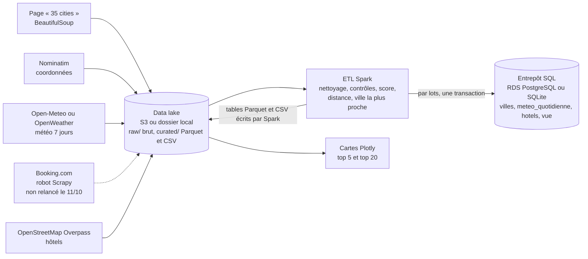

# Kayak : pipeline de données des destinations (bloc 1, RNCP35288)

Collecte de données web sur 35 destinations françaises (météo à 7 jours, hôtels), stockage dans
un **data lake**, **ETL Spark**, chargement dans un **entrepôt SQL**, et deux cartes : les 5
meilleures destinations et les 20 meilleurs hôtels de ces destinations.

> **À lire avant d'utiliser les résultats** (détail dans « Limites et points d'attention ») :
>
> - **Le data lake n'est pas inclus dans ce dépôt**, ni l'entrepôt `entrepot/kayak.db` ni les PNG
>   des cartes : les sorties enregistrées du notebook montrent les résultats de la collecte du
>   11/10/2026, et [`../OBTENIR_LES_DONNEES.md`](../OBTENIR_LES_DONNEES.md) décrit les sources,
>   leurs licences et la commande qui refait une collecte ;
> - **Quelle collecte sert aux résultats** : la **collecte complète du 11/10/2026**
>   (`date=2026-10-11` dans le lac). Elle alimente l'ETL, l'entrepôt `entrepot/kayak.db`, les
>   cartes et le notebook. La première collecte (`date=2026-10-10`) est **conservée comme
>   archive** : sa requête Overpass était plafonnée à 40 éléments par ville et elle ramenait
>   des hôtels allemands ; elle garde aussi la preuve du refus de Booking.com.
> - les hôtels d'une destination sont ceux de son **aire de destination (8 km)**, qui n'est pas
>   la commune ;
> - **Booking.com n'a pas été relancé** (le contrôle anti-robot du 10/10 est un refus respecté) et
>   l'extraction de ses pages est **non validée sur une page réelle** (bloquée par le contrôle
>   anti-robot du site) : les hôtels viennent d'OpenStreetMap, sans note des clients.



## Contenu

| Élément | Fichier |
|---|---|
| Notebook de présentation (résultats, contrôles, SQL, cartes), exécuté | `Kayak_Bloc1_CDSD.ipynb` |
| Source du notebook (format « percent ») | `Kayak_Bloc1_CDSD_source.py` |
| Configuration (variables d'environnement, aire de destination) | `kayak/config.py` |
| Data lake S3 ou local (écritures atomiques, chiffrement S3, cache S3 invalidé par ETag) | `kayak/stockage/data_lake.py` |
| Collecte : destinations, géocodage, météo, Booking, OpenStreetMap | `kayak/collecte/` |
| Minimisation des données OpenStreetMap (courriels et téléphones retirés avant l'archivage) | `kayak/collecte/minimisation.py` |
| robots.txt : archivage daté et interprétation règle par règle | `kayak/collecte/robots.py` |
| Journal des requêtes HTTP de la collecte (statut, taille, durée) | `kayak/collecte/journal.py` |
| ETL Spark (Parquet, CSV, chargement par lots en une transaction) et score météo | `kayak/etl/spark_etl.py`, `kayak/etl/score.py` |
| Cartes | `kayak/cartes.py` → `sorties/` |
| Fonctions d'aide du notebook (volumes, bilan Overpass, image allégée), extraites pour être testées | `kayak/outils_notebook.py` |
| Orchestration | `kayak/pipeline.py` |
| Requêtes SQL d'exemple | `entrepot/requetes_exemple.sql` |
| Dépendances d'exécution (versions figées) et outils de contrôle de la qualité | `requirements.txt`, `requirements-dev.txt` |
| Mutants non tués par la mutation, tous équivalents au sens strict, avec la preuve de chacun | `MUTANTS_EQUIVALENTS.md` |
| Tests (754 fonctions, 1 229 cas pytest en 30 fichiers : ETL de bout en bout, chargement atomique, mode S3, refus, exécution hors ligne du notebook, ignorée sans le data lake) | `tests/` |
| Cartes interactives (HTML) de la collecte du 11/10/2026 | `sorties/` |

Le CSV enrichi (météo + hôtels) que demande l'énoncé est écrit par Spark dans
`datalake/curated/kayak_enrichi/date=<date>/kayak_enrichi.csv`, à côté du même tableau en
Parquet.

Le data lake des deux collectes (non inclus dans ce dépôt) pèse 5,63 Mo (196 fichiers) : la collecte complète du 11/10 en représente
3,22 Mo (92,0 Ko par ville, dont 94 % pour OpenStreetMap) et la première collecte 0,94 Mo
(chiffres calculés par le notebook, section 1, après la minimisation des archives
OpenStreetMap du 19/10/2026 ; avant, 5,87 Mo, 3,40 Mo, 97,3 Ko et 0,99 Mo).

## Limites et points d'attention

**1. Deux collectes, une seule sert aux résultats.**

- *Première collecte, 10/10 (archive).* Sa requête Overpass se terminait par
  `out center tags 40` : les 40 premiers éléments de chaque ville seulement. Overpass renvoie
  les points (`node`) avant les contours (`way`) puis coupe : 23 villes sur 35 atteignaient
  exactement 40 éléments, dont 13 sans aucun contour (Paris, Lyon, Toulouse...). Le rayon de 8 km
  autour de Strasbourg traversait aussi le Rhin : 4 hôtels de commune Kehl (5 établissements
  allemands au total) lui étaient rattachés. Son fichier `raw/osm/date=2026-10-10/hotels.jsonl`
  est dérivé des archives `ville_NN.json` par l'ancien convertisseur : le reconvertir avec le
  code actuel ajouterait la colonne `pays` et l'ETL écarterait alors les hôtels déclarés `DE` ;
  il est laissé tel quel, comme archive cohérente avec la collecte de ce jour-là.
- *Collecte complète, 11/10 (résultats).* Refaite avec le code corrigé (voir plus bas), sur
  Nominatim, Open-Meteo, Overpass et la page source des destinations ; **Booking.com n'a pas
  été relancé**. Le journal `datalake/raw/journal_http/date=2026-10-11/` consigne les 142
  requêtes : Nominatim 35 (toutes en 200), Open-Meteo 35 (200), la page source et son
  `robots.txt` 2 (200), Overpass 70 dont 35 réponses 200 (une par ville) et 35 réponses 504
  « serveur occupé », chacune suivie d'un nouvel essai (attente croissante, puis serveur miroir).
  *Vérification de complétude* sur les archives brutes : les 35 réponses portent la marque de la
  requête actuelle (sans plafond), aucune ne porte de remarque d'erreur d'Overpass, aucune
  n'est tronquée. Une seule ville compte exactement 40 éléments (Besançon) : c'est une
  coïncidence, la requête archivée n'a aucun plafond. Paris compte 1 996 éléments. Au total
  4 128 hôtels collectés (contre 1 202), 3 997 retenus par l'ETL (contre 1 130).
- *Ce qui a changé dans les résultats, et pourquoi.* Le top 5 passe de Aigues-Mortes,
  Bormes-les-Mimosas, Toulouse, Nîmes, Cassis à **Aigues-Mortes, Nîmes, Aix-en-Provence,
  Avignon, Collioure** : la semaine est la même (du 11 au 17/10), mais les prévisions ont été
  révisées entre les deux collectes (l'ensoleillement moyen d'Aix-en-Provence passe de 9,55 h à
  10,69 h par jour, celui de Bormes-les-Mimosas de 10,30 h à 10,23 h) et les écarts de score sont
  faibles. Dans le top 20, 3 hôtels seulement restent : la première collecte ne voyait que 40
  éléments par ville, la seconde voit tous les hôtels, dont 81 cinq-étoiles (16 auparavant), et
  les cinq villes ne sont plus les mêmes. Deux villes (Paris, Biarritz) ont aussi changé de centre
  entre les deux géocodages : Nominatim n'est pas parfaitement stable.

**2. Aire de destination (8 km) et commune.** Les hôtels sont cherchés dans un rayon de 8 km
autour du centre de la destination : une **aire**, pas une commune. L'ETL calcule la distance de
chaque hôtel au centre (haversine) et marque les hôtels dont la commune OpenStreetMap
(`addr:city`) diffère de la destination : 230 hôtels sur 3 997. Dans le top 20, 3 hôtels sont
dans une autre commune (Villeneuve-lès-Avignon, Le Pontet, La Grande-Motte) et 2 sont à plus de
5 km du centre. La commune n'est renseignée que pour 21 % des hôtels (et n'a pas de sens pour un
massif ou un département) : le marquage est partiel, la **distance** est le critère complet
(530 hôtels sans commune connue sont à plus de 5 km de leur centre). Le marquage a aussi des
**faux positifs** : une commune déléguée ou associée à la destination compte comme une autre
commune. Avec une liste de contrôle (non utilisée par l'ETL), le notebook en identifie 6 :
Annecy-le-Vieux et Seynod pour Annecy, Lomme (4 hôtels) pour Lille. Un hôtel sorti pour deux
destinations voisines est rattaché à la **plus proche** (fenêtre sur la distance) : 131
doublons, 78 pour Biarritz et Bayonne, 53 pour Colmar et Eguisheim. Option :
`selectionner_top_hotels(..., privilegier_commune=True)` fait reculer les hôtels d'une autre
commune (17 hôtels communs sur 20 avec le classement par défaut, 0 hors commune au lieu de 3) ;
elle n'est pas le défaut, car la définition retenue est l'aire entière.

**3. Hôtels hors de France.** Un simple rectangle englobant la France ne suit pas les
frontières : il laissait passer les hôtels de Kehl. Corrigé de deux façons : la requête Overpass
est limitée à la zone administrative de la France (`area["ISO3166-1"="FR"]`) et l'ETL écarte tout
hôtel dont `addr:country` est renseigné et différent de `FR` (cas testé). Résultat de la
collecte du 11/10 : aucun hôtel de Kehl, 0 hôtel hors de France. La première collecte, elle, est
laissée telle quelle (archive) et contient encore ses 4 hôtels de commune Kehl (5
établissements allemands au total).

**3 bis. Doublons nœud / contour.** OpenStreetMap décrit parfois un même hôtel deux fois, par un
point (`node`) et par un contour (`way`). Ces paires, de même nom et à quelques dizaines de
mètres, ne sont pas fusionnées par l'ETL : elles gonflent légèrement les effectifs d'hôtels
par ville ; aucune n'a été relevée dans le top 20.

**4. Booking.com.**

- `robots.txt` de Booking est archivé daté (`datalake/raw/booking/date=2026-10-11/`, avec statut
  HTTP, date serveur et empreinte). Pour un robot générique (groupe `User-agent: *`, 83 règles),
  **aucune règle ne correspond** à `/searchresults...` ni à `/hotel/<pays>/<page>` : ces pages
  sont autorisées (verdict recoupé avec Protego, l'analyseur de Scrapy). Le fichier interdit
  d'autres chemins (`/book.html`...). Il a été lu le 11/10/2026, après la première collecte ; ses
  règles ne valent pas autorisation contractuelle (les conditions d'utilisation de Booking.com
  n'ont pas été examinées). L'interprétation suit l'essentiel de la RFC 9309 (groupes fusionnés,
  motif le plus long, fichier absent sans restriction), pas toutes ses subtilités.
- Le 10/10/2026, le site a opposé un **contrôle anti-robot** (AWS WAF) à chaque requête ; le
  robot s'est arrêté sans le contourner. Ce refus est respecté : le robot n'a pas été relancé le
  11/10. Le rapport du 10/10 (`datalake/raw/booking/date=2026-10-10/rapport_collecte.json`) ne
  contient **pas le statut HTTP** des réponses ; le robot corrigé archive désormais, pour chaque
  ville, le statut, l'URL et la taille de la réponse, y compris les refus (403, 429...) et les
  erreurs réseau.
- **L'extraction des hôtels n'est pas validée sur une page réelle (bloquée par le contrôle
  anti-robot).** Son test (`tests/test_booking.py`) est circulaire : il fabrique le HTML avec le
  marqueur que l'extraction cherche. Il prouve que le code lit ce qu'il a été écrit pour lire,
  pas que Booking sert cette structure.
- Réglage Scrapy : `DOWNLOAD_DELAY_JITTER` existe depuis Scrapy 2.19 (version figée ici) et
  remplace `RANDOMIZE_DOWNLOAD_DELAY`, déprécié ; un test vérifie que chaque réglage du robot
  existe dans la version installée.

**5. `page.html` n'est pas dans le lac livré, volontairement.** La collecte archive le HTML brut
de la page source des destinations, mais c'est le contenu d'un site tiers : il n'est pas
redistribué. Seuls le CSV réconcilié (`destinations.csv`) et le `robots.txt` du site sont livrés,
pour les deux collectes ; le notebook l'indique.

**6. L'extensibilité est conçue, pas démontrée.** L'ETL a été exécuté sur 35 villes, sur un
poste. Il utilise l'API Spark, mais n'est **pas exécutable tel quel sur un cluster** : les
fichiers sont écrits dans un dossier de travail local puis publiés dans le lac ; sur cluster, on
écrirait vers des chemins `s3a://`. Ce que fait l'ETL pour monter en charge : aucune table de
météo ou d'hôtels n'est ramenée en entier dans pandas **par l'ETL** (écriture du lac par Spark,
chargement de l'entrepôt par lots lus en flux). Ce qu'il ne fait pas : la table des villes (une
ligne par destination) passe par pandas pour le score, le chargement SQL est séquentiel, le CSV
est copié en mémoire d'un bloc, et les cartes relisent le Parquet des 5 premières destinations
seulement (filtre à la lecture). Chiffrage mesuré et extrapolation : section 1 du notebook.

**7. Écriture Parquet et CSV sous Windows.** L'écriture native de Spark exige les binaires Hadoop
(`winutils.exe`) que Spark ne fournit pas sous Windows. Le code le détecte : sous Linux, macOS,
EMR et Databricks il utilise `DataFrame.write.parquet` et `.csv` ; sous Windows sans
`HADOOP_HOME`, chaque partition Spark écrit son fichier avec pyarrow, toujours sans passer par
pandas. Seule cette seconde voie a été exécutée ici.

## Installation et exécution (Windows, macOS, Linux)

Python 3.12 ; les versions des dépendances sont figées dans `requirements.txt` (outils de contrôle :
`requirements-dev.txt`). `setuptools` y est figé parce que PySpark 3.5 importe `distutils`, retiré de
Python 3.12 : sans lui, l'ETL échoue sur `ModuleNotFoundError`. L'export PNG des
cartes utilise Kaleido, qui exige un **navigateur Chromium installé** (Chrome, Edge ou Brave) ;
sans lui, l'export PNG est ignoré avec un avertissement et seul le HTML est produit.
Hors ligne, l'export échoue aussi, car le fond de carte vient d'Internet : le notebook
l'écrit et affiche le dernier PNG exporté dans `sorties/`. Les PNG ne sont pas inclus dans ce
dépôt ; les cartes HTML de `sorties/` le sont.

```bash
python -m venv .venv
.venv/Scripts/activate            # Windows ; sous macOS/Linux : source .venv/bin/activate
pip install -r requirements-dev.txt   # requirements.txt + outils de contrôle ; Java pour Spark : paquet jdk4py
pytest -q -W error::DeprecationWarning -W error::PendingDeprecationWarning   # 1 229 cas
ruff check --select E,F,I,B,SLF,UP,W --line-length 100 .
mypy --strict kayak               # 0 erreur
# collecte complète du 11/10/2026, SANS Booking.com (refus anti-robot respecté), puis ETL et cartes :
python -m kayak.pipeline --etapes destinations geocodage meteo osm etl cartes --date 2026-10-11
python -m kayak.pipeline --etapes etl cartes --date 2026-10-11   # rejouer sur la collecte archivée
python -m kayak.collecte.hotels_osm --reconvertir --date 2026-10-11   # hotels.jsonl depuis les archives
python -m kayak.collecte.minimisation --date 2026-10-11   # retire courriels et téléphones des archives OSM
```

Sans l'option `--etapes`, le pipeline exécute toutes les étapes, **Booking.com compris** : pour ce
projet, cette étape n'a pas été rejouée. Les trois dernières commandes lisent le data lake de la
date indiquée : il n'est pas inclus dans ce dépôt (voir
[`../OBTENIR_LES_DONNEES.md`](../OBTENIR_LES_DONNEES.md)). Les étapes `etl` et `cartes` ne collectent rien : elles
se rejouent sur le lac local. L'export PNG des cartes charge toutefois le fond de carte
OpenStreetMap (tuiles) depuis Internet ; le HTML interactif en fait autant à l'ouverture.

| Variable | Rôle | Défaut |
|---|---|---|
| `KAYAK_S3_BUCKET` | bucket S3 du data lake | absent : dossier `datalake/` |
| `KAYAK_DB_URL` | URL SQLAlchemy de l'entrepôt | `sqlite:///entrepot/kayak.db` |
| `OPENWEATHER_API_KEY` | clé OpenWeather (One Call 3.0) | absente : Open-Meteo, sans clé |
| `KAYAK_USER_AGENT` | identification du robot | `KayakEtudeCertif/1.0 (...)` |
| `KAYAK_DATE_COLLECTE` | date de la collecte à rejouer (AAAA-MM-JJ) | date du jour |

## Contrôle de la qualité

- `ruff check` (règles E, F, I, B, SLF, UP, W) et `mypy --strict kayak` : 0 constat.
- `pytest` avec les avertissements de dépréciation transformés en erreurs. Le test
  `tests/test_notebook.py` (marqueur `notebook`, de 30 à 73 s sur ce poste selon sa charge) exécute le
  notebook dans une **copie** du projet, **hors ligne** (une garde interdit toute connexion
  hors de la machine, et le navigateur de l'export PNG reçoit un mandataire local qui ne
  répond pas) et vérifie ses chiffres clés ; `pytest -m "not notebook"` l'écarte, et il est
  ignoré quand le data lake est absent, comme dans ce dépôt.
- Chaque module de test arrête Spark et sa machine Java à sa fin (`tests/conftest.py`).
- Les avertissements de dépréciation internes à PySpark 3.5.9 (Python 3.12, pandas 3) sont isolés
  dans les seuls tests qui lancent Spark (marqueur `SPARK` de `tests/test_etl.py`) ; un avertissement
  provoqué par le code du projet reste une erreur. Épingler pandas 2.x n'en supprimerait qu'un
  sur trois ; PySpark 4 les supprimerait, mais c'est un changement de version majeur (non essayé).
- Mutation : mutmut 3, sous Linux ou WSL (il ne fonctionne pas sous Windows), sur tout le paquet
  `kayak/` (15 modules, 5 946 mutants ; mesure du 21/10/2026 avec la suite complète de 1 290 cas,
  dont les 61 de `tests/test_minimisation.py`, non inclus dans ce dépôt) : 5 847 tués ; les 99 autres sont équivalents au sens
  strict (mêmes résultats, mêmes octets écrits ; aucun test ne peut les distinguer) et nommés,
  avec leur preuve, dans `MUTANTS_EQUIVALENTS.md`.
- Chaque module Python et le notebook portent une fiche à cinq rubriques (CHOIX, OÙ, COMMENT,
  POURQUOI, JOURNALISATION) qui cite les tests qui prouvent son fonctionnement.

## Passer sur AWS (S3 + RDS)

1. Créer un bucket S3 (région `eu-west-3`), chiffrement par défaut activé, accès public bloqué.
2. Créer une instance **RDS PostgreSQL** `db.t4g.micro` (les conditions de l'offre gratuite
   d'AWS dépendent de la date d'ouverture du compte : crédits d'accueil pour les comptes
   récents : à vérifier à l'ouverture), accessible depuis le poste de travail (groupe de
   sécurité limité à son adresse IP).
3. Fournir les identifiants AWS (profil `aws configure` ou variables `AWS_ACCESS_KEY_ID` /
   `AWS_SECRET_ACCESS_KEY`), **jamais dans le code**.
4. `pip install psycopg2-binary`, puis `export KAYAK_S3_BUCKET=<bucket>` et
   `export KAYAK_DB_URL=postgresql+psycopg2://<utilisateur>:<mot_de_passe>@<hôte>:5432/kayak`
5. `python -m kayak.pipeline --etapes ...` : mêmes étapes et mêmes tables ; le lac est écrit par
   `DataLake` (chiffrement AES-256), Spark tourne toujours sur le poste (sur un cluster, il
   faudrait lui faire écrire vers `s3a://`). Le cache local des objets S3 est invalidé dès que
   l'objet distant change (ETag et date de modification).
6. Arrêter l'instance RDS après la démonstration (coût).

Le mode S3 est testé avec un faux client écrit à la main (`tests/test_data_lake_s3.py`) ; il n'a
pas été exécuté contre un vrai bucket, faute de compte AWS dans ce travail. Les requêtes SQL sont
écrites en SQL standard mais n'ont été exécutées que sur SQLite.

## Conformité de la collecte

- `robots.txt` : ceux de Booking.com et de la page source des destinations sont archivés datés
  dans le lac (celui de la page source pour la collecte du 11/10 : `Disallow` sur `/wp-admin/`
  et `/wp-content/plugins/`, la page demandée est autorisée) et interprétés règle par règle.
- Robot identifié (User-Agent), débit faible : 1 requête par seconde au plus pour Nominatim, une
  pause d'une seconde entre deux requêtes Overpass, une demi-seconde pour Open-Meteo, une requête
  à la fois pour Booking (délai nominal de 3 s, aléatoire de ±50 %, une seule page par ville).
  Chaque requête de la collecte du 11/10 est consignée dans le journal HTTP, sans clé d'API ni
  corps de requête (Booking non relancé ; les requêtes Booking du 10/10 n'ont pas de statut HTTP
  archivé).
- **Arrêt devant un contrôle anti-robot** : le 10/10/2026, Booking.com a opposé un défi AWS WAF
  à chaque requête ; le robot l'a consigné sans tenter de le contourner et n'a pas été relancé.
  Les hôtels viennent d'OpenStreetMap (licence ODbL).
- Aucune donnée personnelle exploitée : les tables curated et l'entrepôt ne gardent que des
  données d'établissements, sans champ de contact ni avis nominatif.
- **Minimisation** (`kayak/collecte/minimisation.py`) : les moyens de contact que renvoie
  OpenStreetMap (`email`, `phone`, `mobile`, `fax` et les étiquettes `contact:*`, sauf
  `contact:website`, qui donne l'adresse du site de l'hôtel) sont retirés de chaque réponse dès
  sa réception, avant l'archivage ; un courriel ou un numéro cité dans un texte libre est
  masqué (« [téléphone retiré] »). Les archives brutes des deux collectes, écrites avant cette
  règle, contenaient un courriel pour 25 % des hôtels de la collecte du 11/10 et un téléphone
  pour 47 %, dont des adresses grand public : elles ont été minimisées hors ligne le
  19/10/2026, sans nouvelle collecte (6 882 étiquettes retirées, 5 356 du 11/10 et 1 526 du
  10/10 ; la description d'un hôtel de Paris, qui citait ses deux numéros, masquée). Aucun
  résultat ne change (classements, cartes, entrepôt hors cette description). En production,
  la zone brute aurait en plus une durée de conservation courte (cycle de vie S3).
- L'exclusion des hôtes particuliers est prévue dans le robot Booking, jamais exécuté sur une
  vraie page.
- Licences : © les contributeurs d'OpenStreetMap (ODbL) ; Open-Meteo (CC BY 4.0 ; l'API gratuite
  est réservée à un usage non commercial : un usage par Kayak en production demanderait l'offre
  commerciale).

---

*Copyright © 2026 · Auteur : KinSushi · Enzo · Sovralys LLC*
