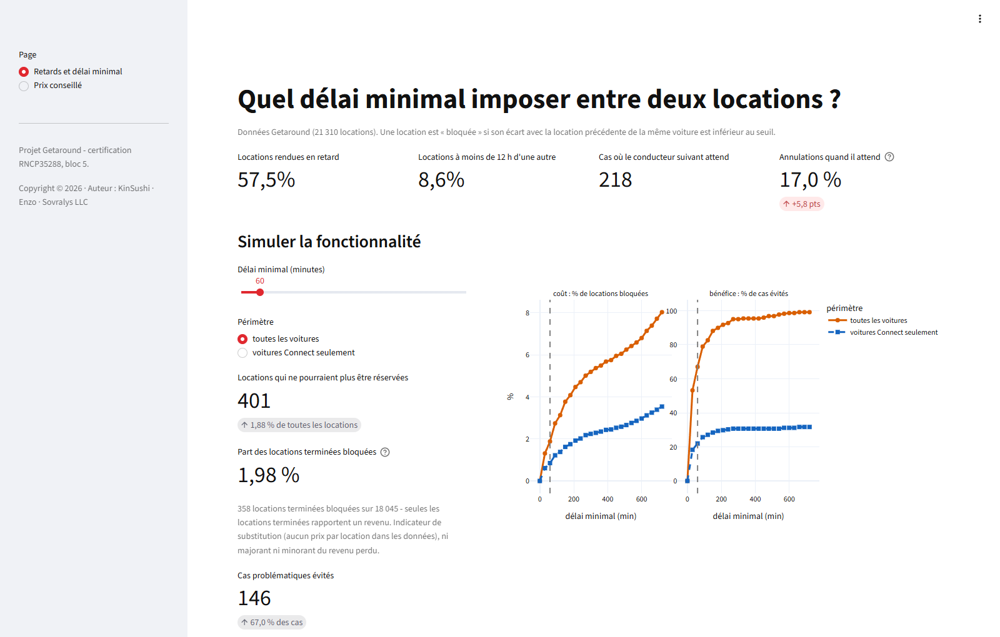
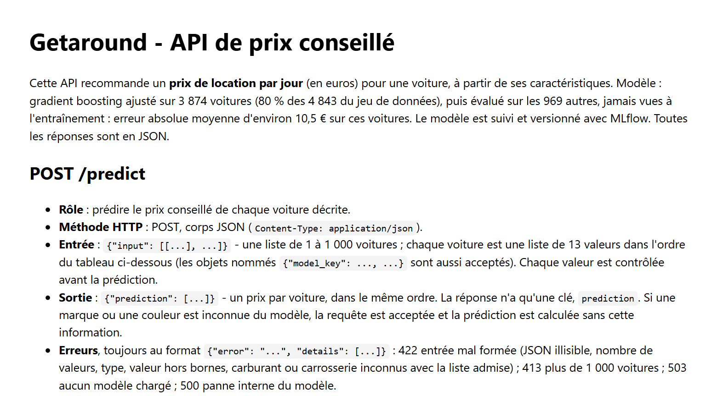
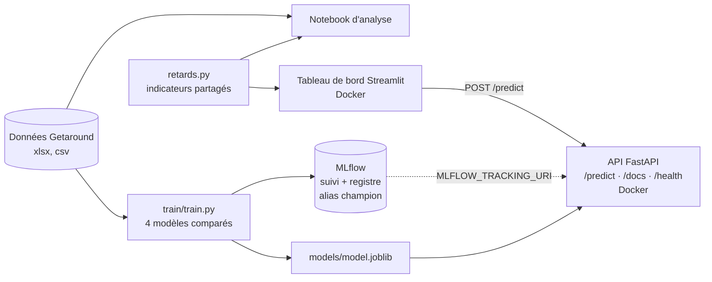

# Bloc 5 : industrialisation d'un algorithme et automatisation des décisions

## Getaround : analyse des retards, prix conseillé, API et tableau de bord

Titre visé : Concepteur développeur en science des données (RNCP35288), bloc 5.

| Livrable de l'énoncé | Où |
|---|---|
| Tableau de bord en production | `dashboard/app.py` ; adresse : https://sovralys-nexus.tail034df0.ts.net/ |
| API documentée, endpoint `/predict` | `api/main.py` ; documentation : https://sovralys-nexus.tail034df0.ts.net:8443/docs ; endpoint : https://sovralys-nexus.tail034df0.ts.net:8443/predict |
| Code complet sur GitHub | https://github.com/KinSushi/jedha-rncp35288-portfolio/tree/main/bloc_5_mlops_deployment |
| Analyse des données (retards, puis exploration des données de prix) | `Getaround_Analyse_Retards.ipynb` |
| Modèle de prix suivi avec MLflow | `train/train.py` ; registre `getaround-pricing`, alias `champion` |

## Résultats en bref

- **Retards** : 57,5 % des locations rendues le sont en retard ; quand une voiture est relouée
  moins de 12 h après, le conducteur suivant attend dans 12,6 % des cas (218 sur 1 729), et ces
  locations sont annulées 17,0 % du temps contre 11,2 % sinon. L'écart (+5,8 points) est observé
  sur 218 cas seulement : c'est une association, pas une causalité démontrée, à lire avec
  prudence, et 37 des 218 « cas d'attente » sont eux-mêmes des locations annulées (attente
  hypothétique).
- **Recommandation** : je recommande un délai minimal de **60 minutes sur toutes les voitures**,
  un arbitrage assumé et non un optimum (le rendement de chaque demi-heure supplémentaire décroît de façon
  continue, sans coude) : 67 % des cas problématiques évités (146 sur 218) pour 1,9 % des
  locations bloquées (401 sur 21 310).
  Les données ne contiennent aucun prix par location : la part du revenu touchée ne peut pas
  être calculée. L'indicateur de substitution est la **part des locations terminées bloquées**
  (358 sur 18 045, soit 1,98 %) ; ce n'est ni un majorant ni un minorant du revenu perdu
  (détails et variantes dans le notebook et le tableau de bord).
- **Prix conseillé** : gradient boosting ajusté sur 80 % des 4 843 voitures (3 874) puis évalué
  sur les 969 autres : **RMSE 16,3 € et MAE 10,5 €** sur ces voitures jamais vues (R² 0,747 ;
  validation croisée 0,768), contre 32,5 € pour la référence « prix moyen ». Variables les plus
  influentes : puissance, kilométrage, marque. Le champion est choisi sur le R² de validation
  croisée, pas sur le jeu de test.

## Aperçu

Tableau de bord en ligne, page « Retards et délai minimal » (captures du 07/11/2026) :



Documentation de l'API en ligne, page `/docs` :



## Architecture



## Données

Les données de l'énoncé ne sont pas republiées avec le code. Adresses officielles :

- retards : `https://full-stack-assets.s3.eu-west-3.amazonaws.com/Deployment/get_around_delay_analysis.xlsx`
- prix : `https://full-stack-assets.s3.eu-west-3.amazonaws.com/Deployment/get_around_pricing_project.csv`

Pour entraîner le modèle, le fichier de prix se place dans `data/` :

```bash
mkdir -p data && curl -o data/get_around_pricing_project.csv https://full-stack-assets.s3.eu-west-3.amazonaws.com/Deployment/get_around_pricing_project.csv
```

Le tableau de bord lit `data/get_around_delay_analysis.xlsx` s'il existe (démonstration locale
avec l'archive remise), sinon il télécharge le classeur à son démarrage depuis l'adresse
officielle. Le notebook lit le classeur dans `data/`.

## Lancer en local

Les commandes se lancent depuis le dossier `getaround/`. Les images Docker utilisent Python 3.12.

```bash
python -m venv .venv && .venv/Scripts/activate      # macOS/Linux : source .venv/bin/activate
pip install -r requirements.txt
python train/train.py                               # réentraîne, journalise dans MLflow, exporte models/
mlflow ui --backend-store-uri sqlite:///mlflow.db   # interface MLflow : http://localhost:5000
uvicorn api.main:app --port 7860                    # API : http://localhost:7860/docs
streamlit run dashboard/app.py                      # tableau de bord : http://localhost:8501
```

Appel de l'API (format de l'énoncé, 13 valeurs par voiture dans l'ordre de `models/colonnes.json`) :

```bash
curl -i -H "Content-Type: application/json" -X POST -d '{"input": [["Renault", 109839, 135, "diesel", "black", "sedan", true, true, false, false, true, false, true]]}' https://sovralys-nexus.tail034df0.ts.net:8443/predict
```

Réponse : `{"prediction": [134.24]}`.

### Validation de l'entrée

Chaque valeur est contrôlée avant la prédiction : une entrée mal typée ou absurde reçoit une
erreur explicite, jamais une erreur interne 500.

| Colonne | Règle |
|---|---|
| les 7 booléens (`has_gps`, ...) | vrais booléens JSON `true`/`false` (ni `"true"`, ni `"oui"`, ni 0/1) |
| `mileage` | nombre de 0 à 1 500 000 |
| `engine_power` | nombre de 1 à 500 (chevaux) |
| `fuel`, `car_type` | texte parmi les valeurs de `models/categories.json`, sinon 422 avec la liste admise |
| `model_key`, `paint_color` | texte ; une valeur inconnue est acceptée, la prédiction se fait sans cette information (la réponse n'a qu'une clé, `prediction`) |

Autres cas : un texte contenant un caractère Unicode isolé (JSON valide, mais non encodable en UTF-8)
est refusé en 422 ; un corps illisible ou non décodable reçoit aussi un 422, en français ; au plus
1 000 voitures par requête (413 au-delà) ; 503 si aucun modèle n'est chargé ; 500 si le modèle plante
malgré une entrée valide. Toutes les erreurs ont le même format,
`{"error": "...", "details": [...]}`. Le fichier `models/categories.json` (valeurs vues à
l'entraînement, versionné avec le dépôt) est lu par
l'API et par le tableau de bord ; il est copié dans les deux images.

## Mise en ligne

Hugging Face, conseillé par l'énoncé, rend ses Spaces Docker payants : hébergement sur mon poste,
publié en HTTPS par Tailscale Funnel.

**Disponibilité** : le service tourne sur mon poste. Il est en ligne quand le poste est allumé, en
particulier pendant l'épreuve.

Depuis la racine du projet (`getaround/`) :

```bash
# 1. images
docker build -f api/Dockerfile -t getaround-api:en-ligne .
docker build -f dashboard/Dockerfile -t getaround-dashboard:en-ligne .

# 2. conteneurs, liés à 127.0.0.1
docker run -d --name getaround-api-en-ligne --restart unless-stopped -p 127.0.0.1:17860:7860 getaround-api:en-ligne
docker run -d --name getaround-tdb-en-ligne --restart unless-stopped -p 127.0.0.1:17861:7860 -e GETAROUND_API_URL=https://sovralys-nexus.tail034df0.ts.net:8443 getaround-dashboard:en-ligne

# 3. publication
tailscale funnel --bg --https=443 http://127.0.0.1:17861
tailscale funnel --bg --https=8443 http://127.0.0.1:17860
```

Vérifier ensuite `/docs`, un appel `curl` à `/predict` et la page « Prix conseillé » du tableau de
bord.

## MLflow et Docker (compétence C5.1)

- `train/train.py` journalise pour chaque modèle les hyperparamètres retenus, RMSE, MAE, R² de
  test, d'apprentissage et de validation croisée, ainsi que le modèle (signature et exemple
  d'entrée) ; le meilleur, au sens du R² de validation croisée, est inscrit au registre avec
  l'alias `champion`. Choisir sur la validation croisée plutôt que sur le RMSE de test garde le
  jeu de test neuf pour mesurer le champion. Le champion est le même sous les deux critères
  (gradient boosting : R² de validation croisée 0,768 contre 0,755 pour la forêt aléatoire). Les
  captures MLflow ont les mêmes métriques que `models/comparaison_modeles.csv`.
- En local (environnement de `requirements.txt`, MLflow installé), l'API charge le champion depuis
  le registre si `MLFLOW_TRACKING_URI` est défini. L'image Docker et la production servent
  l'export `models/model.joblib` du même champion : MLflow n'est pas installé dans l'image.
  Changer de champion en production revient à réexporter `models/`, puis à reconstruire et
  renvoyer l'image.
- Chaque composant a son image Docker (`api/Dockerfile`, `dashboard/Dockerfile`,
  `train/Dockerfile`), avec des versions de bibliothèques figées. L'entraînement en conteneur
  monte les données et la base MLflow en volume (jamais copiées dans l'image) :

```bash
docker build -f train/Dockerfile -t getaround-train .
docker run -v "$PWD/data:/home/utilisateur/app/data:ro" -v "$PWD/models:/home/utilisateur/app/models" -v "$PWD/suivi:/home/utilisateur/suivi" getaround-train
```
- Captures des applications et de l'interface MLflow : dossier `captures/`, prises le 07/11/2026
  (documentation de l'API et tableau de bord sur les adresses publiques ; interface MLflow en
  local, métriques identiques à `models/comparaison_modeles.csv`).

## Accessibilité du tableau de bord et de l'API (compétence C5.3)

Contrôle fait le 19/10/2026 sur les services lancés en local (contraste, clavier, téléphone,
textes alternatifs, langue, titres) ; méthode, résultats avant et après correction, et limites :
`ACCESSIBILITE.md`. En bref : couleurs des courbes à 3:1 au moins et doublées d'un trait, d'un
symbole ou d'un motif ; texte alternatif pour chaque graphique et valeurs du diagramme en tableau ;
page déclarée en français ; thème clair plus contrasté (`dashboard/.streamlit/config.toml`).

## Structure

```
getaround/api/                       API FastAPI (validation de l'entrée) et son Dockerfile
getaround/dashboard/                 tableau de bord Streamlit, son thème (.streamlit/) et son Dockerfile
getaround/train/                     entraînement (train.py), MLflow, export du champion, et son Dockerfile
getaround/requirements*.txt          versions figées (api, tableau de bord, entraînement, développement)
getaround/retards.py                 indicateurs de retard (notebook et tableau de bord)
getaround/ACCESSIBILITE.md           contrôle d'accessibilité du tableau de bord et de /docs
getaround/Getaround_Analyse_Retards.ipynb   notebook d'analyse, exécuté (retards, puis données de prix)
getaround/models/                    champion exporté, colonnes, catégories connues, exemple, comparaison, importance
getaround/data/                      données de l'énoncé (archive remise ; sinon adresses officielles ci-dessus)
getaround/captures/                  preuves de fonctionnement (API, tableau de bord, MLflow)
```

---

*Copyright © 2026 · Auteur : KinSushi · Enzo · Sovralys LLC*
