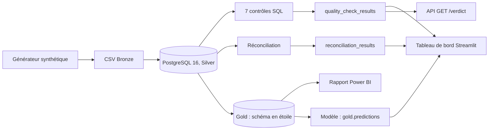

# banking-dataops-monitoring

<div align="center">

**Dispositif de contrôle de la qualité des données bancaires : sept contrôles déterministes, un verdict de publication, une file d'investigation ordonnée par un modèle**

PostgreSQL · Python · contrôles SQL · réconciliation · Streamlit · FastAPI · Power BI · Docker Compose


</div>

---

## Ce que contient ce dossier

Code et documentation du projet `banking-dataops-monitoring`, réalisé pour le bloc 6 du titre **RNCP35288** (direction de projets de gestion de données). La présentation du projet, ses résultats chiffrés et ses limites sont dans le [README du bloc](../README.md).

| Besoin | Où le trouver |
|---|---|
| Lancer l'application | section « Démarrer » ci-dessous |
| Les chiffres et leurs preuves | `evidence/README.md` : chaque fichier est la sortie réelle d'une commande, avec sa date |
| Les décisions d'architecture | [`docs/adr/`](docs/adr/) : neuf décisions datées, avec leurs options écartées |
| Gestion de projet : cahier des charges, veille, rétroplanning, budget, risques, RGPD, indicateurs | [`docs/project/`](docs/project/) |
| Le rapport Power BI et ses mesures | [`docs/powerbi/`](docs/powerbi/) |
| Démarrer sous Windows | [`DEMARRAGE-WINDOWS.md`](DEMARRAGE-WINDOWS.md), [`docs/DEMARRAGE-RAPIDE-WINDOWS.md`](docs/DEMARRAGE-RAPIDE-WINDOWS.md) (sans Docker) |

---

## Démarrer

Docker est requis. Tout se lance depuis la racine de ce dossier.

```bash
docker compose up --build   # ou : make stack-up
```

Tableau de bord : <http://localhost:8501>. API de décision : <http://localhost:8000/verdict>. La pile compte **deux services**, `postgres` et `app` (`docker-compose.yml`) : le conteneur `app` exécute le pipeline au démarrage, puis sert l'API (port 8000) et le tableau de bord (port 8501). Si le port 5432 de la machine est pris par un autre PostgreSQL, définir `POSTGRES_PORT` (par exemple 55432) avant la commande ; `API_PORT` et `DASHBOARD_PORT` existent de même.

**Le modèle n'existe pas au démarrage** (`TRAIN_ON_BOOT=false` n'est pas lu par l'entrypoint). Une fois la pile démarrée, dans un second terminal :

```bash
docker compose exec app python -m banking_dataops.ml.train     # entraîne le modèle (13 s mesurées)
docker compose exec app python -m banking_dataops.ml.predict   # remplit gold.predictions, la file d'investigation
make smoke                                                      # vérification de bout en bout, 15 assertions
```

`make ml-train` et `make ml-predict` sont des raccourcis des deux premières commandes. `run_pipeline.py --train` entraîne le modèle mais ne remplit pas `gold.predictions` ; sous PowerShell, `.\run.ps1 train` enchaîne les deux.

**Date d'ancre du lot.** Le lot généré est daté du **27 juillet 2026** par défaut (`2026-07-27T00:00:00Z`, ADR-0009) : même graine, mêmes lignes, mêmes chiffres du modèle, quel que soit le jour. Cette ancre vieillit : le contrôle de fraîcheur CTRL-007 compare le dernier événement à l'horloge, si bien que depuis le 25 septembre 2026 le verdict d'une exécution par défaut est `WARN` (6 contrôles réussis sur 7, `can_publish` reste vrai). Pour un lot daté du jour et un verdict `PASS` (7 sur 7), comme en démonstration :

```powershell
$env:BANKING_DATAOPS_GENERATED_AT = "today"; docker compose up --build   # PowerShell
```

```bash
BANKING_DATAOPS_GENERATED_AT=today docker compose up --build             # bash
```

La pile Docker lit la variable d'environnement ; hors Docker, `python run_pipeline.py --generated-at today` produit le même lot. La ligne de commande l'emporte sur la variable.

Sous Windows : double-clic sur `DEMARRER-WINDOWS.bat`, ou `.\run.ps1 setup` puis `.\run.ps1 start` ; les ports sont sondés automatiquement (voir [`DEMARRAGE-WINDOWS.md`](DEMARRAGE-WINDOWS.md)).

---

## Chiffres vérifiés

Mesures de la pile Docker du **11 octobre 2026** (PostgreSQL 16, Python 3.12, `--seed 42 --transactions 1500 --customers 100 --train`), à l'ancre par défaut ; les deux lignes de tests viennent de la suite rejouée le **12 octobre 2026**. Chaque chiffre vient d'une sortie de commande conservée dans [`evidence/`](evidence/README.md).

| Vérification | Commande | Résultat |
|---|---|---|
| Suite de tests | `pytest` | **<!--tests-fr-->545 réussis, 3 ignorés, 1 échec attendu (xfail), soit 549 cas<!--/tests-->** |
| Chemins interdits | `pytest tests/test_reverse_paths.py` | 12 réussis, 1 xfail (13 cas) |
| Pipeline de bout en bout | `python run_pipeline.py --train` | code de sortie 0 : Bronze, nettoyage, ingestion, contrôles, Gold, modèle |
| Vérification de démonstration | `python scripts/smoke_check.py` | **DEMO READY, 15 sur 15** |
| Contrôles qualité | table `quality_check_results` | à l'ancre par défaut : 6 réussis et 1 avertissement (CTRL-007), verdict `WARN`, `can_publish` vrai ; avec `--generated-at today` : **7 sur 7, verdict `PASS`** |
| Schéma en étoile | `python -m banking_dataops.powerbi_views` | **8 vues et 7 tables Gold** |
| Déterminisme | deux exécutions, même graine, même ancre | même empreinte de lot, `89ac138fb9943f00` |
| Modèle, sélection | validation croisée à 4 plis sur l'entraînement seul | régression logistique 0,9748, forêt 0,9661 ; la forêt ne gagne pas la marge de 0,01 : la logistique est retenue |
| Modèle, test | évalué une seule fois, 375 transactions dont 30 positives | AUC 0,970 ; au seuil de 0,852 (F1 maximal hors-pli) : précision 0,656, rappel 0,700, F1 0,677 ; matrice 334 / 11 / 9 / 21 |
| Priorités | `gold.predictions`, 1 500 lignes | 126 *high*, 99 *medium*, 1 275 *low* |

Les ignorés sautent sous condition (fichiers SQL contenant la séquence `E''`) ; le *xfail* est un écart connu et déclaré de `docker/entrypoint.sh`. La suite n'exige pas PostgreSQL : **elle n'exécute jamais les sept contrôles SQL sur une base**, qui ne le sont que par le pipeline local et par la vérification de démonstration. Les données sont synthétiques et la cible du modèle est une règle du générateur : les performances démontrent la méthode et la chaîne, pas un taux de détection réel.

Rendus des sorties de ces commandes : [`docs/screenshots/`](docs/screenshots/) (`test-smoke-check.svg`, `test-suite-pytest.svg`, `test-reverse-paths.svg`, `pipeline-run.svg`, `powerbi-star-schema.svg`, `architecture-pipeline.svg`).

---

## Architecture

<div align="center">

</div>

Bronze, Silver, Gold, puis un modèle, avec une couche de contrôle déterministe et un journal d'audit transversal. Le point d'architecture qui compte : **le nettoyage répare la forme, jamais le fond** : un montant implausible traverse la couche de nettoyage intact, pour que les contrôles puissent le juger et le compter. Le verdict de publication ne dérive que des contrôles ; le modèle ordonne une file d'investigation et ne bloque jamais (ADR-0002, ADR-0008).

Trois consommateurs lisent la même décision : un analyste sur le tableau de bord (Streamlit), un comité sur le rapport Power BI (8 vues `vw_`), un pipeline aval par `GET /verdict` (API en lecture seule, ADR-0006).

Vue ASCII et détail par couche : [`docs/pipeline_architecture.md`](docs/pipeline_architecture.md) ; topologie des conteneurs : [`docs/architecture.md`](docs/architecture.md).



---

## Contrôles qualité

| Contrôle | Garanti par | Preuve |
|---|---|---|
| CTRL-001 champs critiques non nuls | le schéma (`NOT NULL`) | `src/banking_dataops/quality_checks.py`, `sql/02_data_quality_checks.sql` |
| CTRL-002 unicité des transactions | le schéma (clé primaire) | idem |
| CTRL-003 montants valides | la couche de contrôle | idem |
| CTRL-004 intégrité référentielle | le schéma (clé étrangère) | idem |
| CTRL-005 plage du score de risque | la couche de contrôle | idem |
| CTRL-006 statut dans le référentiel | la couche de contrôle | idem |
| CTRL-007 fraîcheur du jeu de données (avertissement, 60 jours) | la couche de contrôle | idem |
| Réconciliation par système source | agrégats internes | `src/banking_dataops/reconciliation.py`, `sql/03_reconciliation_queries.sql` |
| Tableau de bord, scénario de démonstration | | `dashboard/streamlit_app.py`, `src/banking_dataops/demo_scenario.py` |
| Procédure d'incident | | `docs/incident_runbook.md` |

Trois contrôles sur sept ne peuvent structurellement pas échouer, parce que le schéma les prévient : c'est la thèse du projet (ADR-0004).

---

## Documentation

| Document | Objet |
|---|---|
| [docs/architecture.md](docs/architecture.md) | Architecture du système, topologie des conteneurs |
| [docs/pipeline_architecture.md](docs/pipeline_architecture.md) | Couches Bronze, Silver, Gold, modèle ; schémas entité-relation |
| [docs/data_dictionary.md](docs/data_dictionary.md) | Tables et champs |
| [docs/controls_matrix.md](docs/controls_matrix.md) | Contrôles reliés aux risques et aux preuves |
| [docs/incident_runbook.md](docs/incident_runbook.md) | Procédure d'investigation d'un incident |
| [docs/rollback_plan.md](docs/rollback_plan.md) | Remise à zéro et retour arrière en local |
| [docs/monitoring_plan.md](docs/monitoring_plan.md) | Dimensions surveillées et pistes d'observabilité |
| [docs/KPI_DEFINITIONS.md](docs/KPI_DEFINITIONS.md) | Chaque indicateur : définition, source, seuil, décision servie |
| [docs/VALIDATION.md](docs/VALIDATION.md) | Procédure de validation locale |
| [docs/CODE_STANDARD.md](docs/CODE_STANDARD.md) | Traçabilité, auditabilité, tests des chemins interdits |
| [docs/adr/](docs/adr/) | Décisions d'architecture |
| [docs/project/](docs/project/) | Cahier des charges, veille, rétroplanning, budget, risques, RGPD, indicateurs |
| [tools/README.md](tools/README.md) | Régénération des figures et des captures depuis `evidence/` |
| [huggingface-space/README.md](huggingface-space/README.md) | Source d'un tableau de bord de secours en lecture seule (aucune adresse en ligne n'est donnée) |

---

## Structure du dépôt

```text
banking_dataops_monitoring/
|-- README.md, MUTANTS_EQUIVALENTS.md
|-- docker-compose.yml, Dockerfile, docker/entrypoint.sh
|-- Makefile, run.ps1, DEMARRER-WINDOWS.bat, DEMARRAGE-WINDOWS.md
|-- run_pipeline.py            orchestrateur : Bronze, nettoyage, Silver, contrôles, Gold, modèle
|-- pyproject.toml, requirements.txt, requirements-dev.txt
|-- src/banking_dataops/       code : génération, ingestion, contrôles, réconciliation, API, modèle
|-- sql/                       schéma, contrôles, vues Power BI, journal d'audit, couche Gold
|-- dashboard/                 tableau de bord Streamlit
|-- tests/                     suite pytest
|-- scripts/                   vérification de démonstration, publication facultative vers une base managée
|-- evidence/                  sorties réelles des commandes, avec date et commande
|-- docs/                      architecture, ADR, gestion de projet, Power BI, figures
|-- tools/, notebooks/, huggingface-space/, data/, models/, output/
`-- .github/workflows/         intégration continue du projet (inactive ici : GitHub n'exécute que les workflows de la racine d'un dépôt)
```

---

## Règles de sûreté

- données synthétiques uniquement : aucune donnée bancaire, d'assurance ou de santé réelle, aucune donnée de client ni d'employeur ;
- aucun secret ni jeton dans le dépôt : les identifiants de `docker-compose.yml` sont ceux d'une base de développement locale et synthétique ;
- aucune connexion à un système de production : c'est une démonstration sur données synthétiques ;
- le dispositif n'est ni une plateforme de données de production, ni un système de contrôle prêt pour une banque, ni un moteur de décision de crédit, d'assurance ou de santé.

---

## Limites connues

Elles sont détaillées dans le [README du bloc](../README.md), § 6. Les principales : la réconciliation compare des agrégats internes et non deux systèmes indépendants ; les seuils sont calibrés sur du synthétique ; la cible du modèle est une règle du générateur ; l'option `--verify` de `run_pipeline.py` est acceptée mais ne vérifie rien ; `run_pipeline.py` n'appelle pas la prédiction ; l'ingestion charge les fichiers Bronze bruts et non les fichiers nettoyés ; la table de réconciliation est vidée à chaque exécution du pipeline ; la tendance d'un contrôle repose sur un seul point ; le `Dockerfile` n'est pas multi-étapes.

