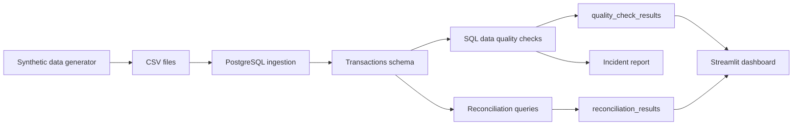
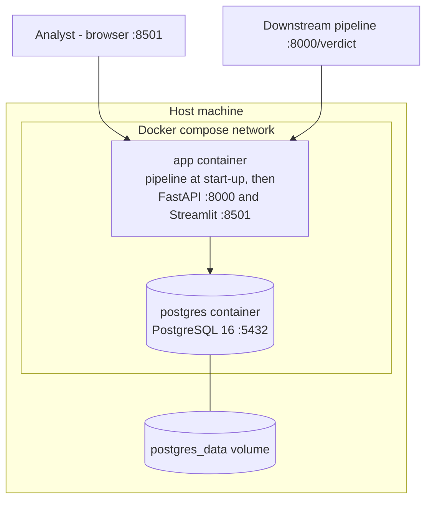
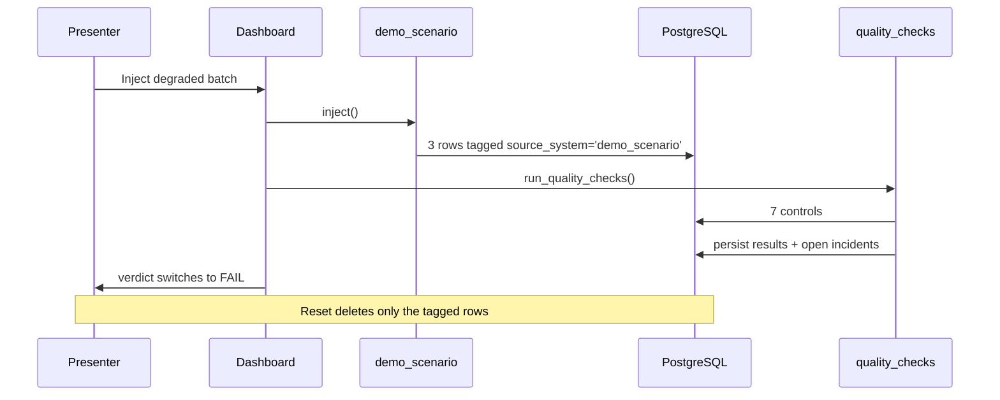

# Architecture: banking-dataops-monitoring

## Purpose

This document describes the executable architecture of the `banking-dataops-monitoring` project.

The project demonstrates a regulated-data monitoring pattern using synthetic data only.

---

## Architecture diagram

---

## Container topology

`docker-compose.yml` declares two services, `postgres` and `app`. There is no third
container: the API and the dashboard run inside `app`, started by `docker/entrypoint.sh`.

| Service | Role | Host port (default) |
|---|---|---|
| `postgres` | PostgreSQL 16, the only named volume (`postgres_data`) | 5432 (`POSTGRES_PORT`) |
| `app` | Image built from the `Dockerfile`. At start-up the entrypoint generates the batch, loads it, runs the pipeline and the reconciliation, then serves the API (uvicorn, port 8000) and the dashboard (Streamlit, port 8501) from the same container | 8000 (`API_PORT`), 8501 (`DASHBOARD_PORT`) |

`app` reaches the database by service name, through `BANKING_DATAOPS_DATABASE_HOST=postgres`,
and starts only once `postgres` reports healthy. Without that gate the pipeline fails
intermittently on a cold start. The ADR-0006 planned a separate API container; the
implementation groups both in `app`, which the ADR now says.

The model does not exist at start-up (`TRAIN_ON_BOOT=false` is not read by the entrypoint): it is
trained and applied on demand, with `docker compose exec app python -m banking_dataops.ml.train`
then `... ml.predict`.

---

## Two consumers, one decision

The verdict has two audiences, and they need different interfaces.

| Consumer | Interface | Needs |
|---|---|---|
| A data quality analyst | Streamlit dashboard | A verdict readable in three seconds, then drill-down |
| A downstream pipeline | `GET /verdict` | A boolean to branch on, before consuming the batch |

The API is deliberately read-only. It reports a decision, it does not make
or change one. That removes the entire authentication and authorisation surface
a control plane would require, and keeps responsibility where it belongs: the
controls decide, the API reports.

| Endpoint | Purpose |
|---|---|
| `GET /health` | Liveness, no database access |
| `GET /ready` | Readiness, database reachable |
| `GET /verdict` | `can_publish` plus the summary: the field to branch on |
| `GET /controls` | Every control with its outcome |
| `GET /incidents` | Open incidents |
| `GET /docs` | OpenAPI, generated |

A `WARN` verdict returns `can_publish: true`. The distinction matters: a warning
is a reservation, not a block, and must not halt a pipeline.

---

## Control layer boundary

The schema and the control layer share the work explicitly.

| Enforced by the schema | Enforced by the control layer |
|---|---|
| `amount_chf NOT NULL` (CTRL-001) | Amount plausibility bounds (CTRL-003) |
| `transaction_id PRIMARY KEY` (CTRL-002) | Risk-score range (CTRL-005) |
| `account_id REFERENCES accounts` (CTRL-004) | Status reference list (CTRL-006) |
| | Dataset freshness (CTRL-007) |

Structural integrity is a database concern and costs nothing at runtime.
Business rules belong to the control layer, because freezing a business
threshold into a schema is a design error: thresholds change, schemas should not.

See `docs/adr/0004-contraintes-en-base.md`.

---

## Demo scenario flow

---

## Components

| Component | Path | Purpose |
|---|---|---|
| Synthetic data generator | `src/banking_dataops/generate_synthetic_data.py` | Creates fake customers, accounts and transactions |
| PostgreSQL schema | `sql/00_schema.sql` | Defines customers, accounts, transactions and result tables |
| Ingestion runner | `src/banking_dataops/ingest.py` | Loads generated CSV files into PostgreSQL |
| Pipeline orchestrator | `run_pipeline.py` | Bronze, cleaning, Silver, controls, Gold, optional training |
| Quality runner | `src/banking_dataops/quality_checks.py` | Runs quality controls and persists results |
| Reconciliation runner | `src/banking_dataops/reconciliation.py` | Summarizes transaction counts and amounts |
| Decision API | `src/banking_dataops/api.py` | Read-only `GET /verdict` and four other endpoints |
| Dashboard | `dashboard/streamlit_app.py` | Displays quality status, volume and summaries |
| Container topology | `docker-compose.yml`, `Dockerfile`, `docker/entrypoint.sh` | Two services, `postgres` and `app` |
| Controls matrix | `docs/controls_matrix.md` | Maps controls to risks and evidence |
| Incident runbook | `docs/incident_runbook.md` | Documents investigation and response workflow |

---

## Public-safety boundary

No real banking, insurance, health, client, employer or private data belongs in this project.

---

Copyright © 2026 · Auteur : KinSushi · Enzo · Sovralys LLC
