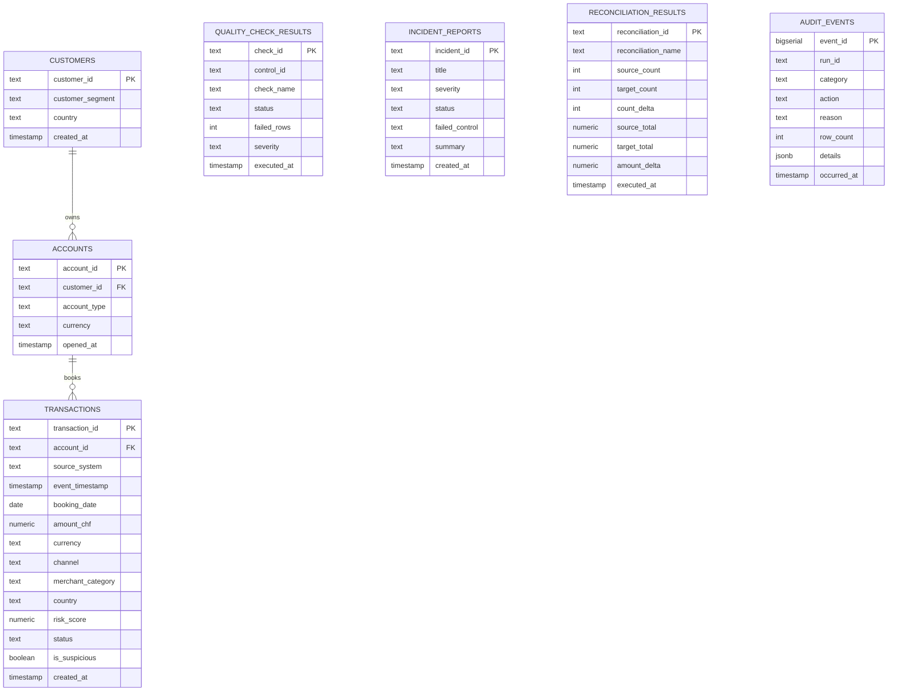
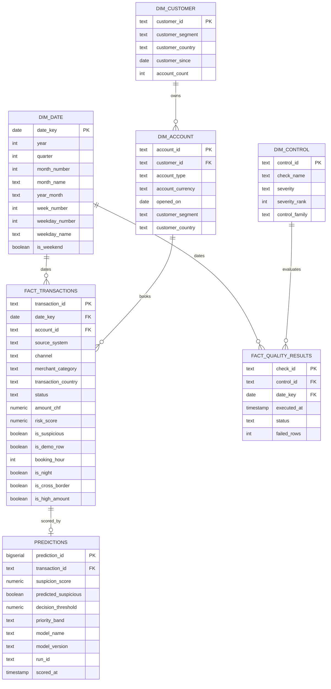

# Data dictionary

Every table, every column, every constraint: OLTP (Silver) and OLAP (Gold).

This document is the reference an auditor opens when a number on the dashboard needs to be traced back to its source. Every column name below was checked directly against `sql/00_schema.sql`, `sql/07_audit_journal.sql` and `sql/08_gold_layer.sql`: not reconstructed from memory.

---

## 1. Entity relationship: OLTP (Silver)

Normalised, third normal form. Source of truth: integrity enforced declaratively, not by application code.

Foreign keys are drawn where PostgreSQL enforces them: `accounts.customer_id → customers`, `transactions.account_id → accounts`. `quality_check_results`, `incident_reports`, `reconciliation_results` and `audit_events` correlate by value (`control_id`, `run_id`) rather than by declared foreign key: they are operational logs, not transactional entities.

### `customers`

| Column | Type | Constraint | Description |
|---|---|---|---|
| `customer_id` | `TEXT` | `PRIMARY KEY` | Sequential, opaque: no personal identifier by design (`docs/project/06-conformite-rgpd.md`) |
| `customer_segment` | `TEXT` | `NOT NULL` | `retail`, `premium`, `sme` |
| `country` | `TEXT` | `NOT NULL` | ISO 3166-1 alpha-2 |
| `created_at` | `TIMESTAMP` | `NOT NULL` | Account opening date, synthetic |

### `accounts`

| Column | Type | Constraint | Description |
|---|---|---|---|
| `account_id` | `TEXT` | `PRIMARY KEY` | Sequential, opaque |
| `customer_id` | `TEXT` | `FOREIGN KEY → customers` | Owner |
| `account_type` | `TEXT` | `NOT NULL` | |
| `currency` | `TEXT` | `NOT NULL` | ISO 4217 |
| `opened_at` | `TIMESTAMP` | `NOT NULL` | |

### `transactions`

The central table. Every control, every KPI, every model feature reads from here or from what it feeds.

| Column | Type | Constraint | Description |
|---|---|---|---|
| `transaction_id` | `TEXT` | `PRIMARY KEY` | Prevents CTRL-002 (duplicates) structurally |
| `account_id` | `TEXT` | `FOREIGN KEY → accounts` | Prevents CTRL-004 (orphans) structurally |
| `source_system` | `TEXT` | `NOT NULL` | `core_banking`, `card_processor`, `payments_gateway`, or `demo_scenario` |
| `event_timestamp` | `TIMESTAMP` | `NOT NULL` | When the transaction occurred |
| `booking_date` | `DATE` | `NOT NULL` | When it was recorded |
| `amount_chf` | `NUMERIC(18,2)` | `NOT NULL` | Prevents CTRL-001 (critical nulls) structurally |
| `currency` | `TEXT` | `NOT NULL` | Always `CHF` in this dataset |
| `channel` | `TEXT` | `NOT NULL` | `api`, `web`, `mobile`, `branch` |
| `merchant_category` | `TEXT` | `NOT NULL` | `electronics`, `travel`, `services`, `health`, `grocery`, `utilities` |
| `country` | `TEXT` | `NOT NULL` | Booking country: compared to `customers.country` for cross-border detection |
| `risk_score` | `NUMERIC(5,4)` | `NOT NULL` | `[0,1]`. Forbidden as a model feature: the label is thresholded from it (`docs/adr/0008`) |
| `status` | `TEXT` | `NOT NULL` | `posted`, `pending`, `rejected`: anything else fails CTRL-006 |
| `is_suspicious` | `BOOLEAN` | `NOT NULL` | The model's training label. Rule-derived on synthetic data: see limitation below |
| `created_at` | `TIMESTAMP` | `NOT NULL` | Date anchor of the generated batch (not the insertion time) |

Indexed on `account_id`, `source_system`, `booking_date`, `channel`, `is_suspicious`, `event_timestamp`.

Label honesty note. On this synthetic dataset, `is_suspicious` is set by a documented rule mixing night activity, cross-border flag, high amount, channel and merchant category, plus irreducible noise (`docs/adr/0008`). On real data it would come from confirmed investigations. The model demonstrates the pipeline and the method, not a production-ready detection rate, and this file says so rather than letting the column speak for itself.

### `quality_check_results`

| Column | Type | Constraint | Description |
|---|---|---|---|
| `check_id` | `TEXT` | `PRIMARY KEY` | The control identifier: one row per control, replaced on each run |
| `control_id` | `TEXT` | `NOT NULL` | `CTRL-001` … `CTRL-007` |
| `check_name` | `TEXT` | `NOT NULL` | Human-readable |
| `status` | `TEXT` | `NOT NULL` | `PASS`, `WARN`, `FAIL` |
| `failed_rows` | `INTEGER` | `NOT NULL` | Volume affected |
| `severity` | `TEXT` | `NOT NULL` | `high`, `medium`, `low` |
| `executed_at` | `TIMESTAMP` | `NOT NULL` | |

### `incident_reports`

| Column | Type | Constraint | Description |
|---|---|---|---|
| `incident_id` | `TEXT` | `PRIMARY KEY` | |
| `title` | `TEXT` | `NOT NULL` | |
| `severity` | `TEXT` | `NOT NULL` | |
| `status` | `TEXT` | `NOT NULL` | Only `open` is written by the code; the schema has no constraint on the value |
| `failed_control` | `TEXT` | nullable | Links to `quality_check_results.control_id` |
| `summary` | `TEXT` | `NOT NULL` | |
| `created_at` | `TIMESTAMP` | `NOT NULL` | |

### `reconciliation_results`

| Column | Type | Constraint | Description |
|---|---|---|---|
| `reconciliation_id` | `TEXT` | `PRIMARY KEY` | |
| `reconciliation_name` | `TEXT` | `NOT NULL` | |
| `source_count` | `INTEGER` | nullable | |
| `target_count` | `INTEGER` | nullable | |
| `count_delta` | `INTEGER` | nullable | |
| `source_total` | `NUMERIC(18,2)` | nullable | |
| `target_total` | `NUMERIC(18,2)` | nullable | |
| `amount_delta` | `NUMERIC(18,2)` | nullable | Always 0 today: this is an internal aggregate check, not a two-system reconciliation. Documented limitation, `docs/project/05-registre-des-risques.md`, risk R-09 |
| `executed_at` | `TIMESTAMP` | `NOT NULL` | |

### `audit_events`

| Column | Type | Constraint | Description |
|---|---|---|---|
| `event_id` | `BIGSERIAL` | `PRIMARY KEY` | |
| `run_id` | `TEXT` | `NOT NULL` | 16 hex characters, correlates one execution |
| `category` | `TEXT` | `CHECK IN (...)` | `pipeline`, `data`, `control`, `decision`, `demo`, `integrity`: closed list |
| `action` | `TEXT` | `NOT NULL`, non-empty | |
| `reason` | `TEXT` | `NOT NULL`, non-empty, enforced | Refused at construction if blank: `docs/CODE_STANDARD.md` §3 |
| `row_count` | `INTEGER` | `>= 0` if set | |
| `details` | `JSONB` | `NOT NULL DEFAULT '{}'` | Free structured context |
| `occurred_at` | `TIMESTAMP` | `NOT NULL DEFAULT NOW()` | |

Indexed on `(run_id, occurred_at)` and `(category, occurred_at)`.

Why a table enforces this where a JSON-file audit log cannot. A declarative `CHECK` constraint holds even if application code is bypassed. A file has no such guarantee: anything can be appended to it.

---

## 2. Star schema: OLAP (Gold)

Denormalised for reading. Materialised as tables, not views: a dashboard, Power BI and the scoring step each read several times per session, and materialising trades storage for predictable latency.

### Why two fact tables share one date dimension

`fact_transactions` and `fact_quality_results` both reference `dim_date`. Every relationship in this model is single-direction: with two fact tables sharing a dimension, a bidirectional filter creates an ambiguous path the engine resolves non-deterministically. Same rule enforced in the Power BI model: `docs/powerbi/report-specification.md`.

### `dim_control.control_family`: the column that carries the project's thesis

| Value | Meaning |
|---|---|
| `Structural` | CTRL-001, CTRL-002, CTRL-004: enforced by the schema, can never fail on inserted rows |
| `Business rule` | CTRL-003, CTRL-005, CTRL-006, CTRL-007: what only the control layer can see |

Slicing a Power BI report on this column is a direct, visual demonstration of `docs/adr/0004-contraintes-en-base.md`.

### `gold.predictions`: model output, never a verdict input

| Column | Constraint | Note |
|---|---|---|
| `suspicion_score` | `CHECK (0 <= x <= 1)` | Probability |
| `predicted_suspicious` | `NOT NULL` | Decision at the stored threshold |
| `decision_threshold` | `NOT NULL` | Stored per row: a retune does not make a past decision unreadable |
| `priority_band` | `CHECK IN ('high','medium','low')` | Relative to the threshold, not absolute (ADR-0009): `high` when `suspicion_score >= decision_threshold` (equal to `predicted_suspicious`), `medium` from 0.60 × threshold up to it, `low` below. With the threshold of 0.852, 126 / 99 / 1 275 of the 1 500 scored transactions |
| `model_version` | `NOT NULL` | Timestamp of the training run that produced this score |

No verdict-issuing code path references this table. Verified mechanically by `scripts/smoke_check.py`, step 6: the source of `GET /verdict` is inspected and asserted to reference neither `gold.predictions` nor `suspicion_score`. See ADR-0002 and ADR-0008.

---

## 3. Column lineage: one definition, one place

Derived columns computed in Gold and nowhere else, to keep the KPI on screen and the model feature the same object.

| Column | Computed in | Formula | Used by |
|---|---|---|---|
| `booking_hour` | `pipeline/gold.py` | `EXTRACT(HOUR FROM event_timestamp)` | Dashboard, `ml/features.py` |
| `is_night` | `pipeline/gold.py` | `booking_hour < 6` | Dashboard KPI, model feature |
| `is_cross_border` | `pipeline/gold.py` | `transaction.country <> customer.country` | Dashboard KPI, model feature |
| `is_high_amount` | `pipeline/gold.py` | `amount_chf > 10000` | Dashboard KPI, model feature |

A column computed twice (once for the dashboard, once for the model) is how the two silently diverge within a release cycle. There is exactly one computation of each, and `tests/integration/test_bronze_to_features.py::test_derived_features_match_their_documented_definition` asserts it holds.

---

## 4. Bronze layer: file contracts

Bronze is not a database; its contract is the CSV header and the timestamped archive.

| File | Stable name | Archived name |
|---|---|---|
| Customers | `synthetic_customers.csv` | `customers_YYYYMMDD_HHMMSS.csv` |
| Accounts | `synthetic_accounts.csv` | `accounts_YYYYMMDD_HHMMSS.csv` |
| Transactions | `synthetic_transactions.csv` | `transactions_YYYYMMDD_HHMMSS.csv` |

The stable name is the pipeline's entry point; the archive answers "which extract produced this verdict". `tests/integration/test_bronze_to_features.py::test_stable_and_archived_files_hold_identical_data` verifies the two are byte-identical at generation.

---

## 5. Where each table is created

| Table | Statement |
|---|---|
| `customers`, `accounts`, `transactions`, `quality_check_results`, `incident_reports`, `reconciliation_results` | `sql/00_schema.sql` |
| `audit_events`, `vw_run_summary` | `sql/07_audit_journal.sql` |
| `gold.*` (dimensions, facts, predictions) | `sql/08_gold_layer.sql` |
| Power BI star-schema views (`vw_dim_*`, `vw_fact_*`, `vw_publication_verdict`) | `sql/06_powerbi_star_schema.sql` |

---

## 6. Public-safety note

All data is synthetic, generated deterministically. No real banking, insurance, health, client, employer or private data is ever stored in this schema. The safety rules are listed in the README (section « Règles de sûreté »).

---

Copyright © 2026 · Auteur : KinSushi · Enzo · Sovralys LLC
