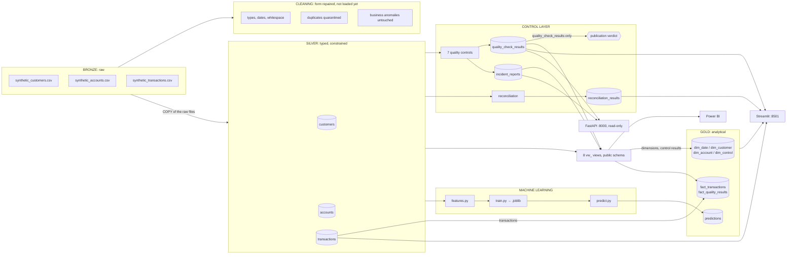
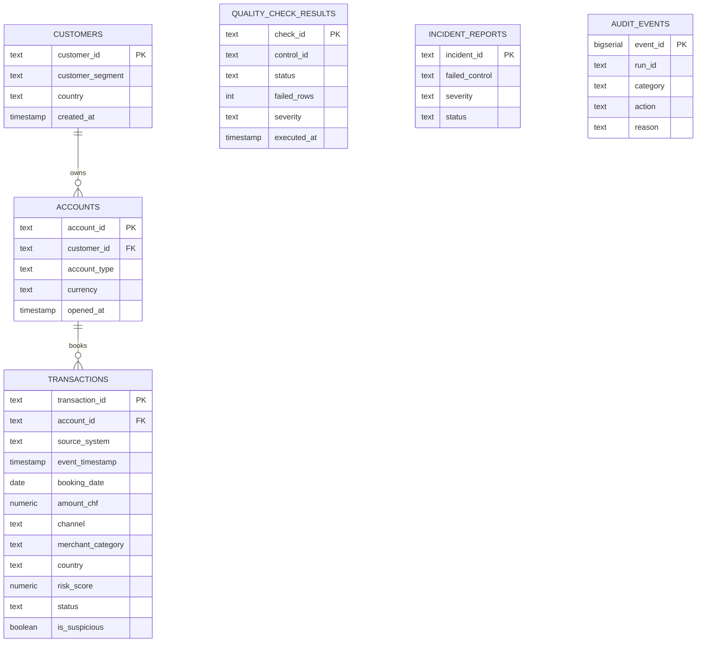
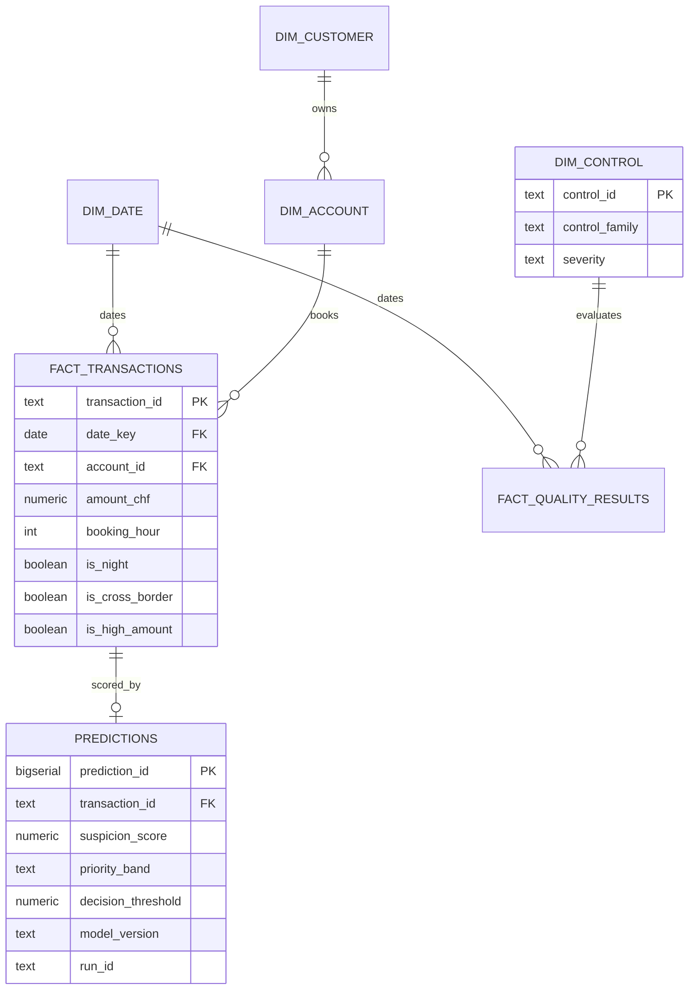

# Architecture du pipeline

`banking-dataops-monitoring` : pipeline médaillon avec couche de contrôle
déterministe et verdict de publication.

Les chiffres ci-dessous sont relevés d'une exécution réelle de la pile Docker, le 11 octobre 2026
(`evidence/pipeline_full.txt`, `--seed 42 --transactions 1500 --customers 100 --train`, ancre de date par défaut du
27 juillet 2026). À cette ancre, le contrôle de fraîcheur CTRL-007 avertit : le verdict est WARN et `can_publish` reste
vrai. Avec `--generated-at today`, les sept contrôles passent (`evidence/variante_ancre_aujourdhui/`).
Deux résultats dépendent donc du jour de l'exécution : le verdict, par CTRL-007, et le nombre de dates, car la
dimension date s'étend jusqu'au jour du run (`sql/06_powerbi_star_schema.sql`, l. 24 à 28), d'où 107 dates le
11 octobre 2026 et 120 le 24 octobre.

Le flux suit le code. Le générateur écrit Bronze ; de Bronze partent le nettoyage, qui n'alimente pas encore la
base, et le chargement `COPY` des fichiers bruts vers Silver (`src/banking_dataops/ingest.py`). Depuis Silver
partent trois branches : les contrôles et la réconciliation ; le modèle, qui lit Silver et écrit
`gold.predictions` (`src/banking_dataops/ml/features.py`) ; les 8 vues `vw_`, importées par Power BI, dont
Gold reprend les dimensions et les résultats des contrôles (`src/banking_dataops/pipeline/gold.py`).

---

## Vue synthétique (ASCII)

```
                          BANKING-DATAOPS-MONITORING
      données synthétiques -> chargées -> contrôlées -> publiables -> priorisées

  +---------------------+                          +-------------------------------+
  | GÉNÉRATEUR          |                          | JOURNAL D'AUDIT : transversal |
  | seed=42             |                          | toutes les étapes y écrivent  |
  | ancre 2026-07-27    |                          | raison métier exigée en base  |
  +---------------------+                          | 267 événements, 0 sans raison |
             |                                     +-------------------------------+
             v
  +---------------------+      +---------------------+
  | BRONZE              |      | SILVER              |
  | fichiers CSV bruts  | COPY | PostgreSQL 16       |
  | 1 500 transactions  |----->| 3 tables typées,    |
  | 100 clients         |bruts | clés primaires et   |
  | 200 comptes         |      | étrangères          |
  | 89ac138fb9943f00    |      | 1 500 transactions  |
  +---------------------+      | anomalies métier    |
             |                 | conservées          |
             v                 +---------------------+
  +---------------------+                 |
  | NETTOYAGE           |                 |
  | fichiers nettoyés   |                 |
  | et quarantaine      |                 |
  | 0 doublon           |                 |
  | 0 quarantaine       |                 |
  | n'alimente pas      |                 | depuis SILVER :
  | encore la base      |                 | trois branches
  +---------------------+                 |
                                          |
              +---------------------------+---------------------------+
              v                           v                           v
  +------------------------+: +------------------------+  +------------------------+
  | 7 CONTRÔLES            |: | MODÈLE : PRIORISATION  |  | 8 VUES vw_             |
  | et réconciliation      |: | lit SILVER, jamais     |  | schéma public, sur     |
  | CTRL-001 à 006 : PASS  |: | GOLD ; 13 variables    |  | Silver et les tables   |
  | CTRL-007 : WARN        |: | logistique, AUC 0,970  |  | de contrôle            |
  +------------------------+: +------------------------+  +------------------------+
              | écrivent    :             | écrit                     | build
              v             :             v                           v
  +------------------------+: +------------------------+  +------------------------+
  | quality_check_results  |: | gold.predictions       |  | GOLD : étoile          |
  | incident_reports       |: | file d'investigation   |  | 4 dimensions, 2 faits  |
  | reconciliation_results |: | 1 500 lignes           |  | 1 500 transactions     |
  |                        |: | 126 high, 99 medium    |  | 107 dates              |
  |                        |: | 1 275 low              |  | dim. et contrôles :    |
  |                        |: |                        |  |   par les vues         |
  |                        |: |                        |  | transactions : SILVER  |
  +------------------------+: +------------------------+  +------------------------+
              |             :
              v             :
  +------------------------+:
  | VERDICT : WARN         |:  ADR-0002 : le score du
  | can_publish = true     |:  modèle ne touche JAMAIS
  | 6 PASS, 1 WARN, 0 FAIL |:  le verdict. Le modèle
  | dérivé de              |:  priorise, il ne décide pas.
  | quality_check_results  |:
  | seul                   |:
  +------------------------+:

  RESTITUTION : CE QUE LIT CHAQUE CONSOMMATEUR
  +------------------------+  +------------------------+  +------------------------+
  | API FastAPI            |  | Streamlit              |  | Power BI (.pbix)       |
  | lecture seule          |  | Silver                 |  | importe les 8 vues     |
  | /verdict, /controls :  |  | quality_check_results  |  | vw_, aucune table      |
  | quality_check_results  |  | reconciliation_results |  | incidents : vue        |
  | /incidents :           |  | Gold                   |  | vw_fact_incidents      |
  | incident_reports       |  | gold.predictions       |  |                        |
  |                        |  | pas incident_reports   |  |                        |
  +------------------------+  +------------------------+  +------------------------+
```

### Version graphique


Source vectorielle : [`screenshots/architecture-pipeline.svg`](screenshots/architecture-pipeline.svg)

---

## Le point d'architecture qui compte

Le découpage en couches est standard. Ce qui l'est moins :

Le nettoyage ne corrige pas les anomalies métier. Il répare ce qui relève de
la forme (types, formats, doublons, dates impossibles) et laisse passer ce qui
relève du fond : un montant implausible le traverse intact. Si le nettoyage
corrigeait les anomalies, des contrôles placés après lui passeraient toujours et
ne mesureraient plus rien.

Aujourd'hui, le nettoyage n'alimente pas encore la base : le chargement lit les
fichiers Bronze bruts (`src/banking_dataops/ingest.py`), et c'est ce lot brut que
les contrôles jugent dans Silver. Le schéma n'impose que des garanties
structurelles (`NOT NULL`, clés primaires et étrangères), sans contrainte `CHECK`
sur le montant, le score ou le statut (ADR-0004) : une ligne fautive est chargée,
puis vue et comptée par les contrôles. Le montant de 1 850 000 CHF du scénario de
démonstration est inséré directement dans Silver
(`src/banking_dataops/demo_scenario.py`).

Le verdict de publication est déterministe. Il ne dérive que de
`quality_check_results`, c'est-à-dire des 7 contrôles, jamais d'un score de
modèle (ADR-0002). Un modèle qui dérive ne peut pas rendre publiable un lot qui
ne l'est pas.

---

## Étapes et modules

| Étape | Module | Entrée | Sortie | Garantie |
|---|---|---|---|---|
| Bronze | `generate_synthetic_data` | graine, ancre de date | CSV bruts (`data/synthetic_*.csv`) | déterministe, empreinte stable |
| Nettoyage | `pipeline.cleaning` | CSV bruts | CSV nettoyés et quarantaine (`data/silver/`), que l'ingestion ne lit pas | ≥ 1 ligne, quarantaine < 5 % |
| Ingestion | `ingest` | CSV bruts (Bronze) | tables Silver (PostgreSQL) | truncate-then-insert, idempotent ; ≥ 1 transaction |
| Contrôles | `quality_checks` | Silver | `quality_check_results`, `incident_reports` | 1 résultat par contrôle déclaré |
| Réconciliation | `reconciliation` | Silver | `reconciliation_results` | lot non vide ; lancée par l'entrypoint Docker ou à la main, pas par `run_pipeline.py` |
| Gold | `pipeline.gold` | vues `vw_` (dimensions, résultats des contrôles) et Silver (transactions) | schéma en étoile | `count(gold) == count(silver)` |
| ML | `ml.train` | Silver | `.joblib` | AUC ≥ 0,70, sinon rejet |
| ML | `ml.predict` | Silver + `.joblib` | `gold.predictions` | un score par transaction ; commande séparée, `run_pipeline.py` ne l'appelle pas |
| Power BI | `powerbi_views` | Silver et tables de contrôle | 8 vues | `CREATE OR REPLACE`, rejouable |

---

## Invariants vérifiés à l'exécution

Ce ne sont pas des tests : ce sont des assertions qui tournent pendant l'exécution
de chaque commande et qui écrivent dans le journal d'audit (`assert_invariant`).

```
nettoyage       >= 1 ligne en sortie                 sinon tout contrôle passerait sur du vide
nettoyage       taux de quarantaine < 5 %            sinon les règles sont mal calibrées
ingestion       >= 1 transaction en Silver           sinon verdict vert sur un lot vide
contrôles       1 résultat par contrôle déclaré      sinon verdict complet sur évaluation partielle
réconciliation  lot réconcilié non vide              sinon un résumé qui ne prouve rien
gold            fact_transactions non vide           sinon la jointure a perdu toutes les lignes
gold            count(gold) == count(silver)         sinon une jointure a perdu des lignes
vues Power BI   les 8 vues existent après création   sinon un panneau vide au lieu d'une erreur
ML, train       >= 200 lignes                        sinon trop peu de positifs pour mesurer
ML, train       0,01 < taux positif < 0,5            sinon le label est cassé
ML, train       AUC >= 0,70                          sinon modèle au niveau du hasard publié
ML, predict     >= 1 transaction à noter             sinon une file vide sans le dire
ML, predict     un score par transaction             sinon un score sur la mauvaise ligne
démo, injection lignes injectées == lignes prévues   sinon la remise à zéro serait inexacte
démo, reset     ne touche que les lignes marquées demo_scenario
```

---

## Exécution

```bash
python run_pipeline.py --seed 42 --transactions 1500 --customers 100 --train
# démonstration : ajouter --generated-at today (lot daté du jour, verdict PASS)
python -m banking_dataops.ml.predict   # indispensable : --train entraîne, il ne score pas
python -m banking_dataops.reconciliation  # le chargement vide reconciliation_results sans la remplir
python -m banking_dataops.powerbi_views
python scripts/smoke_check.py          # attendu : DEMO READY - 15 checks passed
```

---

## Détail par couche (diagrammes Mermaid)


## Layers



The cleaning has no edge to Silver: the load reads the raw Bronze files. The model has no edge from Gold, and
nothing goes from the model to the verdict. Streamlit does not read `incident_reports`
(`src/banking_dataops/monitoring.py`); the API serves them on `/incidents`.

One command for the batch: `python run_pipeline.py`. Scoring and reconciliation are separate commands
(`python -m banking_dataops.ml.predict`, `python -m banking_dataops.reconciliation`).

---

## Why each boundary exists

| Boundary | Rule | Consequence if broken |
|---|---|---|
| Bronze → Cleaning | Form only: types, formats, duplicates | Cleaning a business anomaly hides what the controls must catch |
| Bronze → Silver | Typing and loading by `COPY`, no business logic. The load reads the raw Bronze files: the cleaned files are produced but not yet read by it | A transformation hidden in a load is untestable |
| Silver → Gold | After the controls, whatever the verdict: `dim_control` and `fact_quality_results` are read from the control results, through the views | Built earlier, they would be empty: the Silver load truncates `quality_check_results` (`db.reset_tables`) |
| Silver → ML | Features read Silver, never Gold (`ml/features.py`) | The reason is not recorded (`pipeline/gold.py`: source : inconnue). The cost of the rule is known: the derived columns exist twice, in SQL (`pipeline/gold.py`) and in Python (`ml/features.py`), and no test compares them |
| ML → Gold | Predictions land in `gold.predictions` | A score outside the model must never overwrite a control result |

---

## Entity relationship: OLTP (Silver and control tables)



Normalised, third normal form. It is the source of truth: integrity is enforced declaratively: `NOT NULL`, primary keys, foreign keys. There is no `CHECK` constraint on amount, score or status (ADR-0004), so that the controls see and count a faulty row instead of the insert refusing it. Among these tables, only `audit_events` carries `CHECK` constraints (`sql/07_audit_journal.sql`).

---

## Star schema: OLAP (Gold)



Denormalised for reading. The relationships are logical: `sql/08_gold_layer.sql` declares no foreign key, and the load order, dimensions first, keeps them consistent (`pipeline/gold.py`). In the Power BI model, two fact tables share the date dimension, which is why every relationship is single-direction: a bidirectional filter would create an ambiguous path.

`dim_control.control_family` separates what the schema enforces structurally from what only the control layer can see. It makes the project's central argument sliceable in a report rather than merely stated.

---

## Idempotence

The Silver load, the Gold build and the scoring are TRUNCATE-then-INSERT. The control results are upserted on
`check_id`, after the Silver load has emptied their table; reconciliation adds one row per run, and the Silver load
empties that table too (`db.reset_tables`). Running the pipeline twice therefore leaves the same rows in Silver, in
the control tables and in Gold, timestamps aside; only the audit journal grows, by design (append-only). The same
seed and the same date anchor give the same files (same batch fingerprint, `89ac138fb9943f00` at the default anchor).

The `--verify` option of `run_pipeline.py` is not a proof of idempotence: it is accepted for compatibility with
the Makefile, `run.ps1` and the scheduled workflow, but no code reads it, so it runs the same single pipeline and
checks nothing. Idempotence comes from the truncate-then-insert pattern itself.

---

## Error handling

A step that raises stops the pipeline: the exception propagates after being journalled, and the run exits with a non-zero
code. The audit layer records; it never absorbs.

A *failed control* is not a failed step. The controls are evaluated and the verdict is journalled, then the pipeline
continues to Gold whatever the verdict: no code makes the Gold build conditional on a passing verdict. The verdict is
the signal that tells downstream consumers not to use the batch.

---

## Why not Airflow

Five sequential steps (Bronze, cleaning, Silver with the controls, Gold, optional training), no backfill, no cross-DAG dependency. Airflow would add a scheduler, a metadata database and a web server to call five functions in order.

What it would genuinely bring, and what this script lacks: retry on failure, and scheduling inside the orchestrator. The daily run exists, but outside the script: a cron of the GitHub Actions workflow `.github/workflows/scheduled-pipeline.yml` (05:00 UTC). Airflow is set aside and kept in the roadmap (`docs/project/02-veille-technologique.md`). The honest answer to "why not Airflow" is "not yet, and here is what I lose", not "it is unnecessary".

---

Copyright © 2026 · Auteur : KinSushi · Enzo · Sovralys LLC
