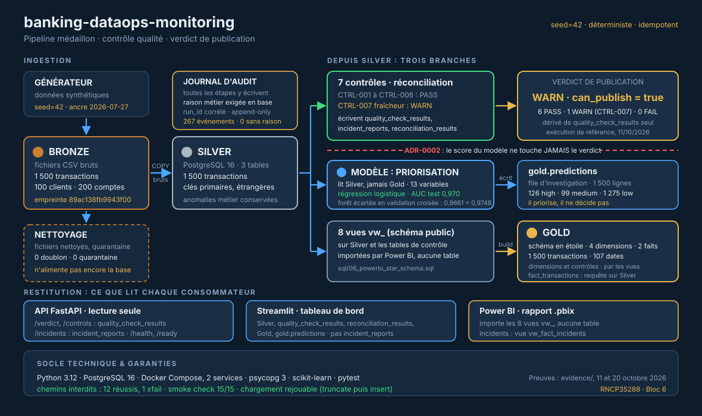
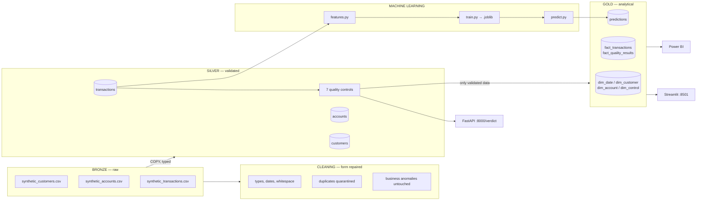
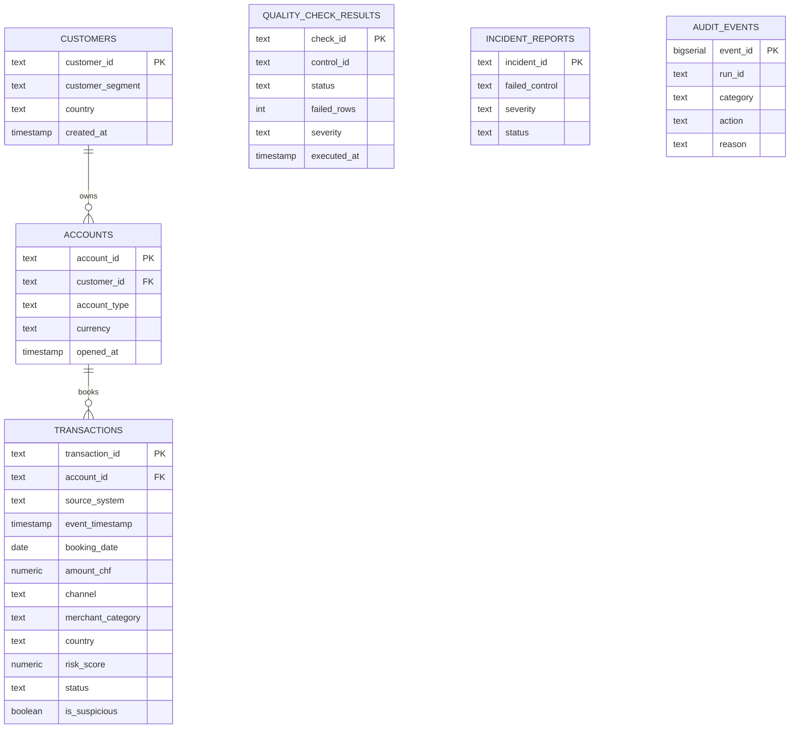
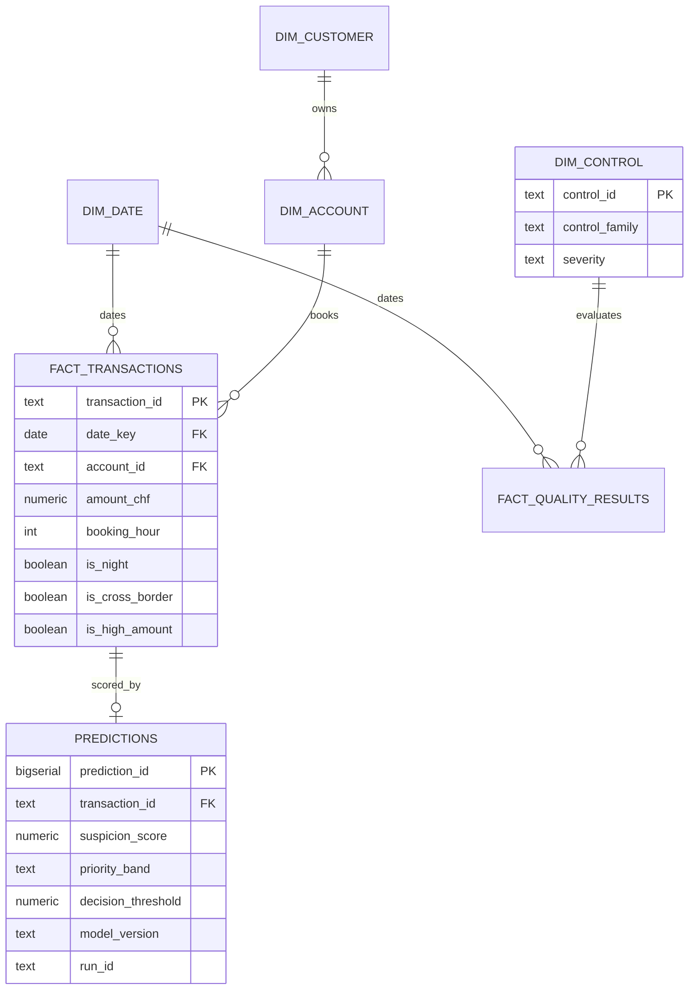

# Architecture du pipeline

`banking-dataops-monitoring` — pipeline médaillon avec couche de contrôle
déterministe et verdict de publication.

Les chiffres ci-dessous sont relevés d'une exécution réelle de la pile Docker, le 11 octobre 2026
(`evidence/pipeline_full.txt`, `--seed 42 --transactions 1500 --customers 100 --train`, ancre de date par défaut du
27 juillet 2026). À cette ancre, le contrôle de fraîcheur CTRL-007 avertit : le verdict est WARN et `can_publish` reste
vrai. Avec `--generated-at today`, les sept contrôles passent (`evidence/variante_ancre_aujourdhui/`).

---

## Vue synthétique (ASCII)

```
                          BANKING-DATAOPS-MONITORING
        données synthétiques -> contrôlées -> publiables -> priorisées

  +--------------+   +--------------+   +--------------+   +------------------+
  |   BRONZE     |   |   SILVER     |   |    GOLD      |   |  ML PRIORISATION |
  |              |-->|              |-->|              |-->|                  |
  | CSV bruts    |   | typé,        |   | schéma       |   | 13 variables     |
  | déterministe |   | contraint    |   | en étoile    |   | logist. AUC 0.970|
  |              |   |              |   |              |   | forêt    0.957 X |
  | 1 500 txn    |   | 1 500 lignes |   | 4 dim/2 faits|   |                  |
  | 100 clients  |   | 0 doublon    |   | 1 500 faits  |   | le simple gagne  |
  | 200 comptes  |   | 0 quarantaine|   | 107 dates    |   | et c'est tracé   |
  +--------------+   +------+-------+   +--------------+   +------------------+
   fingerprint              |             truncate-then-insert
   89ac138fb9943f00         |             (idempotent)
                            |
                            v
  +-----------------------------------------------------+ : ADR-0002
  |        COUCHE DE CONTRÔLE — DÉTERMINISTE            | :
  |                                                     | : Le score du modèle
  |  CTRL-001  nuls critiques           high    PASS    | : ne touche JAMAIS
  |  CTRL-002  doublons                 high    PASS    | : le verdict.
  |  CTRL-003  montants implausibles    high    PASS    | :
  |  CTRL-004  transactions orphelines  high    PASS    | : Le ML priorise,
  |  CTRL-005  score de risque hors[0,1] med    PASS    | : il ne décide pas.
  |  CTRL-006  statut hors référentiel  med     PASS    | :
  |  CTRL-007  fraîcheur des données    low     WARN    | : Vérifié par un test
  |                                                     | : qui lit la source
  |            +---------------------------+            | : de l'endpoint, pas
  |            |  VERDICT : WARN           |            | : la documentation.
  |            |  can_publish = true       |            | :
  |            |  0 ligne en violation     |            | :
  |            +---------------------------+            | :
  +--------------------------+--------------------------+ :
                             |
         +-------------------+--------------------+
         v                   v                    v
  +-------------+    +--------------+    +------------------+
  | API FastAPI |    |  Streamlit   |    |    Power BI      |
  | lecture     |    |  tableau de  |    |  8 vues étoile   |
  | seule       |    |  bord        |    |  (rapport .pbix) |
  +-------------+    +--------------+    +------------------+

  +----------------------------------------------------------------------+
  |  JOURNAL D'AUDIT  —  transversal à toutes les étapes                 |
  |  run_id corrélé · append-only · toute entrée porte une raison métier |
  |  (contrainte en base, pas une convention) · invariants vérifiés      |
  +----------------------------------------------------------------------+
```

### Version graphique



Source vectorielle : [`screenshots/architecture-pipeline.svg`](screenshots/architecture-pipeline.svg)

---

## Le point d'architecture qui compte

La séquence Bronze → Silver → Gold est standard. Ce qui l'est moins :

**Le nettoyage ne corrige pas les anomalies métier.** Il répare ce qui relève de
la forme — types, formats, doublons, dates impossibles — et laisse passer ce qui
relève du fond. Un montant à 1 850 000 CHF traverse la couche de nettoyage
intact, pour que la couche de contrôle puisse le juger et le compter.

Si le nettoyage corrigeait les anomalies, les contrôles passeraient toujours et
ne mesureraient plus rien.

**Le verdict de publication est déterministe.** Il découle des 7 contrôles, jamais
d'un score de modèle (ADR-0002). Un modèle qui dérive ne peut pas rendre publiable
un lot qui ne l'est pas.

---

## Étapes et modules

| Étape | Module | Entrée | Sortie | Garantie |
|---|---|---|---|---|
| Bronze | `generate_synthetic_data` | seed | CSV | déterministe, empreinte stable |
| Cleaning | `pipeline.cleaning` | CSV bruts | CSV nettoyés (`data/silver/`) | ≥ 1 ligne, quarantaine < 5 % |
| Ingest | `ingest` | **CSV bruts** (Bronze) | PostgreSQL | truncate-then-insert, idempotent |
| Contrôles | `quality_checks` | silver | `quality_check_results` | 1 résultat par contrôle déclaré |
| Gold | `pipeline.gold` | silver | schéma étoile | `count(gold) == count(silver)` |
| ML | `ml.train` | silver | `.joblib` | AUC ≥ 0,70, sinon rejet |
| ML | `ml.predict` | silver + `.joblib` | `gold.predictions` | un score par transaction ; **commande séparée**, `run_pipeline.py` ne l'appelle pas |
| Power BI | `powerbi_views` | gold | 8 vues | `CREATE OR REPLACE`, rejouable |

---

## Invariants vérifiés à l'exécution

Ce ne sont pas des tests : ce sont des assertions qui tournent pendant le run et
qui écrivent dans le journal d'audit.

```
cleaning    >= 1 ligne en sortie          sinon tout contrôle passerait sur du vide
cleaning    taux de quarantaine < 5 %     sinon les règles sont mal calibrées
ingest      >= 1 transaction en silver    sinon verdict vert sur un lot vide
contrôles   1 résultat par contrôle       sinon verdict complet sur évaluation partielle
gold        count(gold) == count(silver)  sinon une jointure a perdu des lignes
ML          0,01 < taux positif < 0,5     sinon le label est cassé
ML          AUC >= 0,70                   sinon modèle au niveau du hasard publié
demo reset  ne touche que les lignes marquées demo_scenario
```

---

## Exécution

```bash
python run_pipeline.py --seed 42 --transactions 1500 --customers 100 --train
# démonstration : ajouter --generated-at today (lot daté du jour, verdict PASS)
python -m banking_dataops.ml.predict   # indispensable : --train entraîne, il ne score pas
python -m banking_dataops.powerbi_views
python scripts/smoke_check.py          # attendu : DEMO READY — 15 checks passed
```

---

## Détail par couche (diagrammes Mermaid)


## Layers



**One command:** `python run_pipeline.py`

---

## Why each boundary exists

| Boundary | Rule | Consequence if broken |
|---|---|---|
| Bronze → Cleaning | Form only: types, formats, duplicates | Cleaning a business anomaly hides what the controls must catch |
| Bronze → Silver | Typing and loading by `COPY`, no business logic. The load reads the raw Bronze files: the cleaned files are produced but not yet read by it | A transformation hidden in a load is untestable |
| Silver → Gold | **Only after the controls have run** | A clean-looking dashboard over invalid data |
| Silver → ML | Features read Silver, never Gold | Gold is denormalised; training on it duplicates rows |
| ML → Gold | Predictions land in `gold.predictions` | A score outside the model must never overwrite a control result |

---

## Entity relationship — OLTP (Silver)



Normalised, third normal form. It is the source of truth: integrity is enforced declaratively — `NOT NULL`, primary keys, foreign keys.

---

## Star schema — OLAP (Gold)



Denormalised for reading. Two fact tables share `dim_date`, which is why every relationship is single-direction — a bidirectional filter would create an ambiguous path.

`dim_control.control_family` separates what the schema enforces structurally from what only the control layer can see. It makes the project's central argument sliceable in a report rather than merely stated.

---

## Idempotence

Every load step is TRUNCATE-then-INSERT. Running the pipeline twice leaves the database in the same state, and the
same seed and the same date anchor give the same files (same batch fingerprint, `89ac138fb9943f00` at the default anchor).

The `--verify` option of `run_pipeline.py` is **not a proof of idempotence**: it is accepted for compatibility with
the Makefile, `run.ps1` and the scheduled workflow, but no code reads it, so it runs the same single pipeline and
checks nothing. Idempotence comes from the truncate-then-insert pattern itself.

---

## Error handling

A step that raises stops the pipeline: the exception propagates after being journalled, and the run exits with a non-zero
code. The audit layer records; it never absorbs.

A *failed control* is not a failed step. The controls are evaluated and the verdict is journalled, then the pipeline
continues to Gold whatever the verdict: no code makes the Gold build conditional on a passing verdict. The verdict is
the signal that tells downstream consumers not to use the batch.

---

## Why not Airflow

Five sequential steps, no branching, no backfill, no cross-DAG dependency. Airflow would add a scheduler, a metadata database and a web server to call five functions in order.

What it would genuinely bring, and what this script lacks: retry-on-failure and calendar scheduling. Both are in the roadmap. The honest answer to "why not Airflow" is "not yet, and here is what I lose" — not "it is unnecessary".
