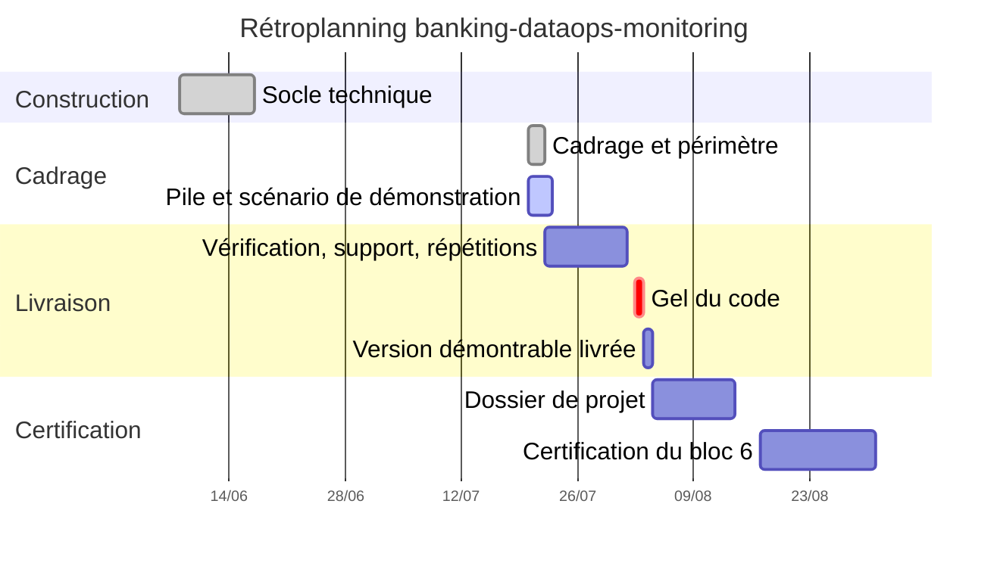

# Rétroplanning

**Compétence visée** : C6.3, définir un rétroplanning et le défendre.

Le plan du 20 juillet 2026 décrit deux temps : une phase de construction technique en juin 2026, puis une phase de cadrage, d'industrialisation et de préparation de la démonstration en juillet. Une phase de consolidation a suivi en octobre 2026 (version 2.7.0 du CHANGELOG, 11 octobre 2026 ; § 6).

Ce document a deux états. Les sections 1 à 5 donnent le plan établi au 20 juillet 2026. La section 6 donne le bilan réalisé contre prévu, arrêté au 11 octobre 2026, à partir des seules pièces du dépôt, puis le planning révisé à la date du 24 octobre 2026 (§ 6.6).

---

## 1. Vue d'ensemble

*Le diagramme est le plan du 20 juillet 2026, regroupé par grandes étapes : les statuts « terminé » et « en cours » sont ceux de cette date. Le planning révisé est au § 6.6.*

## 2. Jalons

| Jalon | Date | Critère de franchissement |
|---|---|---|
| J1 : Socle technique | 16 juin 2026 | Pipeline complet, tests verts, CI opérationnelle |
| J2 : Cadrage validé | 21 juillet 2026 | Problématique, périmètre et coupes documentés |
| J3 : Pile démontrable | 24 juillet 2026 | Démarrage à froid sous deux minutes, scénario rejouable |
| J4 : Support de présentation prêt | 28 juillet 2026 | Huit diapositives, déroulé minuté écrit |
| J5 : Gel du code | 2 août 2026 | Plus aucune modification du code, des dépendances ni du support |
| J6 : Version démontrable livrée | 3 août 2026 | Démonstration complète rejouable de bout en bout |
| J7 : Dossier de projet | 14 août 2026 | Document complet, relu, prêt à imprimer |
| J8 : Certification du bloc 6 | Août-septembre 2026 | Dossier déposé et bloc 6 présenté (non tenu dans cette fenêtre : voir § 6) |

## 3. Charge

La charge estimée le 20 juillet 2026 est de 81 h. Elle se ventile en six postes, les mêmes que ceux du budget (annexe 04, § 2) :

| Poste | Charge estimée |
|---|---|
| Modélisation et schéma | 12 h |
| Générateur et ingestion | 14 h |
| Contrôles qualité et réconciliation | 16 h |
| Tableau de bord | 10 h |
| Conteneurisation et industrialisation | 8 h |
| Documentation et gestion de projet | 21 h |
| Total | 81 h |

La charge consommée n'a été relevée qu'une fois, au 20 juillet 2026, par phase et non par poste : 40 h pour la construction de juin et 7 h pour le cadrage et l'industrialisation, soit 47 h sur 81 h estimées. Il restait donc 34 h à consommer à cette date (81 h moins 47 h). Aucune correspondance entre les phases du relevé et les postes de l'estimation n'est conservée : les 47 h ne sont pas rapprochées poste par poste. Aucune mesure postérieure n'est conservée (§ 6).

## 4. Chemin critique

Le chemin critique passe par J3 → J4 → J5. Un retard sur la pile démontrable décale mécaniquement les répétitions, et la répétition à froid n'est pas compressible : c'est elle qui révèle les défaillances de démarrage.

Marge disponible : deux jours entre J4 et J5. Elle est réservée à la correction de ce que la première répétition chronométrée fera apparaître.

## 5. Règle de gel

À compter du 2 août, aucune modification n'est apportée au code, aux dépendances ou au support. Cette règle n'est pas cosmétique : la dernière modification avant une démonstration est statistiquement celle qui la casse.

Respect de la règle : voir § 6. Le code n'a pas changé après le 27 juillet 2026 ; le support et la documentation ont changé le soir du 2 août.

## 6. Bilan réalisé contre prévu (arrêté au 11 octobre 2026)

Ce bilan ne retient que les faits datés par une pièce du dépôt (CHANGELOG, historique Git, ADR, preuves). Quand aucune pièce ne date un fait, la case l'indique. Le CHANGELOG, l'historique Git d'origine et le dossier de projet ne sont pas publiés dans ce dépôt : les dates qui en viennent sont reprises telles quelles.

### 6.1 Jalons

| Jalon | Prévu | Réalisé : ce que les pièces datent | Écart |
|---|---|---|---|
| J1 : Socle technique | 16 juin 2026 | CHANGELOG 0.1.0 daté du 16 juin 2026 (modèle de données, générateur, ingestion, sept contrôles, réconciliation, incidents, tableau de bord, intégration continue) | Aucun écart de date. Les tests verts et la CI de ce jalon ne sont pas conservés comme preuve datée |
| J2 : Cadrage validé | 21 juillet 2026 | Cahier des charges v1.0 daté du 20 juillet 2026 ; ADR-0005 à ADR-0007 du 20 juillet ; ADR-0008 du 21 juillet | Un jour d'avance pour le cahier des charges |
| J3 : Pile démontrable | 24 juillet 2026 | Aucune mesure de démarrage à froid dans les pièces. CHANGELOG 2.0.1 : budgets de démarrage « non vérifiés de bout en bout » ; CHANGELOG 2.6.0 : premier démarrage impossible (schéma jamais créé), corrigé | Critère « sous deux minutes » non établi |
| J4 : Support de présentation prêt | 28 juillet 2026 | Support de présentation présent dans le premier commit conservé, du 27 juillet 2026 | Jalon atteint selon l'historique Git |
| J5 : Gel du code | 2 août 2026 | Voir § 6.3 | Gel respecté pour le code, pas pour le support ni la documentation |
| J6 : Version démontrable livrée | 3 août 2026 | Le dépôt conserve les pièces ajoutées le soir du 2 août (§ 6.2) et trois commits automatiques de la CI du 3 août (UTC) | Aucune pièce du dépôt n'atteste une démonstration complète rejouée à cette date |
| J7 : Dossier de projet | 14 août 2026 | Version initiale datée « août 2026 » ; révision d'octobre 2026 | Date de la version initiale non précisée au jour |
| J8 : Certification du bloc 6 | Août-septembre 2026 | Le dossier de certification est préparé en octobre 2026 (commits des 10 et 11 octobre 2026) | Non tenu dans la fenêtre prévue ; replanifié (§ 6.6) |

### 6.2 Versions et commits

| Version du CHANGELOG | Date | Contenu |
|---|---|---|
| 0.1.0 | 16 juin 2026 | Socle technique initial |
| 1.0.0 | 20 juillet 2026 | Pile conteneurisée, scénario de démonstration, verdict de publication, API, journal d'audit et tests inverses, dossier de gestion de projet |
| 2.0.0 | 21 juillet 2026 | Couche Gold, classifieur de priorisation (ADR-0008), orchestrateur `run_pipeline.py` |
| 2.0.1 à 2.6.0 | 21 juillet 2026 | Nettoyage et quarantaine, Bronze horodaté, audits et correctifs, support Windows, correction du premier démarrage |

| Historique Git conservé | Date | Nature |
|---|---|---|
| Premier commit | 27 juillet 2026 | Dépôt complet |
| Deux commits | 2 août 2026 au soir (19 h 42 et 20 h 06, heure locale UTC-5) | Support en version française, document de présentation, fiche d'architecture, fichier Power BI, captures, preuves, README |
| Trois commits automatiques de la CI | 3 août 2026 (UTC) | Rapports de validation régénérés |
| Commits de préparation du dossier de certification | 10 et 11 octobre 2026 | Preuves de tests réconciliées, corrections de documentation |

Les travaux de juin et de juillet antérieurs au 27 juillet ne sont datés que par le CHANGELOG, pas par l'historique Git.

### 6.3 Respect de la règle de gel

Le gel du 2 août portait sur le code, les dépendances et le support. Les deux commits du 2 août au soir ajoutent un support en version française, un document de présentation, une fiche d'architecture, un fichier Power BI, des captures et des preuves, et modifient le README : le gel n'a pas été respecté pour le support et la documentation. Entre le commit du 27 juillet et ceux du 2 août, aucun fichier de `src/`, `dashboard/`, `sql/`, `docker/`, `tests/`, `scripts/`, ni du `Makefile`, de `requirements.txt`, de `run_pipeline.py` ou des workflows n'a changé (vérifié par `git diff`) : le gel est respecté pour le code.

### 6.4 Charge et périmètre

| Mesure | Prévu | Réalisé |
|---|---|---|
| Charge totale | 81 h | 47 h consommées au 20 juillet 2026 ; aucune mesure postérieure : l'écart final n'est pas établi |
| Périmètre | Cahier des charges du 20 juillet 2026 | Dépassé : modèle, couche Gold, nettoyage, rapport Power BI, Space de secours (annexe 01, § 4 bis), sans charge estimée ni budget |

### 6.5 Leçons tirées

1. Le planning n'a pas été remis à jour après le 20 juillet : l'ajout du modèle et de Gold le 21 juillet n'a pas modifié l'estimation de 81 heures.
2. Le jalon de certification (J8) a quitté la fenêtre août-septembre 2026 : le dépôt est replanifié au plus tard au 1er novembre 2026 (§ 6.6). La charge restante n'est pas réestimée en heures, faute de mesure postérieure au 20 juillet 2026.
3. Une règle de gel doit nommer ce qu'elle gèle : ici, « support » a été gelé sur le papier et modifié le soir même.
4. Un relevé de charge par phase ne se rapproche pas d'une estimation par poste : le relevé doit reprendre les postes de l'estimation (§ 3).

### 6.6 Planning révisé (état au 24 octobre 2026)

Les échéances et les états ci-dessous sont ceux qu'établissent les pièces du dépôt.

| Jalon | Échéance révisée | État au 24 octobre 2026 |
|---|---|---|
| J7 : Dossier de projet | Révision d'octobre 2026 | Version initiale d'août 2026, révisée en octobre 2026 |
| J8 : Certification du bloc 6, dépôt du dossier | Au plus tard le 1er novembre 2026 (échéance retenue en octobre 2026) | Dossier de projet, annexes, support de présentation et archive de code constitués |

Historique Git au 24 octobre 2026 : des commits de préparation du dossier de certification datent des 10, 11, 12, 17, 20 et 24 octobre 2026.

---

Copyright © 2026 · Auteur : KinSushi · Enzo · Sovralys LLC
